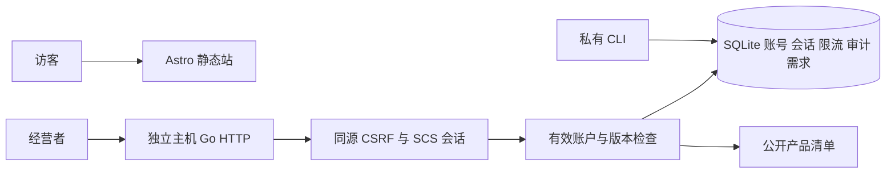

# 迭代 1 管理入口实施细化

本子计划承接已批准的迭代 1，仅登录、注销和真实初始总览。不存在既有公共 API 或生产数据，不更改需求交付 v1。

新增 go.mod/go.sum、cmd/creative 和 cmd/creative-admin、internal/store、internal/auth、internal/httpserver、migrations/001_initial.sql、web/admin 模板与 CSS、对应集成测试；更新 README、.env.example 和 CI。

固定组合：Go 1.27.3；modernc.org/sqlite v1.62.0；SCS v2.9.0 + sqlite3store 209de6e426de；argon2id v1.0.0；gorilla/csrf v1.7.3；x/term v0.47.0。使用 database/sql 的 SQLite store，无 CGo 依赖；构建和集成测试是组合验收，不用文档代替运行。

数据库：单连接、WAL、foreign_keys、busy_timeout=5000；版本与 SHA-256 校验和在迁移事务中保存。仅新增首次迁移，启动自动校验；以后升级前先备份并追加迁移，不编辑已执行 SQL。首轮回退代码保留私有数据库；丢弃数据库仅适用于明确可丢弃的本地测试。会话表由迁移创建，重启继续使用。

认证：私有 CLI create-admin/reset-password/disable-admin，无默认账户，密码从隐藏终端或显式 stdin 读取；Argon2id，12–128 字节。重设/禁用增加账户版本，逐次访问查版本。SCS 登录换 token、30 分钟空闲/12 小时绝对过期；注销销毁。Cookie 仅当前主机、HttpOnly、SameSite=Lax，HTTPS 时 Secure 和 __Host- 前缀；HTTP 仅允许本机预览。

HTTP：管理 Origin 配置限制 Host/Origin；CSRF 所有写操作校验 token；安全头与 no-store。仅明确信任的代理 IP 可提供 X-Real-IP，否则取 socket 地址。登录按账号和来源各 5 次/15 分钟暂时限制，SQLite 原子计数，成功与 CLI 恢复清理账号限制；审核日志不保存密码、token 或输入正文。请求体限 4 KiB。研究 Bearer 无管理权限。

真实状态：需求数量查 SQLite，产品数量读 src/data/products.json；缺失/损坏清单使启动失败。没有接入的收入、流量、搜寻显示未知/未接入。仅支持固定登录、总览、注销路径，其余 404。

实施顺序：①边界/持久化/限流/CSRF 失败用例；②迁移与 CLI；③认证和 HTTP 模板；④ CGO_ENABLED=0 回归与浏览器；⑤独立审查、修复、PR。每批测试有外部 570 秒截止。

可行性预审：组件都支持 database/sql 或 net/http 边界；原文不进入模板可信 HTML；初始数据库为空，不存在破坏性迁移。依赖下载/CGO=0 编译和持久化重启仍须实测。公网 TLS、代理部署、真实搜寻及运营数据属于后续条件。
