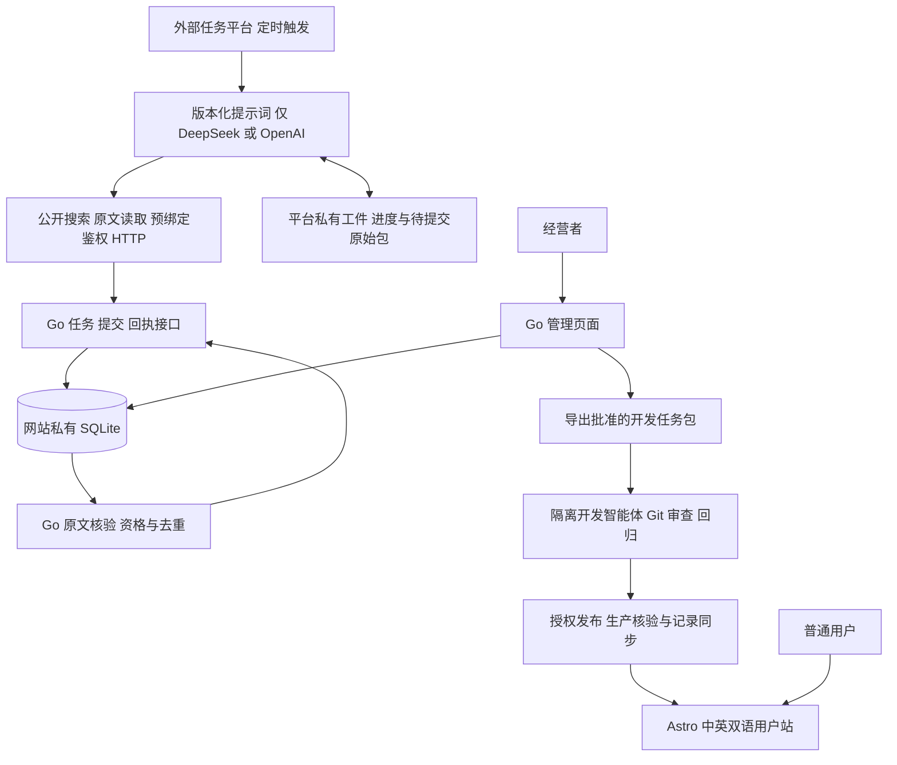

# Creative 敏捷开发计划

> **给开发执行者：** 进入实施时使用 `superpowers:subagent-driven-development` 或 `superpowers:executing-plans`，按已确认的迭代与子任务执行。以下复选框仅在实际完成后勾选。本次只制定计划，不开始产品开发或创建定时任务。

**目标：** 先交付真实空站和可用的需求接收、核验、审核与开发交接闭环；搜寻使用定时提示词任务，产品功能由真实强付费需求驱动。

**架构：** 外部任务平台按时运行版本化提示词，通过搜索/读取工具整理证据，经既有 v1 API 提交到 Go 网站。网站负责身份、硬规则、去重、状态和发布记录；公开 Astro 页面只展示真正上线的产品。跨次搜寻进度由任务平台持久化，不建设独立 Go 搜寻服务。

**技术栈：** Go `net/http`、Go 模板、SQLite 纯 Go 驱动、Astro/TypeScript；模型仅 DeepSeek/OpenAI。工具链及依赖在实施时核验并锁定；定时任务平台先验证能力再接入，不预设具体产品已经支持所需功能。

**规格：** [最终主方案](../specs/2026-11-08-creative-platform-design.md)、[需求交付 v1](../specs/2026-11-08-creative-demand-intake-contract.md)、[用户空站子计划](2026-11-09-creative-public-shell.md)。本计划决定执行顺序，不降低规格中的最终验收要求。

## 全局约束

- “网站初始没有完成任何需求”；产品清单为 `[]`，真实需求库为空，未接入或无法测量的数据明确显示未知。
- “当前只接入 DeepSeek 和 OpenAI 的模型”；提示词平台也适用，不因换执行端启用其他模型。
- “不设置预算边界”；不设搜索总次数或研究总时长上限。平台单次执行窗口结束后通过工件续跑，不视作达标。
- 默认合格待立项池目标为 3；强付费证据仍要求至少 3 位独立用户、2 个独立原始来源、2 条直接付费信号及原有价格/时效条件。免费产品同样适用。
- 网站后端使用 Go；“Go 调试使用 CGO_ENABLED=0”。常规构建/测试也设置该值，单次测试批次不超过 10 分钟。
- 产品开发前必须完成需求立项与方案/计划；平台基础能力按本方案建设，不伪装成已完成的业务需求。
- 每次代码开发前核验并拉取 master 最新代码，新建分支；兼容性改变先审查，代码完成后独立审查、回归，通过 Git 创建 MR/PR。
- 首版开发由经营者在授权隔离环境中启动开发智能体；网站导出与跟踪任务，不执行任意代码。
- 文档中文、素材自制；本轮不消费、充值、采购、部署或实际启用定时搜寻。

## 审查重点

1. 定时任务中断、重叠或丢失上下文：凭持久化工件与串行调度恢复，不重复提交、不猜测回执。归迭代 0/4。
2. 批次已入库但提交响应丢失：原样重试或查询原回执，不能换 batch_id 重复计数。归迭代 2/4。
3. 原文失效、未知作者、否定付费或一份内容跨站转载：不得进入合格池，网站重新计算有效缺口。归迭代 3。
4. 未授权身份、旧审批页面或越权 token：服务器拒绝操作并保留必要审计，不依靠隐藏按钮。归迭代 1/2/5。
5. 后台显示已发布但构建/生产状态不一致：显示待核对或失败，不能计入完成；部署失败可回滚。归迭代 5 及首个产品迭代。

## 迭代 0/1 执行状态（2026 年 11 月 9 日）

已实现双语空站与 Go 认证/总览，自动测试、实际 HTTP 和独立代码审查记录见 [交付验证](../../iteration-01-validation.md)。本轮仅补充执行状态，不改后续范围或 v1 契约。

- 迭代 0：master/工具链准备、平台选择和隔离试验报告已完成；定时任务网络权限失败，跨次恢复与串行验收待通过，迭代 4 保持接入阻塞。
- 迭代 1：页面、配置、真实空数据、认证/迁移、CLI、CI 与代码审查已实现；浏览器工具连续超时，窄屏/键盘/语言切换及浏览器登录验收未完成，M1 不标记完成。
- 交付使用草稿 PR，未合并、未部署；缺少条件按实记录，不把代码完成等同全部验收通过。

## 1. 敏捷节奏与工作规则

建议迭代 0 使用 1–2 个开发工作日验证关键依赖，后续每轮使用 3–5 个开发工作日作为计划时间盒。它们是排期估算，不是完成承诺或搜索时限；首两轮实测后重估。时间盒内做不完的故事拆小或移入下一轮，不减少权限、证据或测试要求。

每轮围绕一个可以演示的用户结果切片，包含所需的页面、后端、数据和测试；不把“先做完所有前端，再做完所有后端”当作迭代。现有用户空站计划只是迭代 1 的一个故事。

- 开始：选择目标，确认依赖；把本轮故事细化为准确文件、接口、测试及执行顺序，完成可行性/兼容性审查后开工。后续迭代的内部函数和数据库字段在进入本轮时补齐，不能边写产品代码边猜方案。
- 进行：看板为“待细化 → 可开发 → 开发中 → 待审查 → 待验收 → 完成”，外部依赖阻塞单独标明。首版建议同时只开发一个核心故事；每个工作区同一时刻只有一个写入者。
- 结束：演示实际行为、核对验收证据、合并已完成故事，记录问题及下一轮调整。敏捷反馈可以改变优先级，不能绕过强付费门槛或把未完成代码标为完成。
- 范围明确的例行实现按已确认计划推进；新增范围、兼容性改变和实际发布按相应确认流程处理，不增加无意义的逐步骤确认。

## 2. 架构与依赖

网站每日 08:00（Asia/Shanghai）维护需求池；外部任务建议每日 08:10 触发。一次运行可以多次搜索和分批提交；窗口结束则保存进度，下次继续。达标后保留定时检查，读取任务确认没有缺口就结束本次运行，不再启动搜索；取消状态只能由经营者恢复。

依赖关系：迭代 1 → 2 → 3 → 4；迭代 0 的平台能力验证必须在迭代 4 前通过。迭代 5 依赖 1/2/3，可在平台接入受阻时继续离线开发。真实业务产品须等真实需求立项；任何外部条件未满足只标记对应能力未交付。

## 3. 迭代总览

| 迭代 | 用户故事与可演示结果 | 主要验收 | 依赖与范围 |
| --- | --- | --- | --- |
| 0 执行条件 | 能明确说明定时任务在哪里运行、怎样调用接口及跨次恢复 | 平台能力记录、隔离验证结果、主线和工具链准备结论 | 暂不创建真实搜寻任务；失败不阻塞本地网站开发 |
| 1 双入口 | 访客看到真实空站，经营者可以安全登录后台 | 双语页面、真实零产品/需求、权限与持久化会话 | 复用用户空站子计划；不展示假工具 |
| 2 候选接收 | 一份规范候选包进入后台，并能查询接收回执 | v1 鉴权、Schema、幂等、可恢复队列及错误码 | 只接收不放行，尚未验证的记录不计为合格 |
| 3 证据核验 | 后台显示为什么合格、为什么要补证及当前缺口 | 原文核验、硬门槛、去重、时效、费用报告和目标状态 | 可先用隔离样本完成；不虚构真实商机 |
| 4 定时提示词闭环 | 定时任务自动取任务、搜寻、提交、补证并按网站状态停止 | 两次独立唤起间恢复、响应丢失重试、取消、达标停止、费用未知处理 | 必须通过平台能力和实际接入验收；不开发独立搜寻服务 |
| 5 立项与开发交接 | 经营者可以审核有效需求、导出任务包并追踪 MR/发布 | 竞品/成本/范围记录、版本化审批、开发工件、费用核对、发布一致性与恢复 | 基础能力可隔离验收；真实业务立项必须有真实证据 |
| 后续 产品迭代 | 每次交付一个获批需求的最小可用产品 | 产品功能、代码审查、回归、生产核验与适用变现条件 | 不预先选择首个工具，不预建通用支付/广告框架 |

建议里程碑：M1=迭代 1 双入口可预览；M2=迭代 3 网站离线接收/验证闭环；M3=迭代 4 定时搜寻实际接入；M4=迭代 5 平台具备立项与开发交接能力。M1–M4 都不等于已经完成业务产品或取得收入。

## 4. 近期可执行任务

### 迭代 0：验证条件，准备第一轮

**规划文件：** 新增 `docs/research-task-operations.md` 记录验证；本轮只在批准的隔离环境产生测试工件，不把假候选写入生产。主线准备不改变公共接口。

**接口与工件：** 沿用 v1 三个接口；未建成网站时使用隔离模拟服务返回相同格式。平台工件包含 `task_id`、`rules_version`、已执行查询/来源游标、稳定 `batch_id`、待发送的准确请求体、已收到回执和未知费用。平台私有元数据不加到 v1 请求中。

- [ ] 核验 Git 远程和 master；若仍为空，明确并完成主线初始化流程后再开始代码开发。记录真实基线，不能把本地文档分支当成已拉取的 master。
- [ ] 选定一个具备定时提示词运行能力的承载平台，记录可选模型、搜索/读取、预绑定鉴权 HTTP、跨次工件、串行运行和网络可达性。模型必须在 DeepSeek/OpenAI 范围内；未具备账号/权限的能力保持未验证。
- [ ] 在获准的测试任务中连续唤起两次：第一次保存标记和一个未确认批次，第二次读回并按同一字节体重试；模拟前一轮仍运行时再次触发，确认平台跳过或排队，不重叠执行。凭据不出现在提示词正文、公开工件和运行报告中。
- [ ] 记录结果：通过的能力必须有运行依据；不能做鉴权请求或不能持久化/串行的平台不进入迭代 4。继续迭代 1–3，保留接入阻塞项，不改写为 Go 搜寻程序。
- [ ] 完成首次迭代任务细化与审查；确认执行环境后才调用真实模型/搜索或启用调度。本次计划阶段不做上述实测。

### 迭代 1，故事 1：访客看到双语空站

**文件、接口与测试：** 完整复用 [用户空站实施计划](2026-11-09-creative-public-shell.md) 的两个任务；只产生公开页面和空产品数组。

- [ ] 在更新后的 master 上建立本故事分支，按子计划先写边界检查并确认预期失败。
- [ ] 实现双语空站、有限公开配置及索引规则，增加真实空状态、404 和可用的语言导航。
- [ ] 执行 `npm run build`、`node --test tests/public-shell.test.mjs`，预期退出码 0；真实浏览器检查空目录、404、键盘与窄屏，每个批次不超过 10 分钟。
- [ ] 独立审查、修复、复验，提交并通过 Git 创建到 master 的 MR/PR，保留待合并提交对应的验证结果。

### 迭代 1，故事 2：经营者安全登录并看到真实初始状态

**规划文件：** `go.mod`、`go.sum`、`cmd/creative/main.go`、`cmd/creative-admin/main.go`、`internal/httpserver/admin.go`、`internal/auth/admin.go`、`internal/store/sqlite.go`、`migrations/001_initial.sql`、`web/admin/templates/login.html`、`web/admin/templates/index.html`、`internal/auth/admin_test.go`、`internal/httpserver/admin_test.go`、README、`.env.example`、`.github/workflows/ci.yml`。

**接口：** `GET/POST /admin/login`、`POST /admin/logout`、`GET /admin/`，全部位于管理主机；会话由 SCS v2 和明确的 SQLite store 持久化，写操作有 CSRF。私有 CLI 初始化/恢复管理员，无默认密码。初始需求表和公开产品清单均为空；后台数量来自实际持久化数据/清单，未接入运营指标显示未知。只创建支持此故事的表，后续迁移追加研究字段。

- [ ] 在本故事子计划中固定依赖版本、会话 store、迁移/回滚方式和认证配置，审查 Go/纯 Go SQLite/会话组件组合可行性后开始实现。
- [ ] 新增 `TestAdminAccessBoundaries`、`TestSessionLifecycle`、`TestAdminWriteRequiresCSRF`、`TestLoginFailuresAreThrottled`、`TestInitialOverview`：断言未登录与执行端 token 不能访问后台，登录轮换会话，注销/过期/禁用后失效，缺少或错误 CSRF 被拒，连续错误登录受限可恢复，初始化后需求/产品/完成数量为 0。加入重启后会话与迁移版本仍一致的用例。
- [ ] 使用 `CGO_ENABLED=0 go test ./internal/auth ./internal/httpserver -timeout 9m` 确认新增用例因待实现行为失败；执行器另设整批不超过 10 分钟的截止时间。
- [ ] 实现最小管理界面、密码哈希、持久化会话、登录限制、模板转义、私有 CLI 和初始迁移；研究审核等未交付功能不显示为可用。
- [ ] 运行上述测试、`CGO_ENABLED=0 go build ./cmd/creative ./cmd/creative-admin` 和浏览器登录/注销检查，预期成功；验证 CI 中的模型/网络替身不产生真实消费。
- [ ] 独立代码审查、修复和回归后创建 MR/PR；演示用户空站与管理员入口，确认两者权限和数据边界。迭代 1 验收通过后才标记 M1。

## 5. 后续迭代待办与验收

以下是已定范围的待办，不是无需细化就能开始编码的逐函数计划。每轮开始时补齐具体子计划和迁移，继续执行“失败测试 → 最小实现 → 通过检查 → 独立审查 → MR/PR”。

### 迭代 2：候选从接口进入后台

**故事：** 管理员创建/取消/恢复搜寻任务并管理执行端 token；定时任务能够读取任务、提交候选并查看自身回执；管理员能查看已接收材料。

**主要文件：** `internal/httpserver/research.go`、`internal/auth/producer.go`、`internal/research/intake.go`、`internal/research/tasks.go`、`internal/store/research.go`、`internal/worker/worker.go`、`migrations/002_research.sql`、`schemas/demand-batch.v1.schema.json`、`web/admin/templates/batches.html`、`web/admin/templates/tasks.html` 和相应 `*_test.go`。

**接口：** 严格复用 v1 的 GET task、POST batches、GET batch；身份由 Bearer 映射 producer_id，接收成功为 `202`，接收状态与资格分离。任务/批次、来源候选与运行费用按同一契约持久化，当前未验证项显示待验证。

**验收：** `TestProducerIsolation` 拒绝跨执行端和 Cookie 冒充；`TestBatchIdempotency` 断言同字节重试返回原回执、不同内容同 ID 为 `409`；`TestInvalidBatch` 覆盖坏 JSON/未知字段/不支持版本/超过 1 MiB 或 20 条候选；`TestTaskCancellation` 断言取消拒绝新批次且定时器不恢复；`TestPendingBatchSurvivesRestart` 证明重启不丢包。后台读到同一批次、计数仍不增加。所有已规定错误码与契约一致，输入文本不执行。

### 迭代 3：证据核验、需求池与费用报告

**故事：** 管理员知道需求是否满足规则、缺什么证据、距离目标还有多少；定时任务获得可操作的补证反馈。

**主要文件：** `internal/research/qualification.go`、`internal/research/dedup.go`、`internal/source/fetch.go`、`internal/model/deepseek.go`、`internal/model/openai.go`、`internal/worker/worker.go`、`internal/research/usage.go`、`web/admin/templates/needs.html`、`web/admin/templates/usage.html`、`config/research.json`、`config/providers.json`、迁移和隔离标注样本。

**接口：** 按 v1 输出逐条 `qualified/needs_evidence/duplicate/rejected` 和当前任务状态；网站掌握资格、去重和计数，模型只辅助语义复核。适配两家接口，未配置连接禁用；测试默认替身，真实连接只在对应权限具备后验证。

**验收：** 至少 30 条隔离标注样本覆盖明确/弱/条件/否定/重复/过期证据，核心字段准确率≥90%，门槛不足样例全部不得进入合格池。`TestSafeSourceFetch` 覆盖跳转、内网和元数据地址；`TestQualificationExpiry` 覆盖 12 个月来源与 30 天资格边界；`TestCrossBatchDedup` 不按标题或重复作者凑数；`TestRecomputeTarget` 在去重后达到默认 3 条才返回达标；`TestUnknownCost` 不把未知、自报或重复账单当成已核对费用。单来源失败返回补证、平台故障才暂停，重启恢复不重复计数；30 天原始材料、180 天研究元数据清理保留必要审计。完成 M2 不代表有真实合格需求。

### 迭代 4：定时提示词任务实际接入

**故事：** 经营者无需每日复制提示词或粘贴结果，任务按配置自行运行并收到网站验证反馈。

**主要文件：** `prompts/research-task.v1.md`、`config/research-task.json`、`docs/research-task-operations.md`、隔离输入/预期工具轨迹样例；仅在网站发现接口缺陷时修改对应代码并回归。不增加 `cmd/creative-researcher` 或单独的搜寻数据库/守护进程。

**提示词职责：** ①读取当前任务和规则；②恢复持久化工件及未确认批次；③仅在允许继续时选择新的查询和公开来源；④保存原文、身份/日期、付费条件与未知项；⑤按 v1 固定准确载荷并持久化后提交；⑥查询回执并依据缺口补证；⑦达标/取消/故障/线索耗尽时按网站状态处理。每次取得来源和回执后增量保存，不仅在正常退出时保存；调用中断产生的费用保持未知。达标或取消后可查询已知回执，不再安排搜索，取消任务不提交新批次。不得伪造证据、增加厂商、修改硬门槛、泄露密钥或获得开发/发布权限。

**平台配置：** 建议每日 08:10、Asia/Shanghai；提示词固定版本、同一任务串行，HTTP 凭据限定 Creative API 目的地址与 v1 权限，不传给搜索网页。搜索来源先选可访问且已核验规则的一组，再按证据缺口扩展。费用不可取得时按 v1 上报未知，不推算为 0；平台运行本身的费用单独核对。

**验收：** 使用隔离任务验证两次独立唤起间恢复、旧规则变化、提交响应丢失、原样重试、无新线索、取消不恢复、达到目标不发起新搜索、单次运行窗口结束后续跑；调度重叠由平台阻止。再在具备对应账号、接入与调用授权后完成一轮真实取任务→原文→JSON→回执，不要求造出合格结果。搜不到或被退回补证也可以证明交付正常；有无真实合格需求单独报告。隔离调度验证结束后清理测试任务，真实任务仅在对应启用条件具备时开启。通过后标记 M3。

### 迭代 5：立项、开发交接与可维护性

**故事：** 管理员复核证据、登记竞品实测和成本，批准最小范围；导出开发任务包、跟踪分支/MR/验证和发布。平台故障时有恢复途径。

**主要文件：** `internal/research/approval.go`、`internal/research/development.go`、`internal/research/releases.go`、相关迁移、`web/admin/templates/development.html`、`cmd/creative-admin/main.go`、`deploy/Caddyfile`、运维文档和集成测试。

**接口：** 管理操作携带记录版本，事务内重验资格并记录审计；导出包包含规格/计划、证据版本、范围、验收、基线与分支。开发结果绑定 commit/MR，发布状态经受控命令核对构建、生产及产品清单后同步，不能由表单直接改为 launched。

**验收：** `TestApprovalRequiresCurrentEvidence` 拒绝过期/缺失证据；`TestApprovalVersionConflict` 拒绝旧页面并发批准；`TestTaskBundleExcludesSecrets` 检查任务包版本与敏感数据；`TestReleaseVerification` 覆盖清单/构建不一致、同步失败、重复同步及回滚；`TestRestoreBackup` 验证备份恢复且状态不倒退为已发布。补齐日常报告、非敏感模型配置与 token 轮换/撤销、费用对账、原始材料保留与最近 7 份备份策略。离线/预览样例不计入生产完成量；生产发布能力还须在首个真实产品发布时验证。通过基础验收后标记 M4。

## 6. 真实产品的滚动迭代

只有真实需求通过主方案第 3 节门槛，才从需求池选入产品待办；没有合格需求时持续搜寻/补证或维护平台，不用演示需求填排期。每次只选择一个最小可交付结果，按实际复杂度分成一个或多个迭代。

| 顺序 | 内容 | 完成条件 |
| --- | --- | --- |
| 需求与设计 | 原文复核、竞品实测、免费/付费方向、成本、方案、文件影响、验收与开发计划 | 证据有效，立项/设计/兼容性审查通过 |
| 产品交付 | 隔离开发智能体按任务包实现，新增适当测试，审查、回归、MR/PR | 当前提交通过全部产品验收，生产核验与回滚就绪，发布成功才计为完成 |
| 变现与发现 | 免费产品的广告条件，或付费产品的收款/交付；实测教程、SEO与自制演示 | 仅启用符合条件的能力，广告与支付分别验收，不因工具上线自动开启 |
| 数据反馈 | 产品真实使用、失败、渠道、成本及广告/订单结算 | 匿名统计注明覆盖范围，付款不依赖埋点；根据实际数据决定修复、改进或下一需求 |

广告为主要收入方向，部分产品自助付费，不预设比例或盈利日期。免费产品先验证无广告也能正常完成任务；付费产品另测验签、重复/乱序通知、超时、退款与交付恢复。推广和统计遵循主方案第 7、8、12 节，未实现的产品不发布教程或购买按钮。

## 7. 每轮统一完成标准

1. 故事有已确认范围、对应规格/计划和可重现的验收样例；产品故事还有当前有效的付费证据。
2. 最新 master 的开发分支，修改仅覆盖本轮；迁移、配置、调用者、文档与错误处理同步完成。
3. 非平凡逻辑有能发现错误的测试；先看到预期失败再最小实现，不用镜像实现的测试凑数。
4. 相关 Go 检查使用 CGO_ENABLED=0；每次测试执行器外层截止时间≤10分钟，Go 测试采用 `-timeout 9m`，长检查拆批。真实服务联调与离线测试分别报告。
5. 独立代码审查与受影响回归通过，证据绑定最终待合并 commit；主线变化或后续修复后重验受影响项。
6. Git MR/PR 包含问题、行为、验证、迁移/回滚影响；仅有提示词或智能体“完成”消息不能通过验收。
7. 可演示、可观察、秘密不泄露、数据不混用；实际部署须有对应授权及生产核验，未发布增量不计为已上线产品。

## 8. 文件影响、兼容性与计划自查

本轮实际只修改主方案、v1 协议的执行方式说明、用户空站计划的衔接，并新增本文。以上代码、提示词、配置与运维文件都是未来各轮的文件清单，当前不创建骨架。

搜寻改为定时提示词不会改变 v1 的路径、字段、错误码、幂等键及目标语义；提示词版本和进度属于执行平台工件，不新增未知字段。网站继续独立核验，权限没有扩大。若平台确需新的服务器状态接口，必须先审查并版本化，不能临时绕过 v1。

覆盖自查：主方案 A 对应迭代 1 与相关管理验收，B 对应迭代 2–4 及迭代 5 的受控审核；C/D/E 对应迭代 5 提供的交接能力及真实产品滚动迭代。五项审查重点均已绑定验收；保留规则阈值、费用未知、备份恢复和发布一致性要求。

可行性结论：2026 年 11 月 9 日独立文档复审未发现阻塞性问题；四份文档的范围、依赖和契约一致。文档链接、代码块、JSON 示例、v1 核心契约未变更及敏感值模式检查已通过。尚未选定/实测外部任务平台，实际调用权限、网络、持久化、原样重试与串行调度是迭代 0/4 的接入关卡；不阻塞本地空站、后台与离线接口开发。以上不代表代码或真实服务已通过运行验收。

## 2026-11-09 迭代 2 执行更新

按逐轮交付完成候选接收增量，详见 [迭代 2 子计划](2026-11-09-creative-research-intake.md) 和 [验收记录](../../iteration-02-validation.md)。本轮已有任务/执行端/材料管理及 v1 接收回执，未验证的包仍为 pending_validation，不增加合格需求。当前只提供持久队列，不启动尚无核验逻辑的 worker。下一轮是迭代 3 原文核验、去重、费用及有效需求池。

公开站与后台桌面登录/键盘导航已实测；完整窄屏检查仍未完成。定时任务平台原有网络与串行条件未解除，不能宣称 M3 达成。上文复选框仍保留各轮完整验收标准，不把局部通过标为整个里程碑完成。

## 2026-11-09 范围与迭代 3 更新

用户明确当前只做 Mac 端页面，故本轮只验收 macOS 桌面浏览器；历史计划中的手机、平板和窄屏验收不再是当前关卡。保留既有 CSS 不代表承诺其他终端支持。

迭代 3 已实现安全原文抓取、两家模型适配、程序资格门槛、去重补证、持久核验循环、费用记录和管理页面。详见[子计划](2026-11-09-creative-verification.md)与[验收记录](../../iteration-03-validation.md)。固定规则保留在代码中，不增加可绕过硬门槛的 research.json；变更门槛须升级规则并审核兼容性。

离线规则与实际 HTTP 闭环使用自制替身，不能替代真实模型语义准确率验证。迭代 4 的定时平台网络、跨运行持久化及串行关卡仍未通过；不得据此启用真实搜寻。网站初始完成需求与产品仍为零，迭代 5 的立项、开发交接与发布能力未交付。

## 迭代 4 本轮交付状态（2026-11-09）

固定提示词、非敏感运行配置、纯传输 outbox 工具、14 项隔离回归、运维手册与独立审查修复已交付，见 [验收记录](../../iteration-04-validation.md) 与 [PR #5](https://github.com/yyl1212/creative/pull/5)。不改变 v1、数据库或公开产品。五次实际定时唤起均未打通 HTTP，临时日程及凭据已清理；平台跨轮恢复、串行和真实搜寻未通过，M3 保持未完成。经营者已选择保持禁用、暂不调整权限，未安装联网放行规则或启用真实任务。

## 迭代 5 本轮交付状态（2026-11-09）

立项复核、版本化需求/开发任务包、设计确认和交付登记、受控发布核验/回滚、日报、非敏感模型设置、实际费用核账、最近7份一致性备份及安全恢复已实现。本地 Go/静态检查、公开站5项与传输14项回归通过，Mac 桌面隔离流程通过，详见 [验收记录](../../iteration-05-validation.md)。独立全分支审查的两项重要问题已修复，草稿 [PR #6](https://github.com/yyl1212/creative/pull/6) 代码提交 `846f19e` 远端 CI 通过，M4 平台基础验收完成；真实产品发布仍需首个获批产品验证。定时搜寻保持禁用，M3状态不变，不调整权限、不调用真实搜索或模型。
