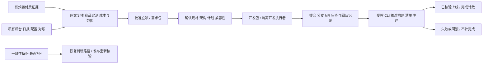

# 迭代 5：立项、开发交接与维护执行计划

> **For agentic workers:** 使用计划执行、测试驱动及最终独立代码审查；两个独立基础组件可按并行任务技能在临时副本交付，由主执行者统一集成，主工作树始终只有一个写入者。

**Goal:** 管理员能依据有效证据立项、确认方案、导出开发包、登记结果；受控命令验证发布，日常报告、配置、对账和备份恢复可用。

**Architecture:** 沿用 Go/SQLite/模板。开发阶段与研究资格分表保存，v1 不变；CLI 在网站进程之外验证发布工件和执行备份恢复。业务产品与自动搜寻仍不启用。

**Tech Stack:** 现有 Go 标准库、纯 Go SQLite、HTML 模板、Astro 空站；不增加依赖。

**Spec:** `docs/superpowers/specs/2026-11-08-creative-platform-design.md` 第 3、6、10 节；敏捷计划迭代 5。

## Global Constraints

- 定时搜寻保持禁用，不安装联网规则，不调用真实模型或搜索，不采购、不合并部署。
- 真实产品与需求初始为空。免费、付费产品均须通过原有强付费门槛；测试数据只在临时库。
- 中文文档、现代极简 Mac 桌面后台；仅 OpenAI/DeepSeek。平台功能不计为已完成需求。
- master `82808cc` 已 fetch，`codex/development-lifecycle` 基于 `482c80a`；使用叠加草稿 PR。
- 保留 001–003 原迁移，仅追加 004；开发操作使用版本并在事务中重验资格、审计。
- Go 使用 CGO_ENABLED=0；每个测试执行器外层最多 570 秒、Go -timeout 9m。

## 文件与接口

| 文件 | 变更 |
| --- | --- |
| `migrations/004_lifecycle.sql` | 新增开发、发布、配置及对账记录；不改变 needs.status 检查约束 |
| `internal/research/approval.go`、`development.go`、`releases.go` | 立项/设计/开工/结果/任务包；只有受控发布核验能写 completed |
| `internal/research/operations.go`、`usage_view.go` | 每日报告、模型配置版本、费用核对与审计 |
| `internal/release/` | 从构建工件与产品清单生成摘要，核对生产页面/标记，预览不计入发布 |
| `internal/store/backup.go` | SQLite 一致性快照，最近 7 份；恢复到新路径，撤销凭据/会话、发布待复核 |
| `cmd/creative-admin/` | 发布工件准备/核验同步/撤销，备份/恢复/报告命令 |
| `cmd/creative/main.go`、`internal/worker/worker.go` | 加载已保存的非敏感模型配置，维护时备份并记录结果；不调度搜寻 |
| `internal/httpserver/`、`web/admin/` | 立项、设计/开发记录、导出、日报、模型设置、对账页面及受控表单 |
| `deploy/Caddyfile`、`docs/operations.md`、验收/README/CI | 未来部署配置、恢复/发布操作说明、回归与浏览器验收 |

## 可行性与兼容性审查

采用独立 development_records.state 表示 approved/design_ready/developing/review_ready/launched/failed/rolled_back/unverified。needs 仍表示研究资格；立项、开工、开发包导出与发布均绑定同一核验版本，并检查未过期。新补证不覆盖批准材料，旧批准自动变成需要复核的显示状态；重批清空后续设计/结果。研究 v1 无新增权限。

立项表单需复核所有计入门槛的来源、至少 3 个实测替代方案（不足时说明搜索范围和原因并记录全部已找到项）、缺口、自助流程、单位成本/币种/资源保护/可持续假设、免费或付费依据、最小范围/排除项/验收/获客入口。免费按广告收入 0 测算；付费另录价格、支付费和价格依据，毛利精确计算，不用预算阈值批准。

设计单独确认规格、架构图、逐任务计划、文件范围、环境变量名称、产品 slug、生产 HTTPS origin、兼容性结论、master 基线和分支。导出采用字段白名单，只带证据摘要/版本与变量名；拒绝常见凭据格式/敏感路径，不能保证识别任何任意文本中的秘密，因此表单明确不填凭据，测试使用敏感哨兵。未经确认的执行者进度不能替代审核和发布。

发布通过 CLI 固定检查本地构建摘要、产品清单、对应 commit 与生产内容，不执行网页/表单提供的 shell。构建标记与页面哈希、批准的生产 origin、开发记录版本都一致才同步；失败记录不增加完成量。回滚是受控登记撤销完成状态，不冒充自动部署。真实生产能力在首个获批产品发布时另行验收。

004 是追加表/列，旧程序会按既有迁移版本检查拒绝打开新库。升级前备份；回退使用旧程序和一致性备份。恢复只写全新路径，不覆盖活动数据库，并禁用恢复的凭据/会话和发布计数，避免复活已撤销权限或旧上线状态。证据保留清理不能因新外键失败；开发记录保存核验 ID 数值而不阻止过期证据删除。

模型配置保存于私有数据库，重启后生效，页面区分保存值和运行值；不保存密钥真值。费用核对保留原自报金额，另存实际金额/币种/账单行依据、版本与操作者，同一账单行不能核对两次。现有 token 轮换/撤销复用并回归。

## Review Focus

- 批准后补证/过期、并发旧版本、恢复旧库：不得继续用失效批准开工或宣称上线。
- 任务包含网页提示、密钥格式、危险路径或不属于允许范围的字段：只导出允许资料，不复制运行环境。
- 构建/生产/清单/提交/目标版本不同、网络失败、同步失败：不得标为 completed；重复同步幂等，回滚撤销完成。
- WAL 写入期间备份、损坏备份、现有恢复目标、权限复活：一致快照，原库不变，恢复失败不覆盖数据。
- 新配置或对账与旧自报并发：版本冲突可诊断，真实核对金额不被自报覆盖，不把未知当 0。

### Task 1: 立项与开发交接

**Files:** 004、approval.go/development.go、相关研究测试。
**Interfaces:** `ApproveNeed(id, needVersion, Approval, actor, source)`；`ConfirmDesign(id, recordVersion, Design, actor, source)`；`StartDevelopment(id, recordVersion, actor, source)`；`RecordDevelopment(id, recordVersion, DevelopmentResult, actor, source)`；`Development(id)`、`Developments()`、`TaskBundle(id, kind)`。结构体与 JSON 字段在实现中随测试固定，不接受任意 map 指令。

- [x] 写 TestApprovalRequiresCurrentEvidence、TestApprovalVersionConflict、TestTaskBundleExcludesSecrets；先观察缺失实现失败。
- [x] 实现立项条件、资格复验、白名单任务包及设计/开工/结果版本约束，测试补证后重新批准和新提交使旧验证失效。
- [x] 运行研究/迁移回归，Expected: 全部通过，原 v1 测试不变；提交。

### Task 2: 发布核验与备份恢复

**Files:** internal/release、internal/store/backup.go、research/releases.go、CLI。
**Interfaces:** 纯工件包 `release.Product{NeedID int, Slug string}`、`Manifest{Schema,Commit,Origin,Environment string; Products []Product; Files map[string]string}`；`Prepare(dist,catalog,commit,origin,environment string)(Manifest,error)` 写 dist/.well-known/creative-release.json；`Verify(ctx,dist,catalog string, manifest Manifest, client *http.Client) error` 校验本地/远端标记和每个公开文件摘要；生产要求 HTTPS、公网 origin，无重定向、无代理，测试注入本地 TLS client 仅测试用。产品清单只允许 need_id/slug，slug 限小写字母数字与连字符，至少 en/zh 对应工具 index.html。

`store.Backup(ctx,db,directory,now)(string,error)` 保留最近 7 份；`store.RestoreBackup(ctx,source,destination) error` 原文件不动、目标必须不存在。恢复清空 sessions、禁用 admins、撤销 producers，development_records.state/release_records.state=unverified，needs.completed 回到待核验；研究任务暂停，模型保存配置禁用。

- [x] 两个独立组件在临时隔离副本测试驱动交付，主工作树由主执行者集成。
- [x] TestReleaseVerification 覆盖清单/构建/生产不一致、失败、幂等、回滚与过期记录；CLI 不提供网页调用入口。
- [x] TestRestoreBackup 覆盖一致性、最近7份、损坏/覆盖拒绝、凭据失效、发布重新核验；再集成受控 CLI 与维护备份。
- [x] 回归对应包及实际 CLI 隔离流程，Expected: 全部通过，真实库不变；提交。

### Task 3: 日报、模型设置、费用核对与后台

**Files:** operations.go、usage_view.go、main/worker、httpserver、templates/CSS、HTTP 测试。
**Interfaces:** 非敏感模型配置带 version 保存，重启加载；费用核对带 usage version，实际费用字段与原自报并存；日报按上海日期统计。

- [x] 先写配置版本冲突/第三厂商拒绝/秘密拒绝、账单重复/精确金额/旧页冲突、日报边界及 HTTP 鉴权/CSRF 测试。
- [x] 实现管理表单、需求包/开发包下载、操作反馈、日常报告、设置运行值提示和费用对账，复用 token 管理。
- [x] macOS 桌面浏览器实测空态、隔离完整流程、键盘操作；不提供表单直接 launched 的操作。
- [x] Go/HTTP 回归通过，提交。

### Task 4: 运维交付与整体验收

**Files:** deploy/Caddyfile、docs/operations.md、README、iteration-05-validation、敏捷状态。

- [x] 补齐独立主机 HTTPS 路由、无私有文件发布、信任代理、备份/恢复/回滚操作；配置存在不等于已部署。
- [x] 全量 Go test/build/vet、Astro 构建/公开测试、Python 传输回归，单批外层570秒。
- [ ] 一次全分支独立审查，修复重要问题，完成迁移回归和 Mac 验收。
- [ ] Git 草稿 PR 与最终 CI；记录 M4 基础验收和真实生产限制，M3 保持禁用。
