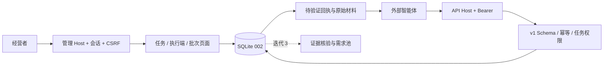

# Creative 迭代 2：候选接收实施计划

状态：2026-11-09，按已确认敏捷计划继续实施。规格为 [v1 交付协议](../specs/2026-11-08-creative-demand-intake-contract.md) 与 [主方案](../specs/2026-11-08-creative-platform-design.md)。使用 executing-plans，逐任务实施，最后独立审查。无实际搜寻、模型调用或部署。

## 范围与兼容性审查

新增任务/执行端管理与三个 v1 接口；沿用极简 Go 页面。用户站不变；既有管理 Cookie、CSRF、Host 校验不削弱。`CREATIVE_RESEARCH_ORIGIN` 未配置时机器接口关闭；配置后必须与管理 Host 不同，正式环境必须 HTTPS。本地可用 localhost:8080 管理、127.0.0.1:8080 机器接口。

追加 002 迁移，不改 001；迁移程序按顺序核对全部历史校验和，未知/缺号版本拒绝启动。升级前一致性备份，回退旧程序需恢复升级前备份，不能删除数据或把 002 数据库交给旧程序。

Schema 首次固化而非修改已上线协议：所有对象拒绝未知字段；必填项允许 null 的范围与 v1 一致。替代方案属性细化为 name/url/checked_at/method/limitations/basis；method 为 research_only/hands_on。ID 为 1–128 位字母数字、下划线或连字符；字符/数组长度限制保护输入资源，不限制总搜寻数量。Schema 使用 [jsonschema/v6](https://github.com/santhosh-tekuri/jsonschema) 的离线编译器，固定 v6.0.3；不自行实现 JSON Schema。模型费用只接受 OpenAI/DeepSeek，非模型服务的 model 为 null。费用原样保存在包内，核对属于迭代 3。

任务每个执行端同时一个当前任务。当前任务取消后可新建；新建替代旧任务后旧任务不可恢复，以免同一执行端有两个当前任务。管理员操作带版本，状态和审计同事务提交。执行端撤销立即失去访问权；轮换替换摘要，旧 token 立即失效。令牌只在创建/轮换 POST 响应显示一次，不写 URL、日志、数据库明文或公开产物。

相同 producer_id + batch_id + 原始字节重试先返回原接收回执，即使任务此后取消/规则改变；不同字节 409。新批次才检查当前任务、规则、取消状态。在途结果达标后允许保存。批次保存、原始载荷哈希、候选版本与接收回执使用同一事务。数据库中的 pending_validation 批次就是持久队列；本轮不启动尚无事实核验能力的空 worker，迭代 3 消费该队列。重启后仍可读回原回执与原始字节，不假装 completed。

资源保护：单包 1 MiB、20 候选；认证后按执行端 60 次/分钟，进程并发 8，超限 429 + Retry-After，窗口后恢复。它不是搜索总次数或费用上限。数据库失败 503；安全的错误码、字段路径、短说明，无输入值/数据库堆栈。POST 的 JSON 类型/结构错误 422，JSON 语法和重复键 400。

## Task 1: 协议、存储与机器接口

新增 `schemas/{embed.go,demand-batch.v1.schema.json}`、`migrations/002_research.sql`、`internal/auth/producer.go`、`internal/research/{intake.go,tasks.go}`、`internal/httpserver/research.go` 及测试；修改 `internal/store/sqlite.go`、`internal/httpserver/admin.go`、`cmd/creative/main.go`、go.mod/go.sum。持久化放在研究服务内，不增加只转发的 store/research.go。

接口：GET /api/research/v1/task 返回 task 对象或 null；POST /batches 返回 202 + receipt_url；GET /batches/{id} 返回该执行端回执与当前任务状态。任务明确返回完整固定 strong-wtp.v1 规则、主题/语言、数量与更新时间。资格计数本轮为真实空池，接收不写 needs，未来核验统一负责有效资格计算。

先写 HTTP 边界测试（配置启用、令牌隔离、真实 Schema/幂等/取消/错误码/数据库失效）、迁移升级测试，再运行观察失败。实现原始包事务存储和 pending 状态，重启使用真实关闭/重开 SQLite 验证。增加并发同包提交、同 ID 冲突和空运行报告、内嵌 HTML 转义、令牌轮换撤销、审计原子性测试。

验证：CGO_ENABLED=0 go test ./internal/store ./internal/auth ./internal/research ./internal/httpserver -count=1 -timeout 9m，外层 570 秒。预期新增测试先失败，实施后全部通过。提交这一完整增量。

## Task 2: 管理页面与配置说明

新增 `web/admin/templates/{tasks.html,producers.html,batches.html,batch.html}`、`internal/httpserver/research_admin.go`；修改总览链接/CSS、README、.env.example。复用现有会话、CSRF 和服务层，不接受 token 作为管理员凭证。页面含创建任务、取消/恢复、执行端登记/轮换/撤销、分页批次列表与单批只读材料。界面显示接收与待核验的区别、未知费用和下一阶段能力。

先写登录/CSRF/版本冲突/真实表单操作与令牌只显示一次的集成测试；运行预期失败。实现后测试通过，并本地 HTTP 演示登录→创建执行端→建任务→提交→回执→后台材料→取消/恢复。尝试浏览器检查必要流程、窄屏和键盘，工具无法支持时如实记录。

验证：CGO_ENABLED=0 go test ./... -count=1 -timeout 9m（外层 570 秒）；CGO_ENABLED=0 go build ./cmd/creative ./cmd/creative-admin；go vet ./...；npm run build 与 npm test。预期全部退出 0，公开 products.json 仍为 []。

## Task 3: 审查、回归与 Git PR

新增 `docs/iteration-02-validation.md`，更新总计划执行记录。独立审查整个新分支相对 861a508 的差异，重点是认证隔离、迁移兼容、并发幂等、取消/轮换竞争、恶意 JSON、审计和原始材料泄漏。修复阻塞问题并回归。提交、推送 codex 分支，创建接在 codex/minimal-redesign 之后的草稿 PR；前置 PR 未合并时不自行合并。验证最终提交 CI。

可行性结论：单进程、现有 SQLite/会话和静态模板可覆盖本轮，无外部模型或调度依赖。追加迁移与独立 API Host 保留旧行为；v1 首次 Schema 明确化有样例和错误码测试，未改变主方案门槛。平台 HTTP/串行调度阻塞仅影响迭代 4，不能将本轮接收成功描述为自动搜索已接通。
