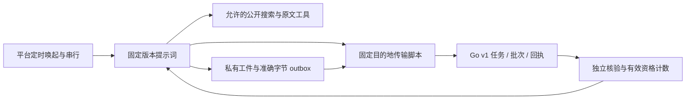

# 迭代 4：定时提示词接入执行计划

> **For agentic workers:** REQUIRED SUB-SKILL: Use superpowers:executing-plans to implement this plan task-by-task.

**Goal:** 交付可恢复的定时搜寻提示词、限定目的地的传输工具和真实平台接入验证；只有全部启用条件通过才标记 M3。

**Architecture:** 平台负责调度与串行，智能体负责搜索和整理，现有 Go 网站负责核验与计数。Python 标准库小脚本只提供固定 API 请求及准确字节 outbox；不负责搜索、模型调用、调度、资格判断，不成为独立搜寻程序。

**Tech Stack:** Codex 本地定时任务、OpenAI 执行模型、Python 3 标准库、既有 Go v1 API。

**Spec:** `docs/superpowers/specs/2026-11-08-creative-platform-design.md` 第 5 节；`docs/superpowers/plans/2026-11-09-creative-agile-delivery.md` 迭代 4。

## Global Constraints

- 按已批准方案继续执行，不重新选择平台架构；master 已 fetch，分支 `codex/research-scheduler` 基于迭代 3，包含最新 master。
- 只用 OpenAI/DeepSeek；模型 API 默认禁用，真实消费和真实运行启用须具备原方案的接入与调用授权。
- 不设搜索总次数、研究总时长或预算上限；HTTP 超时和有限重试仍保留。
- 隔离测试数据不得进入真实库；凭据、outbox 和完整原文不得进 Git；中文文档；仅 Mac 桌面。
- 不改既有 v1 API、迁移、公开产品；若发现接口缺陷，先补回归再改。
- 所有测试批次小于 10 分钟，Go 使用 CGO_ENABLED=0。

## 文件与架构

| 文件 | 职责 |
| --- | --- |
| `prompts/research-task.v1.md` | 固定提示词、恢复顺序、补证、停止、费用与不可信输入处理 |
| `config/research-task.json` | 非敏感调度/绑定要求、启用关卡，默认禁用 |
| `scripts/research_transport.py` | 私有绑定读取、固定三接口、持久化原始字节与回执；无搜索循环 |
| `tests/test_research_transport.py` | 隔离 HTTP、响应丢失、冲突、状态变更与凭据边界 |
| `tests/research-task/scenarios.json` | 提示词隔离输入和预期动作轨迹，禁止作为真实需求 |
| `docs/research-task-operations.md`、`docs/iteration-04-validation.md` | 配置、验收证据、未通过项和恢复方法 |
| `README.md`、`.github/workflows/ci.yml` | 入口与传输回归 |

## 可行性审查

现有三接口、幂等与状态机可复用。仅凭提示词要求准确重试不够可靠，因此增加无研究逻辑的标准库传输脚本，不增加网站 API 或依赖。与 v1 保持兼容；补证仍为原 external_id 加新 batch_id。

官方说明无人值守任务沿用默认沙箱，不能推定可以联网，也没有给出本项目所需的串行保证。上次本地连接被拒；本轮重新实测。网络、跨次恢复、串行或真实授权未通过时保持禁用，记录阻塞；不能把离线测试或两次手动调用说成平台验收。不修改全局权限、不用后台代理绕过沙箱。

## Review Focus

- 提交已入库但响应丢失：跨进程恢复必须使用同 ID 和完全相同字节。
- 取消/换任务/规则升级和回执竞态：先读回执，再读当前任务，禁止给取消任务提交新包。
- 恶意 URL、跳转、代理与错误正文：凭据不得跟随到其他目的地或出现在日志。
- 工件损坏、符号链接或重复 ID：失败关闭，不能覆盖旧包或吞掉未确认状态。
- 本地配置与平台能力不一致：默认禁用，测试报告不能宣称真实调度或付费核验成功。

### Task 1: 提示词、配置与可靠传输

**Files:** 上表提示词、配置、脚本、测试、场景及 CI。

**Interfaces:** 消费既有 v1；产生 `task`、`outbox`、`stage FILE`、`submit BATCH_ID`、`receipt BATCH_ID` 五个显式操作。调用固定 `--binding` 私有文件，绑定 origin/token/state_dir，不接受任意 URL。未确认包保留；提交前检查当前任务。

- [ ] 写传输隔离测试并运行，确认缺少实现导致失败。
- [ ] 实现固定三接口、禁重定向/代理、0600 私有工件、排他写入与 SHA-256 校验；返回安全错误。
- [ ] 编写提示词/config/场景；逐条对照 v1 字段与任务状态。
- [ ] 运行 `python3 -m unittest discover -s tests -p 'test_research_transport.py' -v`，Expected: 全部通过；提交。

### Task 2: 平台验证与交付记录

**Files:** 运行文档、验收记录、README；隔离测试运行材料在 `/private/tmp`。

**Interfaces:** 消费 Task 1 的固定提示词与传输脚本。平台临时任务只访问隔离 HTTP 和工件，不消费真实模型 API 或导入真实候选。

- [ ] 创建短期隔离平台任务，验证 HTTP 能力；成功后继续两次独立唤起恢复和重叠调度验证。每批试验小于 10 分钟，结束删除测试任务。
- [ ] 根据实测如实记录全部验收项；有阻塞时保持真实配置禁用、M3 未通过，列出解除条件。
- [ ] 回归 Go test/build/vet、Astro 构建/公开测试、Python 传输测试；Expected: 全部离线检查通过。
- [ ] 一次全分支独立审查，修复重要问题并回归，提交 Git 草稿 PR，等待 CI。
