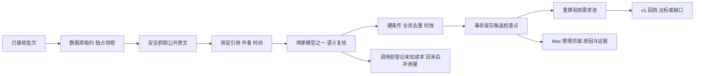

# Creative 迭代 3：证据核验与有效需求池实施计划

> 给执行者：使用 superpowers:executing-plans，逐项完成失败测试、最小实现、回归与一次全分支独立审查。用户已授权继续已确认计划，不重复要求确认常规实现。

**目标：** 将待验证批次处理为逐条可解释的核验回执、去重需求池与费用记录；不预建业务产品。

**架构：** 单个 Go 服务持有 SQLite 工作租约，在数据库事务之外读取公开来源和调用已启用的 OpenAI/DeepSeek；逐候选保存检查点，再在事务内检查租约、规则和版本、更新资格与目标。管理页面继续用 Go 模板。

**技术栈：** 现有 Go/SQLite/JSON Schema；新增 golang.org/x/net v0.62.0 提供 HTML 解析与公共后缀，不引入独立搜寻程序。

**规格：** [主方案](../specs/2026-11-08-creative-platform-design.md)、[v1 交付契约](../specs/2026-11-08-creative-demand-intake-contract.md)、[敏捷计划](2026-11-09-creative-agile-delivery.md)。

## 全局约束与本次用户修订

- 2026-11-09 用户明确仅考虑 Mac 页面；当前验收只针对 macOS 桌面浏览器。手机、平板和其他终端不作为交付或阻塞项；保留已有简单 CSS，不主动删除无害样式。
- 开发前已 fetch/pull master，当前主线 82808cc；分支 codex/research-verification 基于迭代 2 的 0062ba3，堆叠 PR，不擅自合并。
- 只接入 OpenAI/DeepSeek；默认配置不启用真实连接，测试全部使用临时库、隔离来源和模型替身。不开启真实搜寻、付费调用、部署或购买。
- 不降低 3 位独立用户、2 个原始站点、2 位直接付费者、1 条具体价格/可定位支出；付费来源最近 12 个月，资格最近 30 天复核。未知费用不能当 0，无预算/总搜索次数上限。
- 所有 Go 验证 CGO_ENABLED=0，外层每批 570 秒，go test -timeout 9m。中文文档，自制测试素材，不用真实商机填测试。

## 文件与数据影响

新增 `internal/source/{fetch.go,document.go,*_test.go}`：无代理、DNS/连接地址及跳转逐次检查、有限重试、HTML 可见原文与作者/时间绑定。只读取 HTTP(S)，拒绝凭据、非标准端口、内网/特殊地址。无浏览器脚本执行，不绕过登录或验证码。未知来源结构返回补证。

新增 `internal/model/{review.go,openai.go,deepseek.go,*_test.go}` 与 `config/providers.json`：固定可信厂商地址、独立请求格式、严格输出校验、拒绝空白/截断/拒绝回复、有限重试、调用前登记未知费用。配置只允许两家，显式启用且已完成验证才参与主备路由；只有环境变量名称，不保存真值。不在本轮创建/读取私有密钥文件。

新增 `internal/research/{qualification.go,dedup.go,verification.go,usage.go,retention.go,*_test.go,testdata/verification-cases.json}`、`internal/worker/{worker.go,worker_test.go}`、`migrations/003_verification.sql`、`config/research.json`；修改 intake/tasks/batches、启动和管理路由。新增需求/证据与费用页面，保留既有登录/CSRF/独立 Host。

003 追加租约、候选检查点、证据快照、规范需求与别名、费用记录。现有 needs 增加资格与去重字段，已有 001 qualified 行没有核验记录的不算有效池；completed 状态不被新提交覆盖。批次原始包 30 天后置空保留哈希和回执，180 天后清理研究正文但保留最小幂等墓碑、账单与必要审计。旧 001/002 SQL 不改；升级前一致性备份，回退恢复升级前备份并保全新资料。

## 资格、去重及恢复决策

1. 接收方原文与提交方字段分开。HTML 静态解析只认包含引文的明确作者块（article/结构化评论或唯一作者的整页），排除 script/style、隐藏块、blockquote/code 的转引。作者标识、时间缺失或不一致不能计数；无可靠绑定时返回 metadata_unverified。来源正文过大或截断不算验证通过。
2. 模型只返回结构化任务相关性、自助性、原创/非推广、独立性、付费信号及其原文依据、未满足点、条件、价格和已有需求匹配。程序逐项检查引用确在已取得的作者块中，价格/条件保持原文事实。任何缺项、未知或矛盾均不计数；模型不能直接返回 qualified 或修改网站状态。
3. 同来源作者、跨站相同作者名称/身份、相同引用不能重复凑数；站点按公共后缀归并。精确语义任务指纹、证据指纹和 producer+external_id 别名确定重复；模型对已有需求的匹配只辅助，疑似重复不占新名额。保守处理无法确认的独立性。候选处理时读取已有需求上下文；上下文过大不能截断后假装确定独立，转人工复核。
4. 已有候选补证追加版本，旧合格资格在补证重验前撤销；已完成状态不被覆盖。资格有效期取复核后 30 天与付费证据 12 个月边界的较早值。所有读取任务/回执、处理完成及每日维护都按当前服务器时间重算；取消始终优先，定时器不能恢复。
5. 单来源失败为 needs_evidence/source_unavailable，继续其他候选；配置禁用、模型不可用/错误输出等平台故障为 paused_service，未完成项仍待验证。仅管理员携版本明确重试批次，已提交候选检查点不重复核验；取消不被重试解除。无结果报告可进入 waiting_for_signals，次日维护仅恢复等待线索而不恢复取消或平台故障。
6. 数据库租约定时续期；进程退出后新进程在租约过期接管 validating 批次，从候选检查点继续。所有业务结果写入检查租约和 fencing token，失去租约的旧进程不得写结论。模型调用每次独立 usage_id，发出前保存 unknown，响应丢失不抹掉可能发生的成本。
7. 外部 usage 按 producer+usage_id 去重，unknown 可补为 reported，矛盾报告标记冲突，不覆盖已核对值。不同币种分列；相同账单引用不能重复确认或相加。网站模型用量与外部自报分开，缺报价不推算成本。实际账单核对表单与固定成本管理属于迭代 5；本轮不会把自报自动改为 verified。

## Review Focus

- 同时提交补证、租约到期及旧进程迟到写入：必须保留新版本并拒绝陈旧结论（Task 3）。
- DNS 重绑定、IPv4 映射 IPv6、转向元数据与同站点不同子域：不得访问私有地址或重复计站点（Task 1/2）。
- 文本里“不是我愿意付费”、转载报价、作者/日期来自其他评论：不能用字符串包含伪装原文绑定（Task 1/2）。
- 重复费用 ID、不同费用相同账单、请求中断：不重复计费或把未知显示为零（Task 3）。
- 清理后重试、已取消任务、资格刚好过期、历史回执：保留幂等和审计，当前资格/任务状态真实（Task 3/4）。

### Task 1: 安全来源与两家模型适配

**接口：** source.New().Fetch(ctx,url) (Document,error)，Document 包含最终 URL、正文哈希、可见文本、作者块与服务器时间；Document.Bind(quote) 返回明确作者块。model.New(config,journal) 读取显式配置，Reviewer.Review(ctx,Input) 返回 Assessment/error；每次请求通过 Journal.Start/Finish 留用量，不自动充值。

- [ ] 写 TestSafeSourceFetch、TestQuoteAuthorBinding、TestProviderResponses、TestProviderConfig、TestUnknownCallAfterInterruption：覆盖跳转、地址混淆、拒绝/空白/截断/坏 JSON/未知字段、格式纠正最多 1 次、HTTP 额外重试最多 2 次；先运行确认失败。
- [ ] 实现静态原文提取与模型适配，使用正式文档，不直接假设两家参数兼容。
- [ ] `CGO_ENABLED=0 go test ./internal/source ./internal/model -count=1 -timeout 9m`（570 秒外层），预期全通过，提交。

### Task 2: 资格和去重纯规则

**接口：** research.Evaluate(candidate, boundSources, assessment, now) Decision，含逐证据核验结果、原因、任务指纹、证据指纹和有效期；只处理已经重新取得的原文。Dedup 在持久化层把 Decision 映射为规范需求/重复/待复核。

- [ ] 编写至少 30 条自制独立标注样本，明确/弱/条件/否定/重复/过期各类及预期作者/日期/价格。先运行 TestQualificationCorpus、TestQualificationExpiry、TestEvidenceIndependence 观察未实现失败。
- [ ] 实现硬条件、证据原文一致性与有效期；原文字段和硬规则评测达到 ≥90%，门槛不足样本全部拒绝资格。模型语义输出使用隔离替身时明确仅验证消费者，不能称真实厂商准确率。
- [ ] `CGO_ENABLED=0 go test ./internal/research -count=1 -timeout 9m`，预期全通过并输出样本统计，提交。

### Task 3: 持久工作循环、需求池和费用

**接口：** research.Claim/Heartbeat/Process/RetryBatch 与 worker.Run(ctx)；CurrentTask/Receipt 事务内复验身份并重算当前有效池。处理逐候选提交，重启跳过已完成检查点。Maintenance(now) 处理资格、等待线索与材料保留，费用记录不依赖预算。

- [ ] 写 TestVerificationRestart、TestLeaseFencing、TestCrossBatchDedup、TestRecomputeTarget、TestUnknownCost、TestRetentionAndRetry：真实临时 SQLite，包含补证版本、重复账单、原始材料清除后原字节重试、混合批次与暂停重试、取消不恢复，先观察失败。
- [ ] 追加 003，接入异步循环与关闭取消，来源/模型网络调用不持数据库锁；恢复规则和费用去重全部事务化。
- [ ] `CGO_ENABLED=0 go test ./... -count=1 -timeout 9m` 与 build/vet，预期通过，提交。

### Task 4: Mac 管理页面、验证与 PR

- [ ] 增加需求/证据/费用列表与详情，批次展示逐项结论及明确重试；保持未知/自报标识、CSRF、版本校验、转义，补 HTTP 流程测试并先观察失败。
- [ ] 更新 README、.env.example、v1 实施记录及总计划的 Mac 范围；在隔离环境演示提交→核验→回执→需求池，保持公开清单为空。
- [ ] Go 全量 test/build/vet、Astro build/npm test、Mac 桌面浏览器主流程；不安排其他终端测试。每批最长 570 秒。
- [ ] 按 executing-plans 做一次全分支独立代码审查，修复重要问题并回归；Git 推送并创建承接 #3 的草稿 PR，核验最终 CI。

## 可行性及兼容性审查

纯 Go 驱动、现有单连接 SQLite、标准 HTTP 和嵌入 Schema 可以实现。工作租约不跨网络持锁；单候选检查点防止重启双计，调用日志先记 unknown 防止吞掉中断成本。接口 v1 路径、输入字段、幂等回执不变；查询回执由 pending 扩展到既定枚举，研究身份/CSRF 边界保留。原始材料清理后通过持久哈希/回执重试，删除业务元数据前保留最小墓碑。没有阻塞本地实现的问题。

来源/语义解析并不承诺覆盖所有网站：无法可靠定位、验证或确认独立性的材料返回补证。真实模型账号与能力尚未验收，默认禁用；离线字段/规则样本通过不等于真实模型准确率通过。定时平台网络与串行关卡仍只阻塞迭代 4。新用户指示已移除非 Mac 验收关卡。

API 依据：[OpenAI 结构化输出](https://developers.openai.com/api/docs/guides/structured-outputs)、[DeepSeek JSON 输出](https://api-docs.deepseek.com/guides/json_mode/)、[DeepSeek Chat Completions](https://api-docs.deepseek.com/api/create-chat-completion/)。本轮不预设用户可访问某个模型 ID，不发送真实凭据或付费请求。

## 审查修复的文件补充

新增 `internal/usage/external.go` 让 003 迁移和在线接收共用费用去重，`internal/jsonutil/check.go` 共用严格 JSON 规则；003 增加独立核验版本和当前版本指针，来源按版本保留。新增 `internal/research/review_regression_test.go`、`internal/store/review_migration_test.go` 覆盖独立审查复现。固定规则无需另建 research.json。架构路径仍为接收→安全抓取→语义辅助→程序门槛→持久版本/回执→Mac 管理页面，v1 请求契约不变。
