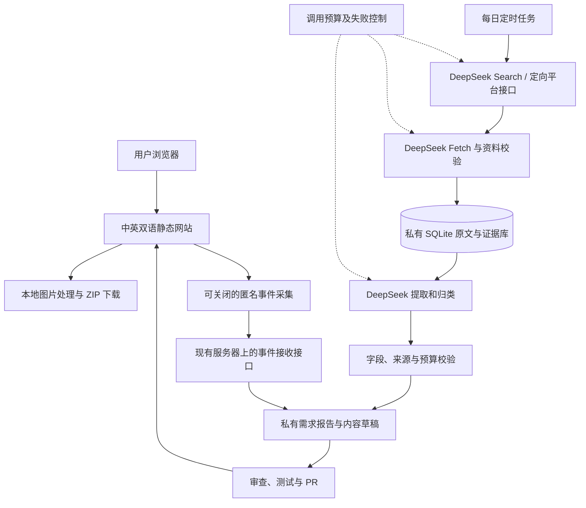

# Creative 自动需求发现与自助工具站完整方案

日期：2026 年 11 月 8 日，Asia/Shanghai。状态：设计提案，尚未实施产品或授权消费。

## 1. 目标与已确定边界

Creative 面向全球用户提供中英双语自助工具，通过真实使用量逐步获得广告或其他收入。后台每天寻找可验证的问题，维护候选需求；前台解决一种明确、可重复的任务。用户不需要主动谈单、报价或提供定制交付。

用户已确认：不限定第一笔收入的时间；每月运行预算上限为人民币 300 元，域名另计，不购买广告。本确认仅用于方案设计，不授权充值、购买服务器、购买域名或投放广告。

初期允许少量异步维护：每周集中查看一次报告、处理异常，以及审核新功能和对外内容。后台采集、整理、测试与统计可自动执行；无人看管的代码生成、任意公开发帖和无限制扩站不在第一版范围内。盈利是需要经营数据验证的结果，不是技术验收项。

## 2. 方案比较与推荐

| 方案 | 优点 | 代价 | 本方案决定 |
| --- | --- | --- | --- |
| 全部使用 OpenAI 搜索和分析 | 搜索与模型集成集中 | 需另行配置账户、预算与可用性 | 作为未来备选，首版不接入 |
| DeepSeek Search、Fetch 与模型分析，独立静态工具站 | 已有明确接入方向；搜索结果和原文可以独立保存；网站使用不会触发模型账单 | 需要编排、校验、预算控制和错误处理 | 推荐采用 |
| 同时接入多家模型、多种插件并自动生成大量工具 | 覆盖范围广 | 故障面和验证成本大，容易重复开发及持续烧钱 | 有真实业务证据后再按需扩展 |

用户提供 DeepSeek 凭据，因而本提案以 DeepSeek 为首选；具体技术栈与流量实验阈值属于设计建议。无需为了“插件化”先建立插件市场。已有 HTTP API 直接调用；只有确有服务通过 MCP 暴露必要能力时才接入 MCP。

## 3. 首个产品与可验证需求

推荐首个候选：批量图片优化。目标用户是需要同时整理多张图片的内容创作者、小商家及普通办公用户。核心流程：选择图片 → 统一设置尺寸、格式、质量或文件大小目标 → 查看结果 → 打包下载。

Squoosh 的公开需求 #1406 描述了反复逐张设置、压缩和下载的问题，并请求批量处理与 ZIP 下载。查询时该需求仍开放，但它只是问题存在的证据，不能证明市场空白或付费潜力。[真实需求来源](https://github.com/GoogleChromeLabs/squoosh/issues/1406)

在正式开发这个候选前，先完成一次范围有限的需求验证：

1. 记录至少 3 条独立用户的需求证据，尽量来自至少 2 个不同来源；转载、同一人的重复发言和推广软文不重复计数。优先最近一年，较旧问题须重新核查是否仍存在。
2. 实际试用搜索结果中至少 5 个相关工具，记录批量限制、大小目标、隐私、下载方式、收费和失败情况；不能仅靠模型摘要判断竞品能力。
3. 找到至少一个当前未被这些工具妥善解决、且可以低成本改善的问题。若找不到，保留调查结果，换候选，不因为代码容易写就开工。
4. 搜索量尚未取得时标记为未知，可进行小规模实用性实验，不据此扩建大量页面或预估收入。

### 第一版能力

- 同时处理最多 10 张图片，单文件不超过 10 MiB，总输入不超过 50 MiB，单张不超过 2000 万像素。这些是初始保护值，需真实手机验证后确定。
- 输入静态 JPEG、PNG、WebP；输出 JPEG 或 WebP。HEIC、SVG、动画 GIF/APNG/WebP 不支持，明确提示而非静默转换成首帧。
- 批量调整最长边、输出格式、压缩质量；大小目标使用有限次数尝试，只有实际输出满足限制才显示成功。无法达到目标时显示实际大小与原因，不伪造“已达标”。
- PNG/WebP 转 JPEG 会丢失透明通道，界面提前说明采用白色背景。默认不保留 EXIF 等元数据，文案明确说明；不得宣传为无损归档工具。
- 不覆盖用户原文件；结果保留可辨识的新文件名。同名输入通过稳定序号避免 ZIP 内覆盖。
- 图片在浏览器内处理，默认不上传、不发给大模型；串行解码与处理，及时释放位图、Canvas 和对象 URL，避免同时占用大量内存。
- 无须注册、无订阅结算、无复杂管理后台；提供双语说明、常见问题和一个异步问题反馈入口。

第一版不追加 AI 生图、视频处理、云端文件存储、付费会员或定制服务。新增格式和工具以实际使用证据为依据。

## 4. 系统架构与部署

前台采用 Astro 静态输出与 TypeScript；图像处理优先使用浏览器原生能力，ZIP 使用专门的小型库。可考虑 fflate，实施时核实许可证与当前兼容性并锁定版本。Node.js 24 用于构建。没有前台付费模型调用，也不在浏览器中存 API Key。

后台采用 Python 3.13、标准库 HTTP/JSON/SQLite 和操作系统定时器，先保持单任务进程。用于统计的最小 WSGI 应用通过 Gunicorn 运行，Caddy 提供 HTTPS 反向代理；研究任务仍是独立定时进程。仅在确有必要时增加依赖；不引入 Redis、消息队列、多智能体编排或向量数据库。定时器负责每天运行，模型 API 本身不负责长期调度。

静态站推荐 Cloudflare Pages，后台任务推荐一台小型常开 Linux 实例。服务商、地区、域名和最终报价在上线前确定；必须确认运行地可合法且稳定地访问所需服务。服务器连备份支出超过分配额度则不购买。也可先在本地试运行，但 Mac 休眠或关机期间不保证调度，不能把本地试验当作全天候运行。

Cloudflare Pages 官方当前免费计划为每月 500 次构建、同时 1 次构建，单文件上限 25 MiB。前台只部署代码与自制小样例，不部署用户图片或采集原文；每周少量发布即可。动态函数等服务有各自额度，本方案不把它们视作无限免费资源。[Pages 限制](https://developers.cloudflare.com/pages/platform/limits/)

正式域名与所有账号由用户持有。部署只同步前台构建目录；私有数据库、日志、日报和凭据不得复制到公开网站。

## 5. 每日自动发现需求

初始种子限定在批量图片处理，保留中英文两组问题，按语言和地区分别评估。例如“批量压缩到指定大小”“图片批量转换不上传”、`batch resize images same settings`。模型可以建议扩展词，但每日最多采用 5 个与当前产品直接相关的新词。

每日 08:00（Asia/Shanghai）执行，首轮回溯历史样本，之后滚动检索最近 7 天，避免索引延迟导致遗漏。通过 URL、内容摘要哈希和作者/原帖关系去重。每次运行有唯一编号与检查点；重跑已完成记录不再次付费分析。

| 步骤 | 初始规模 | 输出与约束 |
| --- | --- | --- |
| 搜索 | 每日最多 20 次请求 | 返回 URL、标题、摘要和可用日期；没有日期则保留未知 |
| 抓取 | 每日最多 30 次请求 | 只读取搜索结果或人工配置的公开来源，按域名限速；遇到登录、验证码或明确拒绝访问就停止 |
| 初筛 | 先用程序处理 | 去掉重复、明显推广、无正文及不相关条目，按来源和任务相关性选最多 20 条 |
| 模型抽取 | 每条最多约 6000 输入、1000 输出 token | 提取用户、任务、限制、引用原文、已知替代品和不确定性；超长页面裁剪并记录不完整标志 |
| 汇总 | 每日 1 次，最多约 8000 输入、2000 输出 token | 输出最多 3 个候选及下一步验证方法，不自动把建议当作开发指令 |

调用数量上限包括重试，未完成条目留到下一轮。优先配置 `deepseek-flash` 非思考模式用于抽取；此名称与计费来自当前官方文档，正式接入前重新验证可用性。首版不对每条记录并行调用两家模型。

DeepSeek Search 返回结构化结果，Fetch 返回 Markdown；二者独立于模型接口。GitHub Issues 可通过正式搜索接口补充精确数据。HN 可选；Reddit 商业 API、Google Trends alpha、需要额外付费授权的数据源不作为第一版依赖。[DeepSeek Search/Fetch](https://api-docs.deepseek.com/guides/search)、[GitHub 搜索](https://docs.github.com/en/rest/search/search)、[HN 接口](https://hn.algolia.com/api)

所有网页和社区文字仅作为待分析数据，不能改变系统规则、要求读取密钥、调用写入工具或发起购买。研究任务仅有搜索和读取能力；抓取 URL 限 HTTP(S) 公网地址，拒绝本机、内网、云元数据地址和包含凭据的 URL。

## 6. 数据模型、验证与失败处理

研究任务数据库初期只需要四类记录：

- `sources`：URL、抓取时间、来源日期、语言、标题、原文哈希、内容摘录及是否截断。
- `needs`：用户任务、使用场景、限制、引用证据、来源 ID、已有方案、未知项、验证状态。
- `runs`：任务时间、进度、完成数、失败原因与检查点。
- `usage`：服务、请求类型、请求编号、输入/输出用量、使用的价格版本、预留费用和核对后的费用。

另设匿名 `metrics_events` 与按日汇总表，具体采集与保留规则见第 12 节；不和研究原文或用户身份关联。

源 URL、独立提及次数、金额和计数由程序保管或计算，模型不能覆盖。模型引用须能定位到实际抓取文本；引用找不到、所用 URL 不在输入集合、必填字段缺失、JSON 为空或截断时均不得发布为有效证据。允许缺失值为 `null`，尤其是搜索量、支付意愿和收入预期。

DeepSeek JSON 模式要求提示中包含 JSON 说明，也可能返回空白内容；使用字段和类型检查、输出长度检查，并限制纠正请求最多 1 次。拒绝或连续失败则标记失败，保留原始材料，不偷偷更换昂贵模型。[JSON Output 文档](https://api-docs.deepseek.com/guides/json_mode/)

HTTP 429、超时及部分 5xx 可以延迟重试，最多 2 次，遵循 Retry-After；认证失败、余额不足或预算耗尽暂停付费任务。未知响应不计作成功。单日任务最长运行 20 分钟并设置独占锁；测试的单次运行另遵守 10 分钟上限。

原始网页内容默认保留 30 天，必要的证据摘录和元数据保留 180 天；仅用于内部分析，不在 Git 或公开页面重新发布全文。每日用 SQLite 一致性备份接口备份，保留最近 7 份；异机备份采用私有加密存储且计入运行预算，至少验证一次恢复。

候选判断看四项：独立问题证据、当前替代品缺口、目标市场获取流量的机会、低成本标准化交付能力。没有证据的字段保留未知，不能让模型的高分替代调查。

## 7. 如何推广网站

### 7.1 搜索流量是主渠道

先做好一个完整工具页及少量解决真实问题的教程。中英版本使用独立 URL，例如 `/en/tools/batch-image/` 和 `/zh/tools/batch-image/`，实现语言切换、各自 canonical、双向和自引用 hreflang、站点地图、可抓取的静态正文。无明确语言偏好时用语言入口作为 x-default；不要按 IP 强制跳转。[Google 多语言文档](https://developers.google.com/search/docs/specialty/international/localized-versions)

首页、工具页、教程、关于、隐私和反馈入口构成初始网站。只有明确独立用途的页面才允许索引；不同压缩 KB 数、尺寸或参数不各生成一页。私有研究报告和临时预览不发布到公开站点。

工具页包含用途、操作步骤、真实限制、常见失败原因、隐私说明和可直接试用的自制样例。教程示例可覆盖“批量缩放并压缩”“如何判断大小目标是否可实现”“本地处理与上传处理的区别”。每篇必须用产品实际操作验证，避免改写他人的文章、虚构对比数据或复制相同内容换关键词。

上线后验证 Search Console 站点所有权并提交 sitemap；按周读取实际查询、曝光、点击、CTR、页面和地区。搜索数据有延迟且不包含所有查询，只代表本站获授权的数据，不能当作全网搜索量。[Search Console 文档](https://developers.google.com/webmaster-tools/v1/searchanalytics/query)

Google Ads 关键词数据可以作为后续补充，取得所需账号和接口权限前不依赖。广告竞争不是自然排名难度，CPC 不是本站广告收益。趋势指数也不是绝对搜索量。

### 7.2 低沟通的传播入口

| 渠道 | 做法与频率 | 自动化范围 | 验证指标 |
| --- | --- | --- | --- |
| 自然搜索 | 每周查看查询，改进 1 个关键页面；最多发布 1–2 篇经过实测的原创教程 | 自动发现题目、生成草稿、检查链接与技术 SEO；新页面发布前审查 | 非品牌曝光、有效访问、工具完成次数 |
| 产品内分享 | 分享当前设置和工具 URL，不携带用户图片、文件名或其他私有内容 | 用户主动点击后复制链接，分享功能本身可全自动 | 分享按钮使用、带标记访问及处理成功 |
| 自有演示频道 | 每周最多 1 条约 20–45 秒的真实操作录屏，以合成图片演示；字幕即可，不必露脸或配音 | 自动生成字幕、封面与发布草稿；取得账号和具体发布授权后再接官方发布能力 | 到站访问及工具使用；不只看播放量 |
| 免费工具目录 | 选择 5 个允许免费自助提交、主题匹配的目录，分别核验规则后一次性提交 | 准备名称、描述、截图等素材；不批量撒链接 | 每个目录的有效引荐访问 |
| 开源仓库展示 | README 展示真实能力、部署链接和自制示例；选择合适许可证后发布代码 | 文档与版本说明可由流水线生成草稿 | 仓库引荐访问及真实问题反馈 |

不购买广告或外链，不发陌生人私信，不批量灌水或刷赞。Show HN 要求可实际体验的作品且作者愿意参与讨论，所以只在用户接受异步交流时作为可选渠道，不纳入默认无人运营计划。[Show HN 规则](https://news.ycombinator.com/showhn.html)

自动化推广的目标是维护可被发现、可被使用的真实产品。新社交账号注册、首次对外发布、向他人发送信息、付费推广不由采集任务自行决定。当前请求仅产出方案，不授权实际发帖、邮件或消息。

### 7.3 内容与素材质量

演示图片使用自制图形、渐变、文字和程序生成的样例；截图来自本项目实际界面。案例不得伪称真实客户，不能把模拟浏览量或样例收益写成实际成绩。评测必须记录工具版本和操作条件。英文与中文各自校对可读性，先确认用户能完成任务，再扩充文案。

## 8. 变现顺序与低售后设计

第一阶段所有工具功能免费，用运行数据确认真实需求。保留异步反馈表单或邮箱与常见问题，用户无需进行销售沟通。服务异常、错误结果或隐私问题仍需要处理，不能承诺零维护。

第二阶段申请适用于经营主体和访问地区的广告服务，例如 AdSense。申请前完成实际功能、有用内容、隐私与 Cookie 说明、反馈入口及必要的同意管理。若面向需要特定同意机制的地区投放广告，先核对服务商当前要求；未准备好时不加载广告或相关追踪。

广告仅出现在有实质内容的页面合适位置，不能伪装下载按钮，不能诱导点击，也不放在错误、处理中、纯导航或空结果页面。申请通过、流量规模和广告收益均不可保证。[AdSense 条件](https://support.google.com/adsense/answer/9724?hl=en)、[发布商内容政策](https://support.google.com/publisherpolicies/answer/11112688?hl=en)

如果广告暂未通过，继续以免费站验证使用，不立刻增加付费套餐或通过大量灌内容反复申请。联盟推荐仅在确有相关产品、已经获得推广资格且能清楚披露佣金关系时考虑。付费会员或数字产品需要处理支付、退款和售后，作为未来独立决策。

收入核算使用实际账单：广告净收入＋其他实际结算收入－模型和采集－服务器与备份－监测等费用－退款税费等必要支出。单看“有收入”不足以确认值得经营；至少连续 3 个月实际经营净现金流为正，才考虑增加预算。税务按实际经营主体与所在地另行核验，不在方案中编造税率。

## 9. 每月预算与调用上限

以下为内部预算分配，不是服务商报价，也不是消费授权：

| 项目 | 月度上限 |
| --- | ---: |
| 模型、搜索、网页读取 | ¥80 |
| 常开任务实例及备份 | ¥80 |
| 监测、必要带宽等 | ¥40 |
| 未分配缓冲 | ¥100 |
| 合计 | ¥300 |

静态站优先使用免费额度，域名另外列一次性/年度费用。任何付费服务先提供实际报价和用途；不启用自动充值，不自动升级套餐，不把缓冲预算自动花完。

截至本次核对，DeepSeek Search 和 Fetch 均为每 1000 次符合计费条件的成功请求 0.75 美元。`deepseek-flash` 输入未命中缓存的高峰价为每百万 token 0.30 美元，输出为 1.20 美元；此示例忽略缓存及低峰优惠，用高峰价估算。[当前模型与搜索价格](https://api-docs.deepseek.com/quick_start/pricing)

按照 30 天、每日 20 次搜索＋30 次读取、20 条抽取（每条 6000 输入/1000 输出 token）、每日 1 次汇总（8000 输入/2000 输出 token）计算：

- 搜索与读取：1500 / 1000 × 0.75 = 1.125 美元。
- 抽取：360 万输入 token × 0.30 / 百万＋60 万输出 token × 1.20 / 百万 = 1.80 美元。
- 汇总：24 万输入 token × 0.30 / 百万＋6 万输出 token × 1.20 / 百万 = 0.144 美元。
- 合计约 3.069 美元，另按 30% 加保护余量约 3.99 美元。

这只是固定工作量与当前单价下的预算演算，并非实际账单或全站成本。没有使用实时汇率，因此不把美元示例直接折算成人民币。运行前填写实际结算币种、价格版本与可核对汇率；缺失或过期则暂停付费调用。

程序在请求前预留费用、请求后用返回 usage 核对；单日 AI/搜索费用上限 ¥3，月度 ¥80。达到 70% 提醒、90% 暂停探索新词、100% 停止相关付费请求。所有重试也计入，价格至少每周核对一次。应用内预算不能替代供应商账单核对；使用专用 key，避免其他程序共享导致漏账。其他固定费用与余额每周核对一次，整个项目达到 ¥300 时停用新增付费任务。

## 10. 实施阶段与验收

这是设计阶段的路线图。通过设计审查后再编写逐任务实施计划；以下时间段是建议实验节奏，不承诺流量或收入在指定日期出现。

| 阶段 | 交付 | 通过条件 |
| --- | --- | --- |
| A 凭据与需求小样 | 新密钥、价格配置、固定样本集和需求雷达小样 | 获得明确的付费调用授权后，少量真实请求验证可用性；至少 30 条人工标注样本，核心字段抽取正确率≥90%，保留证据来源；全部非法/缺失 JSON 被拒绝入库 |
| B 首个浏览器工具 | 图片处理、ZIP、双语说明和失败提示 | 通过 JPEG/PNG/WebP、透明图、方向信息、大图、损坏文件、同名文件、动画拒绝和取消任务等回归；所有显示成功的结果确实符合用户选定限制 |
| C 网站与测量 | 静态站、原创教程、隐私说明、sitemap、反馈入口 | Chrome/Firefox/Safari 及至少一台真实手机可完成任务；键盘与读屏基础操作可用；确认图片不上传、密钥不在构建产物；验证匿名事件的成功、失败、取消、下载触发及渠道关联；域名及托管费用获得授权 |
| D 推广实验 | 搜索收录、分享设置、演示草稿、少量目录提交 | 对同意统计的访问能归因到处理结果，并标注统计覆盖范围；统计未就绪则此项不通过，只能进行有限功能试运行，不据此扩大推广；仅执行已获授权且符合规则的对外发布 |
| E 变现验证 | 符合条件时提交广告申请、展示设置与账单报告 | 广告资格、隐私同意和收款条件就绪后才展示；以实际结算净收入评估，不承诺审批结果 |

每次代码变更先更新远程主线并建立开发分支；仓库目前没有任何提交，也不存在 master。首次初始化主分支及其名称需在实施启动时确定，之后按实际主分支工作；不能假装已拉取不存在的 master。兼容性变更在实施前单独审查。完成后做代码审查、回归验证，并通过 Git/PR 流程集成。

单次测试执行不超过 10 分钟，长检查拆分；如未来引入 Go，调试使用 CGO_ENABLED=0。浏览器样例与测试图片均自制。新逻辑保留有意义的测试，不为静态文案编写镜像测试。

## 11. 需要新增的文件

当前已经涉及的文件只有：

- `.gitignore`：排除 `.env`、`.env.*` 和私有数据目录，允许只有占位符的 `.env.example`。
- `.env.local`：用户要求保存的本地凭据，权限 0600，不加入 Git、不复制到网站、不在文档中展示。
- 本设计文档。

实施阶段拟新增的最小文件结构：

| 文件 | 职责 |
| --- | --- |
| `README.md`、`.env.example` | 中文启动与部署说明；凭据名称占位，不含真值 |
| `package.json`、锁文件、`astro.config.mjs` | 前台依赖、构建和静态路由配置 |
| `src/pages/[lang]/index.astro` | 中英首页 |
| `src/pages/[lang]/tools/batch-image.astro` | 主工具页面及可索引说明 |
| `src/pages/[lang]/guides/[slug].astro` | 少量经过验证的教程 |
| `src/pages/[lang]/[page].astro` | 关于、隐私、使用说明及反馈入口的固定页面 |
| `src/components/ImageBatch.astro`、`src/lib/image-batch.ts` | 浏览器交互、输入校验、处理、下载与资源释放 |
| `src/lib/i18n.ts`、`src/content/` | 翻译文案与原创教程；首版无需通用国际化框架 |
| `public/robots.txt`、sitemap 构建配置 | 索引规则与页面发现 |
| `jobs/daily.py` | 单次调度、去重、限额、任务状态和日报 |
| `jobs/deepseek.py` | Search、Fetch、模型的必要 HTTP 调用、超时和错误分类 |
| `jobs/db.py` | SQLite 表结构、事务与一致性备份 |
| `jobs/metrics.py`、`deploy/Caddyfile` | 匿名事件接收、严格字段校验、HTTPS 入口及不含敏感值的部署配置 |
| `config/research.json` | 种子词、来源、规模限制和非敏感价格配置 |
| `tests/` | 图像处理回归、证据校验、预算、任务重跑和断点恢复 |
| `.github/workflows/ci.yml` | 构建、必要测试、密钥检查；后续按部署方案绑定发布 |

`data/` 保存私有 SQLite、备份与报告，已忽略。依赖或构建目录的忽略规则在引入工具链时补齐。目录和文件保持与职责一致，不提前增加微服务、管理门户或插件抽象。

## 12. 运营指标、停止条件与自动化边界

最初记录有效访问、开始处理、处理成功、处理失败、取消、下载已触发和实际成本。普通浏览器下载链接无法确认用户最终保存成功，因此“下载已触发”只表示网站发出了下载动作，不称为“下载完成”。托管侧访问日志只补充到站情况，不能替代产品事件。

首版统计复用现有任务服务器，通过 `https://metrics.<正式域名>/events` 接收匿名事件；不新增付费统计平台或登录系统。前台仅在隐私审核完成且取得适用同意后启用，用户拒绝时工具仍正常工作。请求不携带 Cookie、不设置持久用户标识，不上传图片内容、文件名、完整页面查询串、完整 referrer、邮箱、密钥或提示原文。

事件字段固定为：随机 `event_id`、当前操作的随机 `run_id`（浏览器内存中保留，非用户 ID）、事件类型、工具名、`en/zh` 语言、渠道、预定义错误码与耗时区间。事件类型限于 `tool_view`、`process_started`、`process_succeeded`、`process_failed`、`process_cancelled`、`download_triggered`。渠道仅允许 `organic/direct/youtube/directory/github/other`，由入口链接标记或来源域名归类后传输，未知来源归 `other`；同一页面操作沿用内存中的渠道，不做跨设备或持久用户归因。服务器生成接收时间。

接口只接受 HTTPS、POST 和必要的 OPTIONS；请求体最多 4 KiB，字段和枚举严格校验，固定允许的网站 Origin，事件 ID 去重。CORS 不是身份认证，匿名事件也可能被伪造，因此不用于财务结算或自动增加预算。设置每分钟最多 300 条、每天最多 10000 条的全局接收上限并记录丢弃计数，不返回私有统计；查询报告仅通过服务器私有访问。反向代理及应用不保存客户端 IP、完整请求正文和 referrer。该接口的资源、域名子域和备份计入已有服务器与监测预算；上线时验证容量，额度不足即停止事件接收，不自动升级。

原始匿名事件保留 30 天、每日聚合数据保留 180 天。使用随机 run_id 关联开始与终态；重复事件不重复计数，矛盾终态标记异常。成功率定义为成功次数 /（成功次数＋失败次数），同时单列取消、缺失终态及各类失败；终态覆盖率为（成功＋失败＋取消）/开始。最近 7 天完整尝试不足 100 次，或终态覆盖率低于 95%，均不宣称达到成功率目标。满足样本和覆盖要求后，目标成功率≥95%。同意统计的用户可能存在样本偏差，报告明确注明范围，不能外推为全站所有用户。

统计未就绪、同意机制未就绪或数据被限流严重影响时，继续提供可用工具，只报告可核对的访问与成本；处理成功率和渠道转化标记为“无法测量/数据不完整”，阶段 D 的归因验收暂不通过。阶段 C 必须验证同意和拒绝两条路径，以及成功、失败、取消、重复、缺失终态与渠道关联。

每周固定检查 30 分钟作为运营目标，出现错误、隐私事件或服务中断时实际时间可能增加。低维护来自小范围功能、清楚的限制和可靠错误处理，不承诺零人力。

- 连续运行 30 天：检查技术质量和是否可被索引，避免过早用收入评判。
- 运行 60–90 天：在确认收录和测量正常后，若几乎没有目标访问，重新评估关键词、产品差异与推广渠道，暂停扩充工具。
- 有访问但使用率低：改说明、加载速度和交互；有开始却频繁失败：先修工具；有使用却无收益：检验广告资格、访问地区和实际广告收益。
- 连续 3 个月没有形成可观察的使用改善或收入证据：暂停新增付费研究，保留低成本可用网站，做一次是否换方向的决策。
- 只有连续 3 个月实际净现金流为正且有明确增长需求，才提出增加预算；不自动增加。

可自动执行：限定来源搜索、资料整理、原文留存、日报、预算保护、回归测试与已批准版本的部署。需要人工确认：新工具立项、兼容性改变、新内容首次发布、新对外推广、新服务采购、改变广告或数据收集方式。

## 13. 凭据与上线前关卡

凭据已按用户要求放在本地 `.env.local`，仅用户可读且被 Git 忽略。原密钥曾通过聊天发送，建议在供应商后台轮换；新的部署使用专用 key。密钥不出现在前台环境变量、构建产物、公开文档、截图、日志、测试快照或 PR 中。

运行环境从服务器私有环境配置读取 key。公开仓库只包含占位 `.env.example`。本方案未调用付费模型或搜索接口，也未充值、建云资源或发布推广内容。

外部关卡包括：实际 API 账户与模型可用性、预算和汇率配置、运行地网络、域名与托管账户、广告资格与收款条件。失败时对应阶段停止并给出原因；不绕过访问限制、不默认追加费用。首版的需求报告与免费工具验证不依赖广告获批。

## 14. 可行性审查记录

文档与架构预审：搜索、抓取、结构化处理及静态托管均有官方能力依据；浏览器本地处理避免按访客量增加模型成本；用户沟通主要集中为异步反馈；推广不依赖陌生人销售。

仍需用实测回答：目标问题是否有足够流量、竞品缺口是否真实、手机内存与浏览器格式行为是否达标、账号及网络是否可用、最终广告收益是否覆盖成本。这些已转化为分阶段验收关卡，不作为未经验证的成功承诺。

第一轮独立审查发现匿名事件测量方案不完整，以及“下载完成”无法由普通浏览器可靠确认。已修正为自有最小事件接口与“下载已触发”，明确字段、隐私、限额、保留期和统计未就绪时的阶段验收降级。

2026 年 11 月 8 日独立复审结论：无阻塞性方案问题，可以交给工程师制定实施计划。该结论只覆盖方案可实施性；需求缺口、真实手机表现、账号可用性、实际费用与收益仍按阶段关卡验证，不构成开发、部署或消费授权。
