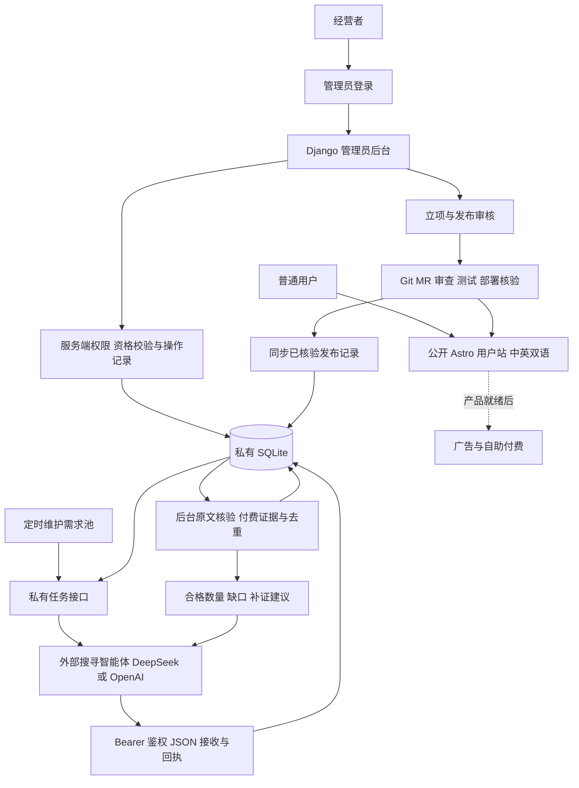

# Creative 自动需求发现与自助工具站完整方案

日期：2026 年 11 月 8 日，Asia/Shanghai。状态：设计提案，尚未实施产品或授权消费。

## 1. 目标、当前状态与本版功能

Creative 面向全球用户提供中英双语自助产品。由外部智能体自动搜寻真实用户愿意付费解决的任务并按协议提交，网站核验后根据证据选择产品、制定方案、开发和上线；不先选一个容易开发的工具再寻找理由。用户不需要主动谈单、报价或提供定制交付。

用户已确认的边界：不限定第一笔收入的时间；取消原每月 ¥300 及所有分项金额上限，只记录实际费用，不购买广告；不设置固定搜索次数限制，达到足够数量的合格需求后停止；当前只接入 DeepSeek 和 OpenAI 的模型；只能基于搜寻到的强付费意愿需求开发；网站初始没有完成任何需求；采用部分免费工具引流、广告收入为主、部分产品自助付费的组合；外部智能体自动提交需求，网站返回校验结果；网站提供独立的管理员页面入口和用户使用页面入口。这些要求不是充值、采购、广告接入或发布授权。

实际仓库目前只有方案和本地配置，没有产品代码，也没有已运行的模型集成。以下是拟开发功能，不代表已经实现。

| 功能 | 本版具体行为 | 初始状态 |
| --- | --- | --- |
| 用户入口 | 中英双语首页、空工具目录、关于、隐私和异步反馈；后续使用已上线免费/付费产品 | 已上线产品 0；不展示演示产品、虚构客户或收入 |
| 管理员入口 | 登录后查看需求与证据、批次回执、搜寻任务、审核、发布状态、费用和操作记录 | 只有经营者账户；需求和产品为空，外部服务未接入时明确提示 |
| 外部智能体协作 | 下发目标与证据规则；智能体自行搜索、整理并自动提交 JSON，网站返回回执和补证要求 | 真实需求库为空，尚未接入外部执行端 |
| 交付校验与付费意愿筛选 | 校验格式、原文、独立性及付费表述，跨批去重；外部结论不直接放行 | 没有证据就保持待补证，不计入合格需求 |
| 需求池与状态管理 | 区分待补证、合格、已批准、开发中、已上线、拒绝和过期 | 已完成需求 0；默认目标是积累 3 条合格待立项需求 |
| 立项材料 | 输出需求证据、竞品实测清单、免费/付费分类、变现假设、成本、最小功能和验收条件 | 不预设图片压缩或其他首个工具 |
| 两家模型范围 | 外部搜寻与网站复核均限定 DeepSeek/OpenAI；网站按需复核与生成立项文案 | 凭据未验证的配置不执行；没有第三家模型入口 |
| 运行与费用报告 | 私有日报展示合格数量、缺口、证据、暂停原因、网站实际费用、外部自报费用及未核对项 | 未调用费用为 0；无法测量的业务数据标记未知 |
| 产品发布后的运营 | 免费工具自然引流与广告、部分产品自助付费；配套实测教程、SEO、推广草稿及分渠道收入核对 | 没有已上线产品时不生成假工具页或启动产品推广 |

本版先交付用户空站、管理员后台、需求接收接口和外部搜寻协作流程；具体工具代码、支付交付和产品推广随首个通过立项的需求另行确定实施范围。外部智能体自动搜寻与整理，网站自动接收、校验、管理候选和生成报告；新工具仍需通过立项、设计、代码审查、回归和发布流程。合格不等于已批准，搜索达标不触发任意代码生成或直接上线。

每周集中查看报告、处理异常及异步反馈。盈利由实际经营数据验证，不是可保证的技术验收结果。

## 2. 仅接入 DeepSeek 和 OpenAI

当前模型允许列表固定为 `deepseek`、`openai`。配置校验拒绝其他模型厂商；本版不实现第三家模型适配、转发路由或插件市场。以后增加厂商属于新的范围变更，不能通过模型自行改配置启用。

| 方案 | 优点 | 代价 | 决定 |
| --- | --- | --- | --- |
| 只启用两家中的一家 | 配置简单，凭据不足时可先运行 | 单家故障时可能暂停 | 允许的运行方式 |
| 两家按任务配置主用及可选备用 | 可按效果、成本和可用性选择 | 需要两种接口的验证 | 本版采用的能力范围 |
| 每条记录默认双模型投票 | 可得到更多判断 | 成本翻倍也不能证明事实 | 不采用；仅对难例进行必要复核 |

| 任务 | 本版可用连接 | 选择依据 |
| --- | --- | --- |
| 外部智能体的搜索与读取 | 执行端使用 DeepSeek/OpenAI 已验证能力及允许的公开来源接口；网站不再运行搜索循环 | 原始来源可追溯性、语言、时效及完整成本 |
| 外部智能体的需求与付费意愿提取 | 执行端使用两家中满足结构化要求的模型，按交付协议提交 | 同一标注样本上的付费证据误判、字段准确率、延迟和成本 |
| 网站的候选复核 | 网站使用两家中已启用的模型，辅助核对外部提交的原文语义 | 复核矛盾、条件付费和引用不清等难例，不默认重复全部请求 |
| 立项草稿与中英文文案 | 两家中通过相应评测的模型 | 原文一致性、可读性及成本 |

具体模型 ID 在实施前按实际账号能力和价格核验；外部执行端须通过接入验收确认所用模型，自报标签不能证明实际调用来源；不预设某品牌必然更便宜或更准确。每个角色指定主用模型及可选备用模型，搜索服务与分析模型可独立组合。DeepSeek 凭据已在本地保存但尚未实测；OpenAI 凭据尚未核验。未配置、无权限或不满足能力的连接保持禁用，不阻塞另一家已验证的连接。

厂商连接仅包含受信地址、协议、模型标识、地区、凭据环境变量名称、能力与价格版本，不保存密钥真值。DeepSeek 的兼容接口与 OpenAI Responses 的工具和结构化参数分别适配，不能假设只换 base URL 即可。备用调用限定在已授权的两家、用途和数据发送范围内；不设金额上限。外部运行环境与网站凭据分别管理，提交需求无需拿到网站模型密钥。项目不会自动继承聊天应用里的插件、账号或权限；若以后确需 MCP，须另行确认服务与用途，不作为本版运行依赖。

已核对能力依据：[OpenAI 工具](https://developers.openai.com/api/docs/guides/tools)、[OpenAI 搜索](https://developers.openai.com/api/docs/guides/tools-web-search)、[DeepSeek Search/Fetch](https://api-docs.deepseek.com/guides/search)。这些是方案依据，不代表已完成集成或付费实测。

## 3. 强付费意愿门槛与开发立项

首个产品暂不确定。此前图片批处理仅有功能诉求，未证明符合下面的付费门槛，故撤销预选；不导入为合格需求，也不预建其页面或业务代码。

### 3.1 合格需求必须同时满足的条件

以下数量和时效是本方案建议的初始筛选值，用户要求的硬原则是必须有强付费意愿证据。运行时不得为了凑足目标而自动降低规则。

1. **任务明确且可自助交付**：说明谁需要什么结果、使用频率和限制；排除主要依赖谈单、长期定制或人工代办的项目。
2. **独立问题证据**：至少 3 位独立用户描述同一核心任务，来自至少 2 个独立原始网站/社区；转载、跨站重复发言、推广软文、同一需求换语言或换标题不重复计数。无法确认独立性时不计数。
3. **直接付费证据**：上述用户中至少 2 位针对这个任务明确表达愿意付费、正在寻找付费解决方案，或已有相关支出但仍有未满足的问题。至少 1 条包含具体预算、可接受价格及其计费单位，或者可定位的现有付费支出。只有“好用就买”等无具体条件的表态不足以通过。
4. **引用与时效可核验**：记录原始 URL、原文片段、作者的来源内标识、发布时间、抓取时间、任务对应关系及付款条件。用于计入门槛的付费证据须在最近 12 个月内，发布时间不明或更旧的仅作背景；合格资格须在最近 30 天内复核。金额、币种、周期或条件不清时保持未知，不由模型补全。
5. **有明确未满足点**：付费陈述确实与同一任务及约束相关，并存在原文支持的不足。模型负责提出解释，程序检查引用，立项时人工复核原文语义、付费者与使用者关系和是否仍有效。

“很多人抱怨”、点赞、搜索量、竞品收费页面、模型评分和单个悬赏均不能独立通过门槛。竞品有收费仅证明存在报价；别人在购买相关工具也不能证明会购买 Creative。原文中的否定、讽刺、附带条件和卖家自述须单独标记，不当作无条件购买承诺。

### 3.2 从合格需求到允许开发

`qualified` 仅表示证据达到强付费意愿筛选规则。进入 `approved` 必须再完成：

- 人工复核所有用于达标的付费证据，确认任务、金额、条件、独立性和时效；不可访问或撤回的证据重新补齐，否则退回待补证。
- 实际检查至少 3 个相关替代方案；不足 3 个时记录搜索范围和未找到原因，检查全部已找到方案。保留版本、日期、定价及实际使用结果，确认至少一个可改善的缺口；不能以模型摘要代替实测。
- 根据第 8 节选择免费或付费产品，并说明依据。两类都估算模型/计算/交付成本及自助流程；免费产品按广告收入为 0 测算实际运行成本和资源消耗，明确可持续运营的假设；不设预算门槛，也不能以预计广告收入抵扣实际支出。付费产品另需与原文相符的价格、收费单位及含支付费用的毛利测算；关键成本未知、无法控制支出或依赖持续人工服务时暂不立项。
- 定义最小功能、明确排除项、验收样例与获客入口；具体工具、技术选择、支付与兼容性改动在此时形成独立方案和开发计划。

只有上述检查通过、证据仍在有效期且立项获批准，才可开始该需求的业务开发。初始平台基础设施不冒充某条已解决需求。免费是变现选择，不是降低证据要求：两类工具都须满足第 3.1 节；没有合格需求时保持空站并继续搜寻或等待，不用免费热点补位。

状态流转为 `candidate → qualified → approved → developing → launched`；可分流为 `rejected` 或 `stale`。只有功能验收、代码审查、回归和生产发布核验均通过才记为 `launched`，并计入“已完成需求”；收款仍单独以真实订单核对。开发前须重新检查证据有效期，批准后过期也不能直接开工。

## 4. 用户入口、管理员入口与系统架构

### 4.1 两类页面与一个机器接口

以下域名是部署位置示意，不代表已注册或上线。本版建议以独立子域区分管理后台，用户站保持双语；本地开发用不同端口模拟对应边界。

| 入口 | 建议位置 | 访问者与内容 |
| --- | --- | --- |
| 用户使用页面 | `https://www.<正式域名>/zh/`、`/en/` | 公开访问；浏览已上线工具、免费使用，按具体产品自助购买与获得交付，查看使用说明和反馈 |
| 管理员页面 | `https://admin.<正式域名>/admin/` | 经营者登录后管理需求、搜寻任务、审核及运营记录；首版中文界面 |
| 外部智能体接口 | `https://api.<正式域名>/api/research/v1/…` | 只接受登记执行端的专用 token；读取任务、提交需求包、查询回执，不提供后台登录权限 |

用户首页页脚可提供“管理后台”链接，链接只到登录入口；链接是否可见不承担安全保护。首版不强制免费用户注册，也不建立通用会员中心；付费身份和订单归属在首个付费产品设计中确定，普通购买者始终没有管理员权限。

用户站初始只有真实介绍、空目录、关于、隐私和反馈；页面显示“暂无已上线工具”。管理员后台初始显示需求 0、合格需求 0、已完成需求 0、产品 0；没有接入的数据源显示“未接入/未知”，不填充模拟收入、订单或流量。初始管理员账户通过服务器私有初始化流程创建，不提供公开注册或默认密码。

### 4.2 管理员后台功能

| 页面 | 本版可操作范围 | 不能绕过的边界 |
| --- | --- | --- |
| 总览 | 查看需求池缺口、待处理批次、服务状态、产品数量、费用及后续实际收入 | 区分未知、自报和已核对；不显示预算额度或超预算暂停 |
| 需求与证据 | 查看原始链接、付费原文、去重关系、验证结论；填写人工复核、竞品与立项记录；退回补证、拒绝或批准 | 原文和机器回执只读；批准前服务端重新检查资格、时效、竞品与验收记录，不能直接编辑状态跳过门槛 |
| 搜寻任务 | 查看执行端反馈；调整目标数量和主题；取消及明确恢复任务 | 不设搜索次数、总时长或费用上限；证据门槛不能为凑数降低；规则变更版本化并做兼容性审查 |
| 提交批次 | 查看接收、验证、部分通过和失败原因；重新验证可恢复项 | 重验保留历史与幂等关系，不因多点几次增加合格数量 |
| 产品与发布 | 查看关联需求、免费/付费方案、开发/测试/发布状态及上线地址；登记待发布审核意见 | 后台批准不等于实际部署，首版不提供任意代码执行或直接将状态改为已上线的按钮 |
| 费用与运营 | 查看网站费用、外部自报费用、核对依据；产品上线后分别看广告/付费收入与使用情况 | 未知费用不计为 0，退款/手续费不重复扣减，匿名事件不能确认为收入 |
| 配置与执行端 | 维护已有两家模型的非敏感路由、查看配置可用状态；登记执行端、生成/轮换/撤销其提交 token | 不提供第三家模型选项；模型/支付/部署密钥不回显、不写入前端；执行端 token 只在生成时显示一次 |
| 操作记录 | 查看谁在何时批准、退回、取消/恢复、修改配置或轮换 token，以及结果与原因 | 不能在普通后台表单中修改/删除审计记录；不记录密码、token 真值或完整业务文件 |

首版建议只设置经营者一个管理员，不建立团队邀请和复杂角色体系。以上用户数量是设计默认值，不是扩展权限的限制；以后新增管理人员须重新明确操作权限。

审批和其他状态变更使用服务端受控操作，关闭相关模型的任意状态编辑、原文覆盖和批量删除。表单提交携带记录版本，服务端事务中检查版本及当前资格；记录已变化时返回冲突并要求刷新，防止旧页面批准已失效证据。动作、前后状态、执行人和时间在同一事务内记入审计记录。管理页面直接请求接口时也执行相同校验，不能只依赖按钮是否可见。

发布仍走 Git/MR、测试和部署核验。公开构建的 `src/data/products.json` 只包含允许公开的产品字段，是用户目录的来源；私有需求、证据和订单不加入该文件。发布流程在实际部署并核验后，通过受控服务端同步命令登记提交/构建标识、产品清单和上线结果，管理员产品页据此显示已上线；同步失败显示“发布待核对”，不按审批记录推算上线。首个产品阶段验证清单、生产页面和后台状态一致，并提供失败回滚流程；后台不能通过填写任意 URL 冒充成功部署。

### 4.3 认证、权限与实现选择

公开用户站继续使用 Astro 静态输出、TypeScript 和 Node.js 24。管理后台与私有 API 改用 Python 3.13 + Django 5.2 LTS，在实施时锁定受支持的修订版本；复用其认证、会话、表单、CSRF 和管理页能力，并为需求审核增加少量专用操作。相比手写登录加 CRUD，这一方案减少需要自行维护的认证代码。官方将 Django admin 定位为可信人员使用的内部管理工具，5.2 支持 Python 3.13。[Django admin](https://docs.djangoproject.com/en/5.2/ref/contrib/admin/)、[5.2 发布说明](https://docs.djangoproject.com/en/5.2/releases/5.2/)

数据库仍为 SQLite，由 Django ORM/迁移统一管理表结构；研究核验保持一个后台工作进程，事务保持短小，不把网络请求放在数据库写锁中。Django 经 Gunicorn 运行，Caddy 提供 HTTPS 和主机/路径分流。当前没有既有产品代码或生产数据库，本次是实施前方案调整；保留外部交付 v1 的路径、JSON 和回执语义，不让换框架破坏执行端协议。

管理后台的所有页面和数据请求均要求有效管理员身份，不允许普通用户或外部 token 访问。使用 Django 的服务端会话和密码哈希机制；不把管理员 token 放入 localStorage。生产会话采用 HTTPS、Secure/HttpOnly 和合适的 SameSite 设置，Cookie 仅作用于管理主机，不共享给用户站/API 子域；登录成功轮换会话，退出和账户禁用后失效，设置空闲及绝对有效期。密码设置/恢复通过私有服务器流程进行，不设置默认口令或公开管理注册。

Django 本身不提供登录尝试限速，实施时补充成熟的登录防爆破组件，按账号与来源短期限制失败尝试，避免永久锁死管理员，并验证恢复流程。管理操作启用 CSRF 防护，只用 POST 等写方法改变状态；研究接口仅凭 scoped Bearer token 鉴权、不回退到 Cookie 认证，只有这些机器端点可以按其鉴权方式单独处理 CSRF，不能全局关闭保护。[Django 安全说明](https://docs.djangoproject.com/en/5.2/topics/security/)

管理员页面不加载广告或第三方统计；研究原文、标题、报告默认转义为文本，不执行 HTML、脚本或提示词。私有响应不进入共享缓存，不加入 sitemap；noindex 仅控制索引，不替代鉴权。非敏感配置与 token 生命周期可通过后台管理，实际模型、支付、部署密钥仍保存在服务器私有配置；只显示“已配置/未配置/待验证”等状态，不回传秘密值。

首版认证矩阵：访客只能访问公开页面；未来付费用户只能访问其订单/权益；管理员会话访问后台受控功能；执行端 token 只能调用分配任务/提交/自身回执。管理会话不能替代执行端 token 调用机器接口，执行端 token 也不能替代管理会话。反向代理分流之外，应用本身继续核验身份、权限与资源归属。

### 4.4 架构与部署

任务、接收、验证和报告都由管理后台可查看；外部智能体仍负责搜索循环，网站仅对已提交原文做核验。先接一个具备定时、HTTP 和持久化进度能力的执行端，不构建智能体市场或分布式调度。

用户静态站可使用 Cloudflare Pages；管理/API 服务和工作进程运行在常开 Linux 实例。域名、服务商、价格及部署授权在实施前确认，本地先验证页面、权限和协议；Mac 休眠期间不保证长期服务。[Pages 限制](https://developers.cloudflare.com/pages/platform/limits/)

此轮新增管理员界面与后台框架，未更改“初始零需求完成量、强付费证据才开发、仅两家模型、免费广告与部分付费、不设预算边界”的要求。

## 5. 外部搜寻与标准化交付

采用用户选择的“外部智能体自动提交，网站返回校验结果”。详细协议位于 [外部智能体需求交付协议](2026-11-08-creative-demand-intake-contract.md)，包括接口、必填字段、示例、幂等、错误码和验收规则。

可选方式比较：人工导入 JSON 改动最少但需要手动操作；HTTPS 自动提交支持无人值守的交付与反馈，是本版选择；让智能体直接写数据库或提交产品代码会混淆数据与发布权限，不采用。

网站每日 08:00（Asia/Shanghai）及需求状态变化后维护当前任务，外部执行端按其调度读取。任务包含主题/语言、完整证据规则及版本、目标/当前数量/缺口和运行状态。主题建议从办公重复任务、电商运营辅助和开发者资料处理开始，种子不是已验证需求。具体查询扩展、来源选择、原文整理与断点搜寻由外部智能体负责。

`target_qualified_needs` 的建议默认值仍为 3，可配置。数量只计网站核验后、最近 30 天资格有效且状态为 `qualified` 的独立需求；已批准、开发、上线、拒绝或过期的记录不占名额。两类变现均需通过第 3 节强付费证据门槛。进入开发链路或失效后产生缺口，再向执行端提供补充任务，不强制每天找同样数量。

外部智能体提交的是候选和证据，不是已经批准的需求。网站结构校验通过后返回 `202` 回执；后台再核对原文、身份独立性、日期、付费条件及跨批重复。外部智能体查询回执，根据待补证原因继续搜索；去重后不足则继续，网站返回 `target_reached` 才停止安排新搜寻。智能体认为“本轮结束”不等于网站认定“目标完成”。

没有固定搜索、抓取、分析次数，没有任务总时长或金额上限；单请求超时、故障有限重试、接口限流及来源访问规则仍保留。任务状态为 `active/target_reached/paused_service/waiting_for_signals/cancelled`。`paused_service` 用于真实账号余额/供应商额度不足、持续故障或执行端不可用，不作为隐藏的费用阈值；无法继续时回执记录原因与恢复条件。

完成当前来源与非重复查询队列后仍无新证据，可以等待新信息窗口；不能无限改写同义词冒充进展。每次接收回执及新搜寻前重读任务状态；已在途结果保留，达标后不再安排新任务。先使用一个登记执行端，同批重试不重复计数，不提前引入多智能体竞抢或分布式调度。

所有提交内容和网页都属于不可信数据，只能成为待核验资料，不能改变系统规则或触发执行代码、购买、发布及读取密钥。外部模型使用范围仍为 DeepSeek/OpenAI，具体执行平台在接入验收前核验；本版没有选定或运行外部服务。

## 6. 数据模型、验证与失败处理

初期研究数据包含以下记录：

- `sources`：原始 URL、服务端抓取/来源日期、作者的来源内标识、原文哈希、证据摘录和截断情况；外部提交值与网站核验值区分保存。
- `needs`：任务、用户、限制、付费证据、金额/币种/周期/条件、已有方案、不足与未知项、网站规范化需求 ID、规则版本、资格时间、立项依据、免费/付费建议及状态。
- `tasks`：目标/当前合格数量/缺口、规则版本、允许的执行端、主题语言、状态与更新时间。
- `batches`：执行端、批次/运行 ID、载荷哈希、接收时间、版本、回执、逐条结果和验证检查点；与网站内部需求 ID 映射。
- `usage`：调用来源是网站或外部执行端、厂商/模型/角色、用量、币种、价格版本、报告/未知/已核对费用及账单依据；不保留预算预留与额度扣减逻辑。
- 管理认证与会话使用 Django 内置表；`audit_events` 保存受控状态操作及操作者，`release_records` 在实际发布后保存核验结果；不与公开产品数据或匿名事件混用。

产品上线后再添加匿名事件与汇总；付费订单另存，不与研究证据或匿名身份混用。

需求包按版本化 JSON Schema 校验，未知字段、非法枚举、超大正文等返回明确错误；正文合法只代表可以接收，不能成为资格结论。输入中的 URL、引用、金额与作者须与重新取得的原文核对；公开付费自述与本站真实订单分开。原文不可获取、独立性无法确认、日期/付费条件未知时不计入门槛。缺失事实保持 null，不让模型补全。

DeepSeek/OpenAI 可协助复核语义和生成报告，但程序控制引用集合、资格计数和状态迁移；开发前仍需人工原文复核。空白、拒绝、截断及格式错误不会放行为证据，单次格式纠正最多 1 次；没有可用模型或来源时保留材料待恢复。[OpenAI 结构化输出](https://developers.openai.com/api/docs/guides/structured-outputs)、[DeepSeek JSON 文档](https://api-docs.deepseek.com/guides/json_mode/)

网站仅安全读取公开 HTTP(S) 来源，核验每次解析与跳转地址，拒绝内网、本机、元数据地址和带凭据 URL，不绕过登录或验证码。外部包按纯文本处理，不能执行其提示或 HTML。认证 token 只有任务读取、候选提交和自身回执读取权限，不授予立项、数据库直连或发布权限。

HTTP 429、超时和部分 5xx 可有限延迟重试，单请求最多 2 次并遵循 Retry-After；持续失败则 paused_service。执行端遇到提交超时，应查询或原样重试同一批次，不另造批次规避幂等。网站用唯一约束、事务、工作进程独占和检查点恢复，保证重复接收与重启不重复计数，也不覆盖已批准/已上线状态。模型调用超时可能已计费，金额保留未知并待账单核对，不当作免费。

初始化数据库和产品清单为空，测试样例隔离。只有显式发布且生产核验通过的产品进入公开目录，外部包永远不能直接发布工具。

原始网页/交付包默认保留 30 天，必要证据摘录、回执与研究元数据保留 180 天；账单依据按实际核算要求另定。私有保存，不公开重发全文。SQLite 一致性备份保留最近 7 份，异机加密备份并验证恢复；这些都有实际费用，记录但不按固定金额暂停。

## 7. 如何推广网站

### 7.1 搜索流量是主渠道

初始空站只展示真实介绍，不发布工具教程、不申请广告或提交“已可用产品”的目录。首个产品通过验收并上线后，才生成对应工具页和少量真实教程。中英版本使用独立 URL，例如 `/en/tools/<slug>/` 和 `/zh/tools/<slug>/`，实现语言切换、各自 canonical、双向和自引用 hreflang、站点地图、可抓取的静态正文。无明确语言偏好时用语言入口作为 x-default；不要按 IP 强制跳转。[Google 多语言文档](https://developers.google.com/search/docs/specialty/international/localized-versions)

初始网站仅有首页、空目录、关于、隐私和反馈入口，明确“暂无已上线工具”；空目录与占位页不加入 sitemap，并设置 noindex，介绍页可按实际内容决定索引。未完成工具没有公开路由，直接访问返回 404；工具上线后才将对应页面加入 sitemap。只有明确独立用途的页面才允许索引，不为参数组合批量造页。私有研究报告和临时预览不发布到公开站点。

产品上线后的工具页标明免费或付费，包含用途、操作步骤、真实限制、适用的价格及交付说明、常见失败原因、隐私说明和自制样例。教程选题来自该产品解决的任务，每篇必须实际操作验证；不提前给尚未实现的能力写使用指南，不虚构对比数据或复制相同内容换关键词。

首个产品上线后验证 Search Console 站点所有权并提交 sitemap；按周读取实际查询、曝光、点击、CTR、页面和地区。搜索数据有延迟且不包含所有查询，只代表本站获授权的数据，不能当作全网搜索量。[Search Console 文档](https://developers.google.com/webmaster-tools/v1/searchanalytics/query)

Google Ads 关键词数据可以作为后续补充，取得所需账号和接口权限前不依赖。广告竞争不是自然排名难度，CPC 不是本站广告收益。趋势指数也不是绝对搜索量。

免费工具承担自然搜索和分享入口：只在任务相关且对应付费产品确已上线时提供清楚的推荐链接。免费任务在声明范围内可独立完成，不在结果生成后临时要求付款，也不强迫点击广告。广告收入来自展示广告，不等于购买广告引流，仍遵守不投放付费广告的既定选择。

### 7.2 低沟通的传播入口

| 渠道 | 做法与频率 | 自动化范围 | 验证指标 |
| --- | --- | --- | --- |
| 自然搜索 | 每周查看查询，改进 1 个关键页面；最多发布 1–2 篇经过实测的原创教程 | 自动发现题目、生成草稿、检查链接与技术 SEO；新页面发布前审查 | 非品牌曝光、有效访问、工具完成次数 |
| 产品内分享 | 分享当前设置和工具 URL，不携带用户业务内容、文件名或其他私有内容 | 用户主动点击后复制链接，分享功能本身可全自动 | 分享按钮使用、带标记访问及处理成功 |
| 自有演示频道 | 每周最多 1 条约 20–45 秒的真实操作录屏，以自制样例数据演示；字幕即可，不必露脸或配音 | 自动生成字幕、封面与发布草稿；取得账号和具体发布授权后再接官方发布能力 | 到站访问及工具使用；不只看播放量 |
| 免费提交的产品目录 | 选择 5 个允许免费自助提交、主题匹配的目录，分别核验规则后一次性提交 | 准备名称、描述、截图等素材；不批量撒链接 | 每个目录的有效引荐访问 |
| 开源仓库展示 | README 展示真实能力、部署链接和自制示例；选择合适许可证后发布代码 | 文档与版本说明可由流水线生成草稿 | 仓库引荐访问及真实问题反馈 |

上表中的产品推广活动全部以实际产品已上线为前提；初始空站阶段只准备素材规范和草稿，不执行这些推广。不购买广告或外链，不发陌生人私信，不批量灌水或刷赞。Show HN 要求可实际体验的作品且作者愿意参与讨论，所以只在用户接受异步交流时作为可选渠道，不纳入默认无人运营计划。[Show HN 规则](https://news.ycombinator.com/showhn.html)

自动化推广的目标是维护可被发现、可被使用的真实产品。新社交账号注册、首次对外发布、向他人发送信息、付费推广不由采集任务自行决定。当前请求仅产出方案，不授权实际发帖、邮件或消息。

### 7.3 内容与素材质量

演示图片使用自制图形、渐变、文字和程序生成的样例；截图来自本项目实际界面。案例不得伪称真实客户，不能把模拟浏览量或样例收益写成实际成绩。评测必须记录工具版本和操作条件。英文与中文各自校对可读性，先确认用户能完成任务，再扩充文案。

## 8. 免费工具引流、广告为主与自助付费

用户已选择组合模式：部分工具免费使用，用于自然引流，以广告作为主要收入方向；另一部分产品采用自助付费。广告为主是经营目标，不预设广告必然获批、能够覆盖成本或一定占收入多数；按实际数据评估，不设未经验证的工具数量比例或收入占比。

### 8.1 如何划分免费与付费

| 类型 | 适合的已验证需求 | 用户体验 | 收入与约束 |
| --- | --- | --- | --- |
| 免费工具 | 有重复使用与自然搜索机会，单次边际成本很低，可在浏览器本地或受控资源内完成 | 在说明的范围内免费完成一个完整任务，清楚展示限制，优先无需注册 | 符合条件后展示广告；低流量或无广告时也要负担得起 |
| 自助付费产品 | 用户明确愿意为具体结果、规模、效率或额外交付付费，价格能覆盖可变成本 | 操作前说明价格、计费单位和交付内容；自助支付、自助交付、异步支持 | 依据需求选择按次、固定额度或一次性购买；付费使用和结账流程默认不放广告 |

免费与付费均须通过强付费证据与立项门槛。强付费证据用于确认问题价值，是否收费属于后续经营选择，不强制每个工具都收费。若一个需求拆出免费工具和付费能力，二者共用原始需求 ID，不重复计入需求池；付费证据还必须覆盖实际收费的增量价值，不能把对免费任务的兴趣套用于另一项收费能力。

优先开发哪一类由有效证据、成本和获客机会决定，不为凑比例强制先做免费或付费产品。免费工具提供完整的约定能力，不把关键结果临时锁在付费墙后。与其相关的付费产品上线后可以推荐，但不能伪装成必选步骤。订阅、预售与付费 API 不预建，只有具体需求支持时才另行设计。

### 8.2 广告启用与免费成本

初始空站不加载广告脚本、不收款、不预售、不展示购买按钮。免费工具上线时可以暂时没有广告；须先具有真实可用功能和经过审查的原创说明，再申请符合经营主体和地区条件的广告服务，例如 AdSense。接入前核验站点和账号资格、页面内容、隐私告知及适用的同意要求，按页面启用；不因“工具上线”自动打开所有广告位。

Google 的资格页面要求自有、符合政策的内容；发布商政策禁止在无内容、低价值、建设中或仅用于导航/提示等页面展示广告，也不允许未经人工审查或整理的自动生成内容投放广告。因此本方案的空目录、未完成产品、错误页、支付及纯状态页默认不放广告；有实际功能也不代表一定通过审核。广告清晰标识，与操作/下载按钮分开，不诱导点击或强制观看。[AdSense 资格](https://support.google.com/adsense/answer/9724?hl=en)、[发布商内容政策](https://support.google.com/publisherpolicies/answer/11112688?hl=en)

广告未获批、被关闭、用户拒绝相关同意或屏蔽广告时，免费工具仍在原声明额度内可用；不绕过拒绝或屏蔽，不自动改为收费。广告仅在必要权限和条件满足时加载，不把点击率作为诱导操作的目标。

免费工具优先避免按访客数发生付费模型调用。确需服务器或模型时，先明确运行资源、技术限流、单位成本和资源不足提示；不能把未知广告收入当作已经覆盖支出。付费调用仍仅限 DeepSeek/OpenAI。未取得真实广告数据前，收入预测记为未知，成本按广告收入为 0 测算；真实资源不足时拒绝新操作并清楚说明，按承诺处理付费交付。资源限流保障可用性，不设置费用阈值，也不是需求搜寻总次数限制。

### 8.3 自助付费交付

初始空站没有付费产品。收费方案须绑定真实需求、付费原文和适用条件，最终成交只认实际订单。免费工具不依赖支付服务开通；只有付费产品进入收款前才启用对应能力。

首个付费产品上线之前，单独完成以下交付关卡：

- 确认经营主体、可用收款地区、结算币种、渠道费用和退款/售后流程；选择支付服务时核实官方要求，不预设任意地区都能开通。成本纳入第 9 节费用记录与立项测算，未具备收款条件时保持测试或预览，不接受订单。
- 明确用户付款后得到什么、使用次数或期限、交付限制；展示价格、条款和异步支持入口。按次或额度产品的成功交付、失败补偿规则必须可执行。
- 采用托管支付页面，由服务端验证支付结果；订单创建时由服务端确定产品、金额与币种，支付通知验签并幂等核对。支付成功跳转页和匿名埋点均不能直接授予权限。交付/下载凭证绑定订单且防重放，退款后的权限和额度按已披露规则处理。
- 根据实际产品决定服务端能力或数字交付，说明静态资源的访问和再分发限制；不将“前端隐藏按钮”作为付费保护。支付与交付代码仅在该产品设计获准后添加，不强行让所有未来产品套一个收费框架。
- 覆盖成功、失败、取消、重复与乱序通知、超时后补记、退款、交付失败和权限恢复测试；保留可核对账本，不将未经结算的意向金额记为收入。

可以提供有限演示或试用以降低使用门槛，但具体范围随产品成本确定。自助支付避免销售谈判，仍须提供 FAQ 和异步反馈，处理错误结果、退款及服务异常；不承诺零维护。

### 8.4 分别核算效果

分别记录免费工具有效使用量、广告实际收益与付费产品实际成交、退款和交付成本。广告点击或匿名埋点不直接记作收入；付费成功也不依赖匿名统计。广告报表的估算值与最终结算值分开，无法归属到单个产品的收入/成本保留为站点级，不强行拆分出虚假的单工具利润。

经营净现金流以实际结算广告收入＋实际结算付费收入，扣除退款、渠道费、模型/采集、服务器/备份、交付和其他必要支出计算；避免对已扣手续费的净结算再次扣费。税务按实际主体与所在地核验。广告为主的目标不能代替经营数据，强付费意愿也不保证本站成交。至少连续 3 个月实际经营净现金流为正且有增长证据，才评估扩展规模。

## 9. 费用记录，不设置预算边界

按用户最新要求，取消原每月 ¥300 总额、模型/搜索 ¥80 分项、每日 ¥3 提醒阈值、70%/90%预算通知及预算用尽暂停；不设每月、每日、单任务或单厂商金额上限。不以隐含 token 总量、搜索总次数或固定任务总时长替代费用上限，删除费用预留、可用预算扣减和 `paused_budget` 状态。

仍保留实际费用核算：外部智能体的模型、搜索/抓取和平台运行费用；网站的原文验证、模型复核、托管/域名、备份、广告所需服务、支付/交付和其他必要支出。供应商价格、汇率及报告日期明确记录，实际用量或金额未知时标为未知，不能默认 0。

外部执行端直接使用自己的私有配置调用服务，网站不为预算控制代理其模型/搜索。它提交的费用标记为自报，待供应商账单核对；网站自己的已确认费用独立记录。合并核算须避免同一调用被执行端报告和供应商账单双计；只有覆盖完整且已核对才宣称掌握全项目成本。

没有金额边界不等于没有供应商限制。余额不足、API 配额、网络或来源访问问题仍会使任务暂停并说明实际原因，恢复后继续；正常完成条件仍为网站验收后的需求目标。单请求输出长度、超时、错误重试及接口并发/速率控制属于技术保护，不构成研究总量或费用配额。

取消预算限制仅是本轮设计要求，不自动开通服务、购买机器、升级套餐、授权充值或启动真实收费 API 调用。实施前按选定服务确认账号、用途、接入及部署授权；不把此前保存的密钥当作已经验证可用或自动充值许可。

经营报告分开列示广告/付费收入及实际成本，用于判断是否继续或改变方向。继续经营和扩展规模由实际证据与经营者决定，不再以固定预算阈值自动停止。

## 10. 实施阶段与验收

先完成用户空站、管理员入口和需求接收基础能力，并接入一个外部搜寻执行端，再由实际验收结果决定业务开发。设计通过后编写逐任务实施计划；没有达到付费门槛时，阶段 A/B 可以完成，阶段 C/D 不得通过假需求启动。

| 阶段 | 交付 | 通过条件 |
| --- | --- | --- |
| A 双入口与真实初始状态 | 双语用户站、管理员登录与后台、空目录/数据库/发布清单 | 真实需求、合格需求、已完成需求及产品均为 0；测试样例隔离；没有默认工具、购买按钮或假收入；未上线路由 404，空目录 noindex 且不入 sitemap；候选不能进入公开目录；未登录/非管理员/执行端 token 不能读取管理数据；会话注销、过期、CSRF、登录限速和秘密不回显通过验收 |
| B 外部搜寻与自动接收 | 任务/提交/回执接口、版本化 JSON、原文核验、两家模型可选复核与私有报告 | 按交付协议完成鉴权、幂等、格式、跨批去重、假证据、付费门槛、部分通过、故障恢复和达标停止验收；至少 30 条隔离标注样本覆盖明确/弱/条件/否定/重复/过期证据，核心字段准确率≥90%，门槛不足样例全部不进入合格池；验证外部执行端一次完整往返；后台审核不绕过硬门槛，旧版本审批冲突可诊断，取消/恢复与审计一致；没有金额阈值暂停，外部费用未知不能记为 0 |
| C 首个需求立项 | 当前有效付费证据、原文复核、竞品实测、免费/付费分类及依据、成本、产品方案和计划 | 第 3 节全部通过并获批准，才允许开发业务功能；不预先指定图片工具或任何产品；无合格需求时等待而非造数据 |
| D 首个产品开发与发布 | 仅实现获批准的需求；免费能力或收费与交付按产品设计 | 最新主线新分支、兼容性审核、代码审查与回归；功能、真实浏览器/设备、隐私及适用安全验收通过；免费产品验证无广告、拒绝相关同意、广告加载失败和资源保护路径，付费产品通过第 8 节收款/交付关卡；产品上线与广告启用分开验收，广告默认关闭且只在满足条件的页面加载；生产核验后才计为已完成并公开展示；后台审批不等于上线，实际产品清单、生产页面和同步发布记录一致，失败回滚可验证 |
| E 推广与收入核对 | 实测教程、免费引流、广告资格/内容核验、推广草稿、匿名统计和两类收入账单 | 仅推广已上线产品，第三方发布获得相应授权；统计注明覆盖范围；广告报表与实际订单分别核对收入，不把付费表态、埋点或点击当作成交；广告未获批不阻塞已可承担成本的免费工具上线 |

实际模型 API 调用须有对应凭据、账号可用性和消费授权；配置支持两家不等于两家都已实测。公开发布需要确认域名、托管及实际费用；接口和校验规则可先离线验证，自动搜寻需外部执行端实际接入。

每次代码变更先更新远程主线并建立开发分支；当前本地只有文档提交，远程主分支尚未初始化，也不存在可拉取的 master。首次实施时建立 master 并按实际远程状态核验，不能假装拉取不存在的分支。兼容性变更在实施前单独审查；完成后代码审查、回归，并通过 Git 创建 MR/PR 集成。本次仅修订文档，不执行产品开发。

单次测试不超过 10 分钟，长检查拆分；如未来引入 Go，调试使用 CGO_ENABLED=0。浏览器与付费证据回归使用自制素材或标注的隔离样例，不将模拟数据写入生产。

## 11. 需要新增或修改的文件

本轮修改主设计文档中的双入口、权限、架构与文件职责，并同步外部交付协议的权限边界；仓库另有 `.gitignore` 与被忽略、权限 0600 的 `.env.local`，不增加产品代码或新厂商密钥。

第一阶段拟新增的最小文件结构（路径为实施计划输入，尚不存在产品代码）：

| 文件 | 职责 |
| --- | --- |
| `README.md`、`.env.example` | 中文双入口与启动说明；仅私有配置变量名称占位，包含管理员初始化说明，不含默认密码 |
| `package.json`、锁文件、`astro.config.mjs` | 用户站构建与静态路由 |
| `src/pages/[lang]/index.astro`、`src/pages/[lang]/tools/index.astro` | 用户首页、初始空目录及管理登录入口链接 |
| `src/pages/[lang]/[page].astro`、`src/lib/i18n.ts` | 关于、隐私、反馈及中英文文案 |
| `src/data/products.json` | 初始空数组；仅公开产品字段，需求证据及私有绑定不进入前端构建 |
| `public/robots.txt`、sitemap 配置 | 仅真实公开页面可索引，管理站不收录 |
| `backend/pyproject.toml`、锁文件、`backend/manage.py` | Django、Gunicorn 及实际需要的安全/校验依赖与管理命令入口 |
| `backend/config/settings.py`、`urls.py`、`wsgi.py` | 主机/路由、管理认证与会话、机器接口隔离、环境配置 |
| `backend/research/models.py`、`migrations/` | 任务、需求、批次、证据、费用、执行端、审计和发布核验记录，统一由 ORM 迁移管理 |
| `backend/research/admin.py`、`forms.py`、`templates/admin/` | 管理页面、只读证据、受控审批/任务操作、总览与费用展示 |
| `backend/research/views.py`、`auth.py` | 外部任务/提交/回执 v1 接口及 scoped token 鉴权；不接受管理 Cookie 替代 |
| `backend/research/services.py`、`qualification.py` | 状态迁移、版本冲突、幂等、审核硬门槛和事务内审计，供页面与任务统一调用 |
| `backend/research/fetch.py`、`model_clients.py` | 原文安全读取及必要的 DeepSeek/OpenAI 复核 |
| `backend/research/management/commands/` | 定时维护任务、领取/恢复验证、费用核对；首个产品发布时增加受控发布结果同步 |
| `schemas/demand-batch.v1.schema.json` | 保持现有交付 v1 的 JSON 契约 |
| `config/research.json`、`config/providers.json` | 主题、目标、证据规则及仅两家模型的非敏感配置；管理修改须版本化 |
| `deploy/Caddyfile` | 用户/管理/API 主机和路径分流、HTTPS；不能代替应用权限校验 |
| `tests/` | 双入口、权限/会话/CSRF、审核冲突/审计、交付幂等、证据门槛、恢复与发布一致性 |
| `.github/workflows/ci.yml` | 用户站构建、后台检查、必要测试及密钥检查，部署按批准流程绑定 |

原计划的零散 `jobs/intake.py`、`jobs/db.py` 等未实现，现由 Django 应用和管理命令承担；这不是对已有生产代码的迁移。首个需求立项后再增加具体工具、教程、支付交付、匿名统计和默认关闭的广告组件，避免提前编写未知业务。

`data/` 保存私有 SQLite、原文、备份和报告，已忽略；生产候选、订单和测试样例不混用。依赖或构建目录的忽略规则随工具链补齐。

## 12. 运营指标、停止条件与自动化边界

初始空站只在私有后台记录外部任务、接收/验证进度与费用；没有产品就没有产品使用量或订单，未知访问量不伪装为 0 次实测。首个产品上线后区分免费/付费，才按其实际任务记录有效访问、开始、成功、失败、取消及适用的交付动作和成本。普通浏览器下载链接无法确认用户最终保存成功，因此“下载已触发”只表示网站发出了下载动作，不称为“下载完成”。托管侧访问日志只补充到站情况，不能替代产品事件。

产品上线后的统计复用现有任务服务器，通过 `https://metrics.<正式域名>/events` 接收匿名事件；统计功能本身不新增付费平台或登录系统；产品的付费身份与交付认证另按产品设计。前台仅在隐私审核完成且取得适用同意后启用，用户拒绝时工具仍正常工作。请求不携带 Cookie、不设置持久用户标识，不上传用户业务内容、文件名、完整页面查询串、完整 referrer、邮箱、密钥或提示原文。

事件字段固定为：随机 `event_id`、当前操作的随机 `run_id`（浏览器内存中保留，非用户 ID）、事件类型、工具名、`en/zh` 语言、渠道、预定义错误码与耗时区间。处理型工具的事件类型限于 `tool_view`、`process_started`、`process_succeeded`、`process_failed`、`process_cancelled`、`download_triggered`；只接入该产品实际存在的事件，不给没有下载能力的产品制造下载统计。若首个产品不是处理型工具，在其设计中定义对应的开始与成功终态并审查后接入。渠道仅允许 `organic/direct/youtube/directory/github/other`，由入口链接标记或来源域名归类后传输，未知来源归 `other`；同一页面操作沿用内存中的渠道，不做跨设备或持久用户归因。服务器生成接收时间。

接口只接受 HTTPS、POST 和必要的 OPTIONS；请求体最多 4 KiB，字段和枚举严格校验，固定允许的网站 Origin，事件 ID 去重。CORS 不是身份认证，匿名事件也可能被伪造，因此不用于财务结算或自动开通服务。设置每分钟最多 300 条、每天最多 10000 条的全局接收上限并记录丢弃计数，不返回私有统计；查询报告只通过认证后的管理员入口或服务器私有访问。反向代理及应用不保存客户端 IP、完整请求正文和 referrer。该接口的资源、域名子域和备份计入实际成本；上线时验证容量，资源不足时限流并报告，不自动采购或升级。

原始匿名事件保留 30 天、每日聚合数据保留 180 天。使用随机 run_id 关联开始与终态；重复事件不重复计数，矛盾终态标记异常。成功率定义为成功次数 /（成功次数＋失败次数），同时单列取消、缺失终态及各类失败；终态覆盖率为（成功＋失败＋取消）/开始。最近 7 天完整尝试不足 100 次，或终态覆盖率低于 95%，均不宣称达到成功率目标。满足样本和覆盖要求后，目标成功率≥95%。同意统计的用户可能存在样本偏差，报告明确注明范围，不能外推为全站所有用户。

统计未就绪、同意机制未就绪或数据被限流严重影响时，继续提供可用工具，只报告可核对的访问与成本；处理成功率和渠道转化标记为“无法测量/数据不完整”，阶段 E 的归因验收暂不通过。产品发布阶段必须验证同意和拒绝两条路径，以及成功、失败、取消、重复、缺失终态与渠道关联。

每周固定检查 30 分钟作为运营目标，出现错误、隐私事件或服务中断时实际时间可能增加。低维护来自小范围功能、清楚的限制和可靠错误处理，不承诺零人力。

- 首个产品上线后运行 30 天：检查技术质量和是否可被索引，避免过早用收入评判。
- 首个产品上线后运行 60–90 天：在确认收录和测量正常后，若几乎没有目标访问，重新评估关键词、产品差异与推广渠道，暂停扩充工具。
- 有访问但使用率低：改说明、加载速度和交互；有开始却频繁失败：先修工具；免费使用多但广告收入低：检查实际资格、覆盖与成本，不通过增加误触获利；付费产品有使用却无购买：检查价格、交付价值和支付失败。免费使用没有购买不是天然失败，不把它与付费漏斗混算。
- 连续 3 个月没有形成可观察的使用改善或收入证据：报告问题并评估是否换方向，保留已售权益；不以金额阈值自动停止搜寻。
- 连续 3 个月实际净现金流为正且有明确增长需求，再评估扩展规模；不自动采购新服务。

可自动执行：外部智能体在已配置权限内搜寻/整理/提交；网站接收、核验、反馈、报告及批准范围内的回归检查。首次产品立项、设计、兼容性改变、首次发布、对外推广、服务采购、广告启用和收费/数据收集变更按相应审批执行；后续已批准版本可按部署流程自动发布。任何流程不得跳过强付费意愿门槛，也不能把“已批准”直接展示为“已完成”。

## 13. 凭据与上线前关卡

凭据已按用户要求放在本地 `.env.local`，仅用户可读且被 Git 忽略。原密钥曾通过聊天发送，建议在供应商后台轮换；新的部署使用专用 key。密钥不出现在前台环境变量、构建产物、公开文档、截图、日志、测试快照或 PR 中。

运行环境从服务器私有环境配置读取 key。公开仓库只包含占位 `.env.example`。本方案未调用付费模型或搜索接口，也未充值、建云资源或发布推广内容。

网站与外部执行端分别使用私有凭据；只接入 DeepSeek/OpenAI 模型，公开配置只引用变量名称。执行端向网站提交时使用独立的 scoped token，不传模型密钥。允许列表以外的模型连接一律拒绝；新增第三家须变更方案。仅填写模型名称不表示有访问权，未配置或未验证的连接不进入自动主备路由。

外部关卡包括：实际 API 账户与模型可用性、外部执行端定时与 HTTP 能力、价格和汇率记录、运行地网络、域名与托管账户、广告服务资格，以及仅付费产品所需的商户与收款条件。失败时对应阶段停止并给出原因；不绕过访问限制、不自动充值或开通服务。空站、需求雷达及成本可控的免费工具不依赖广告或支付获批；展示广告需对应资格和页面条件，付费产品收款需实际收款与交付能力。

## 14. 可行性审查记录

此前独立审查已确认：初始空站不造数据；只允许 DeepSeek/OpenAI；强付费证据、立项和已上线状态分开；免费广告与自助付费可以并行，广告与收款分别验收。

本轮用户选择外部智能体自动提交并接收校验反馈，同时取消预算边界。主方案改为网站提供任务/交付/回执接口，外部执行搜索循环，网站保留原文核验、去重与开发门槛；新增独立交付协议。历史 ¥300 总额、分项上限、费用预留和预算暂停规则全部撤销，不作为现行验收要求。

仍需接入时确认具体执行端的定时/HTTP/持久化能力、实际模型来源、真实费用报告和网站验证可获得的来源内容。明确接口并不等于已连接某个平台。实际付费意愿、成本、广告资格及成交仍需按各阶段验证。

本轮只修改设计，未实现页面或接口、连接外部智能体、开始真实搜寻、购买或部署。上轮独立复审已通过外部交付闭环、幂等与去重、原文核验和预算边界撤销。

双入口修订的独立复审结论：无阻塞性问题，可以进入实施计划。已检查管理员会话、执行端 token 和未来付费身份的权限隔离，服务端资格/版本检查与审计，实际部署核验后的发布同步，敏感数据不进入公开构建，以及 Django 替换未实现的手写后台时保留交付 v1 兼容性。实际权限、CSRF、登录防护、并发审批及发布回滚仍须实施后验收；本次未执行这些运行测试。
