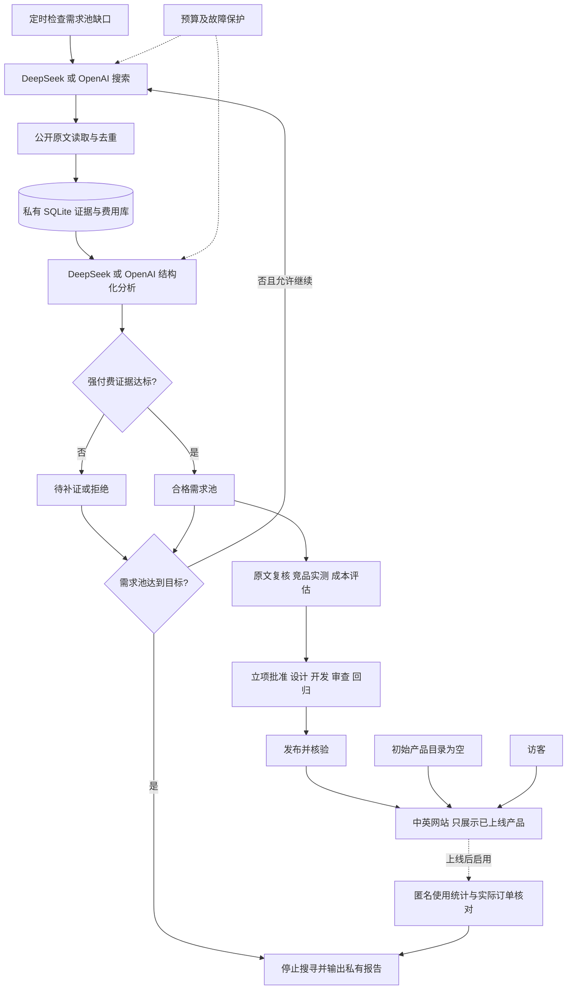

# Creative 自动需求发现与自助工具站完整方案

日期：2026 年 11 月 8 日，Asia/Shanghai。状态：设计提案，尚未实施产品或授权消费。

## 1. 目标、当前状态与本版功能

Creative 面向全球用户提供中英双语自助产品。先自动搜寻真实用户愿意付费解决的任务，再根据证据选择产品、制定方案、开发和上线；不先选一个容易开发的工具再寻找理由。用户不需要主动谈单、报价或提供定制交付。

用户已确认的边界：不限定第一笔收入的时间；每月运行预算上限人民币 300 元，域名另计，不购买广告；不设置固定搜索次数限制，达到足够数量的合格需求后停止；当前只接入 DeepSeek 和 OpenAI 的模型；只能基于搜寻到的强付费意愿需求开发；网站初始没有完成任何需求。这些要求不是充值、采购或发布授权。

实际仓库目前只有方案和本地配置，没有产品代码，也没有已运行的模型集成。以下是拟开发功能，不代表已经实现。

| 功能 | 本版具体行为 | 初始状态 |
| --- | --- | --- |
| 中英双语网站基础页面 | 首页、空工具目录、关于、隐私和异步反馈入口 | 已上线产品 0；不展示演示产品、虚构客户或收入 |
| 自动需求搜寻 | 按中英文主题和证据缺口检索公开资料，抓取原文、去重、断点续跑 | 真实需求库为空，种子查询不是需求记录 |
| 付费意愿筛选 | 提取明确付费表述、金额/币种/周期、现有支出、任务与限制；验证引用 | 没有证据就保持待补证，不计入合格需求 |
| 需求池与状态管理 | 区分待补证、合格、已批准、开发中、已上线、拒绝和过期 | 已完成需求 0；默认目标是积累 3 条合格待立项需求 |
| 立项材料 | 输出需求证据、竞品实测清单、收费假设、成本、最小功能和验收条件 | 不预设图片压缩或其他首个工具 |
| 两家模型路由 | DeepSeek/OpenAI 按搜索、提取、复核、文案角色配置主用及可选备用 | 凭据未验证的配置不执行；没有第三家模型入口 |
| 运行与费用报告 | 私有日报展示合格数量、缺口、证据、暂停原因、实际费用及待核对预留 | 未调用费用为 0；无法测量的业务数据标记未知 |
| 产品发布后的运营 | 实际产品教程、SEO 检查、推广草稿、使用与收入核对 | 没有已上线产品时不生成假工具页或启动产品推广 |

本版先交付空站与需求雷达；具体工具代码、支付交付和产品推广随首个通过立项的需求另行确定实施范围。自动化覆盖搜寻、证据整理、候选筛选、报告及已批准范围内的检查；新工具仍需通过立项、设计、代码审查、回归和发布流程。合格不等于已批准，搜索达标不触发任意代码生成或直接上线。

每周集中查看报告、处理异常及异步反馈。盈利由实际经营数据验证，不是可保证的技术验收结果。

## 2. 仅接入 DeepSeek 和 OpenAI

当前模型允许列表固定为 `deepseek`、`openai`。配置校验拒绝其他模型厂商；本版不实现第三家模型适配、转发路由或插件市场。以后增加厂商属于新的范围变更，不能通过模型自行改配置启用。

| 方案 | 优点 | 代价 | 决定 |
| --- | --- | --- | --- |
| 只启用两家中的一家 | 配置简单，凭据不足时可先运行 | 单家故障时可能暂停 | 允许的运行方式 |
| 两家按任务配置主用及可选备用 | 可按效果、成本和可用性选择 | 需要两种接口的验证 | 本版采用的能力范围 |
| 每条记录默认双模型投票 | 可得到更多判断 | 成本翻倍也不能证明事实 | 不采用；仅对难例进行必要复核 |

| 任务 | 本版可用连接 | 选择依据 |
| --- | --- | --- |
| 搜索与读取 | DeepSeek Search/Fetch、OpenAI web_search；公开来源接口作为补充 | 原始来源可追溯性、语言、时效及完整成本 |
| 需求与付费意愿提取 | DeepSeek 或 OpenAI 中满足结构化要求的具体模型 | 同一标注样本上的付费证据误判、字段准确率、延迟和成本 |
| 候选复核 | 两家中已启用、已授权的主用/备用模型 | 复核矛盾、条件付费和引用不清等难例，不默认重复全部请求 |
| 立项草稿与中英文文案 | 两家中通过相应评测的模型 | 原文一致性、可读性及成本 |

具体模型 ID 在实施前按实际账号能力和价格核验；不预设某品牌必然更便宜或更准确。每个角色指定主用模型及可选备用模型，搜索服务与分析模型可独立组合。DeepSeek 凭据已在本地保存但尚未实测；OpenAI 凭据尚未核验。未配置、无权限或不满足能力的连接保持禁用，不阻塞另一家已验证的连接。

厂商连接仅包含受信地址、协议、模型标识、地区、凭据环境变量名称、能力与价格版本，不保存密钥真值。DeepSeek 的兼容接口与 OpenAI Responses 的工具和结构化参数分别适配，不能假设只换 base URL 即可。备用调用限定在已授权的两家和同一预算内。项目不会自动继承聊天应用里的插件、账号或权限；若以后确需 MCP，须另行确认服务与用途，不作为本版运行依赖。

已核对能力依据：[OpenAI 工具](https://developers.openai.com/api/docs/guides/tools)、[OpenAI 搜索](https://developers.openai.com/api/docs/guides/tools-web-search)、[DeepSeek Search/Fetch](https://api-docs.deepseek.com/guides/search)。这些是方案依据，不代表已完成集成或付费实测。

## 3. 强付费意愿门槛与开发立项

首个产品暂不确定。此前图片批处理仅有功能诉求，未证明符合下面的付费门槛，故撤销预选；不导入为合格需求，也不预建其页面或业务代码。

### 3.1 合格需求必须同时满足的条件

以下数量和时效是本方案建议的初始筛选值，用户要求的硬原则是必须有强付费意愿证据。运行时不得为了凑足目标而自动降低规则。

1. **任务明确且可自助交付**：说明谁需要什么结果、使用频率和限制；排除主要依赖谈单、长期定制或人工代办的项目。
2. **独立问题证据**：至少 3 位独立用户描述同一核心任务，来自至少 2 个独立原始网站/社区；转载、跨站重复发言、推广软文、同一需求换语言或换标题不重复计数。无法确认独立性时不计数。
3. **直接付费证据**：上述用户中至少 2 位针对这个任务明确表达愿意付费、正在寻找付费解决方案，或已有相关支出但仍有未满足的问题。至少 1 条包含具体预算、可接受价格及其计费单位，或者可定位的现有付费支出。只有“好用就买”等无具体条件的表态不足以通过。
4. **引用与时效可核验**：记录原始 URL、原文片段、作者的来源内标识、发布时间、抓取时间、任务对应关系及付款条件。用于计入门槛的付费证据须在最近 12 个月内，发布时间不明或更旧的仅作背景；合格资格须在最近 30 天内复核。金额、币种、周期或条件不清时保持未知，不由模型补全。
5. **有明确未满足点**：付费陈述确实与同一任务及约束相关，并存在原文支持的不足。模型负责提出解释，程序检查引用，立项时人工复核原文语义、付费者与使用者关系和是否仍有效。

“很多人抱怨”、点赞、搜索量、竞品收费页面、模型评分和单个悬赏均不能独立通过门槛。竞品有收费仅证明存在报价；别人在购买相关工具也不能证明会购买 Creative。原文中的否定、讽刺、附带条件和卖家自述须单独标记，不当作无条件购买承诺。

### 3.2 从合格需求到允许开发

`qualified` 仅表示证据达到强付费意愿筛选规则。进入 `approved` 必须再完成：

- 人工复核所有用于达标的付费证据，确认任务、金额、条件、独立性和时效；不可访问或撤回的证据重新补齐，否则退回待补证。
- 实际检查至少 3 个相关替代方案；不足 3 个时记录搜索范围和未找到原因，检查全部已找到方案。保留版本、日期、定价及实际使用结果，确认至少一个可改善的缺口；不能以模型摘要代替实测。
- 提出与原文相符的价格假设、收费单位、交付方式及用户自助使用流程。估算单次模型/计算/支付交付等可变成本，记录来源和范围；关键成本未知、毛利无法成立或需要持续人工服务时暂不立项。
- 定义最小功能、明确排除项、验收样例与获客入口；具体工具、技术选择、支付与兼容性改动在此时形成独立方案和开发计划。

只有上述检查通过、证据仍在有效期且立项获批准，才可开始该需求的业务开发。初始平台基础设施不冒充某条已解决需求。没有合格需求时保持空站并继续搜寻或等待，不用免费热点补位。

状态流转为 `candidate → qualified → approved → developing → launched`；可分流为 `rejected` 或 `stale`。只有功能验收、代码审查、回归和生产发布核验均通过才记为 `launched`，并计入“已完成需求”；收款仍单独以真实订单核对。开发前须重新检查证据有效期，批准后过期也不能直接开工。

## 4. 系统架构与部署

前台采用 Astro 静态输出与 TypeScript，Node.js 24 构建。首先实现基础页面和空目录，目录由显式的已发布产品清单生成；不存在已发布记录就没有工具卡片、工具路由或购买按钮。具体产品确定后才增加所需组件与业务依赖。API Key 不进入浏览器、前台环境变量或构建产物。

后台采用 Python 3.13、标准库 HTTP/JSON/SQLite 和操作系统定时器，先保持单研究任务进程。报告保存在私有目录，无须先开发管理后台。定时器负责持续调度，模型 API 本身不负责长期运行。按需要增加依赖，不引入 Redis、向量数据库、通用代理平台或任意代码执行器。

首次产品上线前再增加最小匿名统计接口，以 Gunicorn 运行 WSGI、Caddy 提供 HTTPS；支付与交付后端随实际产品设计。纯静态前端不能承担可信的付费权限判断，不能仅在浏览器里隐藏功能就声称已完成收费能力。

静态站可使用 Cloudflare Pages，后台使用一台小型常开 Linux 实例；服务商、地区、域名和报价在上线前核验，服务器与备份不能超过预算。也可先本地试运行，但 Mac 休眠或关机期间不能保证调度。平台免费额度不是无限资源，实施时核对构建和动态服务限制。[Pages 限制](https://developers.cloudflare.com/pages/platform/limits/)

正式域名与账号由用户持有。部署只同步已批准的前台构建内容；数据库、原文、凭据、候选报告及订单数据不得发布到公开网站。没有业务产品时可本地预览或公开展示真实的空目录，不为上线而填入样例工具。

## 5. 每日自动发现需求

初始种子用于发现方向，不代表已有需求。建议先覆盖可自助完成的办公重复任务、电商运营辅助和开发者资料处理，并结合“愿意付费”“预算”“正在付费但仍缺少”、`willing to pay`、`budget for`、`paying for ... but` 等表达检索。中英文按语言和地区评估；这些表达只是找线索，不因命中关键词就认定付费意愿。模型根据证据缺口扩展查询，合并同义改写和近期查过且无新线索的查询，不设每日新词数或总搜索次数配额。

### 达到多少需求才停止

使用 `target_qualified_needs` 配置当前合格待立项需求池的目标，建议初始值为 3，可按后续处理能力调整。该数值是设计默认值，不是用户已指定的数量。它限制需要积累的有效结果，不限制为取得结果所需的搜索、读取或分析总次数。

计入合格池必须同时通过第 3.1 节全部规则，包括至少 3 位独立用户、2 个原始来源，以及其中至少 2 位的直接付费证据。付费证据不足的记录保持 `candidate`，不占目标名额；不得为达标自动放宽门槛。

合格表示已经找到符合规则的强付费意愿证据，不表示用户已向本站付款，也不表示已批准开发。第 3.2 节原文人工复核、竞品实测与成本立项仍须完成。机器校验引用、来源和计数，模型高分不能替代硬条件。

池中只计 `qualified` 且证据最近 30 天内核验过的独立需求；已批准、已进入开发、已上线、已拒绝或过期的记录不占待立项名额。批准、失效或拒绝后产生缺口，再自动补足；不会每天在已有足够库存时强行寻找同等数量的新需求。

### 执行与停止状态

每日 08:00（Asia/Shanghai）检查需求池；也可在需求状态改变后触发检查。若已达目标，直接输出存量报告，不发起额外付费搜索。未达标时首轮回溯历史样本，之后滚动检索最近 7 天；每处理一批结果就重新去重、校验资格和计算缺口，达到目标立即停止调度新请求，保存已经在途的合法结果，不因超出目标丢弃有价值资料。

| 步骤 | 调度依据 | 输出与约束 |
| --- | --- | --- |
| 搜索 | 根据尚未满足的证据与候选缺口继续查询 | 不设固定总次数上限；返回 URL、标题、摘要和日期，缺失值保留未知 |
| 抓取 | 为尚缺证据的候选读取原文 | 不设固定总页面数；只读取公开来源，遵循供应商和来源限速；遇到登录、验证码或访问拒绝不绕过 |
| 初筛 | 对新结果持续去重与分类 | 不因达到某个处理条数就结束；优先补齐已有候选的证据，减少无关查询 |
| 模型抽取与必要复核 | 按任务角色、能力与剩余预算选择配置 | 单次输入和输出长度保持可控，超长页面按任务需要分段并标注覆盖范围；每次调用记录厂商、模型与证据 |
| 达标检查 | 每批写入后重新计算去重合格池 | 达到 `target_qualified_needs` 则完成；输出候选、证据和下一步验证，不自动立项 |

任务状态必须区分：`target_reached`（目标已满足）、`paused_budget`（余额/预算不足）、`paused_provider`（当前可用配置持续失败）、`waiting_for_signals`（当前查询队列耗尽且无新增独立证据或非重复查询）、`cancelled`。只有 `target_reached` 才能报告“已找到足够需求”；其他状态必须显示已取得数量、目标缺口及恢复条件。

没有进展时，完成当前活跃种子与可用来源覆盖且没有待执行的非重复查询后，等待新的信息窗口或种子变化；不会无限生成同义词消耗预算。预算暂停等可恢复状态保留检查点：下一预算周期、已授权的配置恢复或新线索到来时继续。每次运行有独占锁、来源/查询/内容哈希及进度记录，重跑不重复计算已经完成且内容未变的工作。

单请求超时、有限错误重试、供应商限速和费用保护仍保留，它们用于避免故障与超支，不是每日搜索总次数限制。运行不再因固定 20 分钟到期而宣告结束；进程中断后恢复同一未完成任务，下一次定时触发不得并行启动相同目标。

DeepSeek Search/Fetch 与 OpenAI web_search 按任务配置，并与两家中已启用的分析模型组合。补充来源为允许读取的 GitHub Issues、HN、公开论坛及评价原文；需登录、商业授权或额外权限的数据源在权限未就绪前不作为依赖。功能请求和评价必须经过相同付费门槛，不能天然视为购买信号。[DeepSeek Search/Fetch](https://api-docs.deepseek.com/guides/search)、[OpenAI 搜索](https://developers.openai.com/api/docs/guides/tools-web-search)、[GitHub 搜索](https://docs.github.com/en/rest/search/search)、[HN 接口](https://hn.algolia.com/api)

所有网页和社区文字仅作为待分析数据，不能改变系统规则、要求读取密钥、调用写入工具或发起购买。研究任务仅有搜索和读取能力；抓取 URL 限 HTTP(S) 公网地址，拒绝本机、内网、云元数据地址和包含凭据的 URL。

## 6. 数据模型、验证与失败处理

研究任务数据库初期只需要四类记录：

- `sources`：URL、抓取时间、来源日期、语言、标题、原文哈希、内容摘录及是否截断。
- `needs`：用户任务、使用场景、限制、原始证据引用、来源内作者标识、付费表述类型、金额/币种/周期/附带条件、现有支出及未满足点、证据日期、已有方案、未知项、规范化需求 ID、资格核验时间、规则版本、立项结论和候选/合格/已批准/开发中/上线/拒绝/过期状态。
- `runs`：目标需求池与配置版本、目标数量、当前合格数量、状态与停止原因、任务时间、查询队列、进度及检查点。
- `usage`：厂商、模型、任务角色、请求类型、请求编号、输入/输出及工具用量、币种、价格版本、预留费用、待核对/已核对状态和核对后的费用。

另设匿名 `metrics_events` 与按日汇总表，具体采集与保留规则见第 12 节；不和研究原文或用户身份关联。

源 URL、独立提及次数、金额和计数由程序保管或计算，模型不能覆盖。模型引用须能定位到实际抓取文本；引用找不到、所用 URL 不在输入集合、必填字段缺失、JSON 为空或截断时均不得发布为有效证据。允许缺失值为 `null`，尤其是搜索量、付费金额和收入预期。付费意愿未知可以保存为候选，但不能进入合格池；公开证据中的“自述已付费”和本站经核验订单必须分开记录。金额同时保留原始文本，模型提取值须与原文核对，缺少币种或周期不得猜测。

DeepSeek 和 OpenAI 按具体模型实际支持情况使用 JSON Schema、JSON 模式或工具调用，并统一进行字段、类型、输出完整性和事实来源校验。DeepSeek JSON 模式可能返回空白内容，其他接口也需分别处理拒绝、截断与工具错误；单次结果的格式纠正最多 1 次。失败时只允许选择已启用、已授权且能力匹配的备用配置，切换前重新预留预算；没有合适备用则保留原始材料并暂停对应阶段。[OpenAI 结构化输出](https://developers.openai.com/api/docs/guides/structured-outputs)、[DeepSeek JSON 文档](https://api-docs.deepseek.com/guides/json_mode/)

HTTP 429、超时及部分 5xx 可延迟重试，单个请求最多 2 次并遵循 Retry-After；凭据无效时禁用该配置，余额不足或预算耗尽暂停相关付费任务，不能通过换厂商绕过项目预算。未知响应不计作成功，也不假定免费；重试及备用调用须另行预留费用，原调用的未决费用按第 9 节继续占用额度。所有网络请求设置超时，任务用心跳、独占锁和持久化检查点应对进程故障；单次测试运行仍不超过 10 分钟。

原始网页内容默认保留 30 天，必要的证据摘录和元数据保留 180 天；仅用于内部分析，不在 Git 或公开页面重新发布全文。每日用 SQLite 一致性备份接口备份，保留最近 7 份；异机备份采用私有加密存储且计入运行预算，至少验证一次恢复。

候选排序先过强付费证据硬门槛，再比较替代品缺口、可承受成本、可标准化交付程度和获客机会；热度和评分不能补偿付费证据缺失。初始化数据库与公开产品清单均为空，测试样例只进入隔离测试库，不得作为真实需求、订单或已上线产品导入。公开目录只接受 `launched` 对应的显式发布记录，不从候选数据直接生成。

## 7. 如何推广网站

### 7.1 搜索流量是主渠道

初始空站只展示真实介绍，不发布工具教程、不申请广告或提交“已可用产品”的目录。首个产品通过验收并上线后，才生成对应工具页和少量真实教程。中英版本使用独立 URL，例如 `/en/tools/<slug>/` 和 `/zh/tools/<slug>/`，实现语言切换、各自 canonical、双向和自引用 hreflang、站点地图、可抓取的静态正文。无明确语言偏好时用语言入口作为 x-default；不要按 IP 强制跳转。[Google 多语言文档](https://developers.google.com/search/docs/specialty/international/localized-versions)

初始网站仅有首页、空目录、关于、隐私和反馈入口，明确“暂无已上线工具”；空目录与占位页不加入 sitemap，并设置 noindex，介绍页可按实际内容决定索引。未完成工具没有公开路由，直接访问返回 404；工具上线后才将对应页面加入 sitemap。只有明确独立用途的页面才允许索引，不为参数组合批量造页。私有研究报告和临时预览不发布到公开站点。

产品上线后的工具页包含用途、操作步骤、真实限制、价格及交付说明、常见失败原因、隐私说明和自制样例。教程选题来自该产品解决的任务，每篇必须实际操作验证；不提前给尚未实现的能力写使用指南，不虚构对比数据或复制相同内容换关键词。

首个产品上线后验证 Search Console 站点所有权并提交 sitemap；按周读取实际查询、曝光、点击、CTR、页面和地区。搜索数据有延迟且不包含所有查询，只代表本站获授权的数据，不能当作全网搜索量。[Search Console 文档](https://developers.google.com/webmaster-tools/v1/searchanalytics/query)

Google Ads 关键词数据可以作为后续补充，取得所需账号和接口权限前不依赖。广告竞争不是自然排名难度，CPC 不是本站广告收益。趋势指数也不是绝对搜索量。

### 7.2 低沟通的传播入口

| 渠道 | 做法与频率 | 自动化范围 | 验证指标 |
| --- | --- | --- | --- |
| 自然搜索 | 每周查看查询，改进 1 个关键页面；最多发布 1–2 篇经过实测的原创教程 | 自动发现题目、生成草稿、检查链接与技术 SEO；新页面发布前审查 | 非品牌曝光、有效访问、工具完成次数 |
| 产品内分享 | 分享当前设置和工具 URL，不携带用户业务内容、文件名或其他私有内容 | 用户主动点击后复制链接，分享功能本身可全自动 | 分享按钮使用、带标记访问及处理成功 |
| 自有演示频道 | 每周最多 1 条约 20–45 秒的真实操作录屏，以自制样例数据演示；字幕即可，不必露脸或配音 | 自动生成字幕、封面与发布草稿；取得账号和具体发布授权后再接官方发布能力 | 到站访问及工具使用；不只看播放量 |
| 免费提交的产品目录 | 选择 5 个允许免费自助提交、主题匹配的目录，分别核验规则后一次性提交 | 准备名称、描述、截图等素材；不批量撒链接 | 每个目录的有效引荐访问 |
| 开源仓库展示 | README 展示真实能力、部署链接和自制示例；选择合适许可证后发布代码 | 文档与版本说明可由流水线生成草稿 | 仓库引荐访问及真实问题反馈 |

上表中的产品推广活动全部以实际产品已上线为前提；初始空站阶段只准备素材规范和草稿，不执行这些推广。不购买广告或外链，不发陌生人私信，不批量灌水或刷赞。Show HN 要求可实际体验的作品且作者愿意参与讨论，所以只在用户接受异步交流时作为可选渠道，不纳入默认无人运营计划。[Show HN 规则](https://news.ycombinator.com/showhn.html)

自动化推广的目标是维护可被发现、可被使用的真实产品。新社交账号注册、首次对外发布、向他人发送信息、付费推广不由采集任务自行决定。当前请求仅产出方案，不授权实际发帖、邮件或消息。

### 7.3 内容与素材质量

演示图片使用自制图形、渐变、文字和程序生成的样例；截图来自本项目实际界面。案例不得伪称真实客户，不能把模拟浏览量或样例收益写成实际成绩。评测必须记录工具版本和操作条件。英文与中文各自校对可读性，先确认用户能完成任务，再扩充文案。

## 8. 变现方式与低售后设计

本轮建议采用“需求验证后自助付费，广告仅作补充”，按产品用途在按次收费、固定额度或一次性购买中选择；这是待确认的设计建议，不是用户已授权的收费方案。删除旧版“所有工具先永久免费、广告优先”的默认安排。会员订阅、预售和付费 API 不预建，只有具体需求支持时才另行设计。

初始空站不收款、不接预售、不显示虚构价格或“立即购买”按钮。合格需求只是立项输入；价格假设必须绑定其付费原文、计费单位和适用条件，最终是否有人购买只能用实际交易验证。

首个付费产品上线之前，单独完成以下交付关卡：

- 确认经营主体、可用收款地区、结算币种、渠道费用和退款/售后流程；选择支付服务时核实官方要求，不预设任意地区都能开通。成本纳入第 9 节预算与立项测算，未具备收款条件时保持测试或预览，不接受订单。
- 明确用户付款后得到什么、使用次数或期限、交付限制；展示价格、条款和异步支持入口。按次或额度产品的成功交付、失败补偿规则必须可执行。
- 采用托管支付页面，由服务端验证支付结果；订单创建时由服务端确定产品、金额与币种，支付通知验签并幂等核对。支付成功跳转页和匿名埋点均不能直接授予权限。交付/下载凭证绑定订单且防重放，退款后的权限和额度按已披露规则处理。
- 根据实际产品决定服务端能力或数字交付，说明静态资源的访问和再分发限制；不将“前端隐藏按钮”作为付费保护。支付与交付代码仅在该产品设计获准后添加，不强行让所有未来产品套一个收费框架。
- 覆盖成功、失败、取消、重复与乱序通知、超时后补记、退款、交付失败和权限恢复测试；保留可核对账本，不将未经结算的意向金额记为收入。

可以提供有限演示或试用以降低使用门槛，但具体范围随产品成本确定。自助支付避免销售谈判，仍须提供 FAQ 和异步反馈，处理错误结果、退款及服务异常；不承诺零维护。

广告或联盟推荐只在产品、实际流量和资格条件合适时作为补充，不用它们替代强付费证据门槛。若接入广告，再核对内容、隐私与适用同意要求；不得伪装下载按钮或诱导点击。[AdSense 条件](https://support.google.com/adsense/answer/9724?hl=en)、[发布商内容政策](https://support.google.com/publisherpolicies/answer/11112688?hl=en)

收入核算使用实际账单：实际结算收入减模型/采集、服务器/备份、支付渠道费、交付成本、退款和其他必要支出；税务按经营主体与所在地另行核验。强付费意愿不等于购买本站，存在用户最终不购买或收益不足以覆盖成本的可能。至少连续 3 个月实际经营净现金流为正且有增长证据，才提出增加预算。

## 9. 每月预算与按实际工作量计费

以下为内部预算分配，不是服务商报价，也不是消费授权：

| 项目 | 月度上限 |
| --- | ---: |
| 模型、搜索、网页读取 | ¥80 |
| 常开任务实例及备份 | ¥80 |
| 监测、必要带宽等 | ¥40 |
| 未分配缓冲 | ¥100 |
| 合计 | ¥300 |

静态站优先使用免费额度，域名另外列一次性/年度费用。此表是空站与需求雷达的基础分配；增加收费产品前须将支付、交付与售后相关实际成本纳入同一总预算重新分配，不能把每个新产品都另算一份 ¥300。任何付费服务先提供实际报价和用途；不启用自动充值，不自动升级套餐，不把缓冲预算自动花完。

费用随达到目标所需的实际工作量变化，不再使用“每天固定搜索若干次”的工作量假设，也不根据旧演算宣称某个固定月费。统一账本汇总所有厂商：搜索/读取的实际计费数量 × 对应单价，加模型输入、输出及工具费用；模型内置搜索的工具计费同样计入，不能只计算 token。

DeepSeek 当前公布 Search、Fetch 每 1000 次符合条件的成功请求 0.75 美元，这里的 1000 是计价单位，不是使用配额；OpenAI 按启用时核实的模型和工具价格记录，不能套用 DeepSeek 单价。[DeepSeek 价格](https://api-docs.deepseek.com/quick_start/pricing)

运行前填写每个已启用配置的实际结算币种、价格版本、可核对汇率和请求费用预留规则；缺失或过期则暂停该配置。每次请求前，按实际序列化输入的保守费用、最大输出/思考费用及工具费用预留，缓存优惠未经确认时按未命中计算。先在数据库事务中确认可用额度并持久化预留，再发送请求；预留不足不发起请求。结束后用返回 usage 或供应商账单核对，包含实际输入、输出、缓存、思考和多步骤工具等所有计费项。原生工具无法确定单请求费用边界时，改用可逐步计费的独立搜索接口，或保持禁用。单请求的保护参数不构成任务总搜索次数限制。

超时、连接中断、usage 缺失或进程崩溃时，原调用标记为“费用待核对”，保留预留，不自动释放；无法查明时继续按保守预留值占用额度。重试及备用厂商调用分别申请新预留。剩余额度按“预算－已确认费用－未决预留”计算，重启与预算换月均不得清除未决项或再次扣减同一已核对记录；按供应商实际结算周期归属账本，并在确认费用后替换对应预留。不能确认已结清的费用继续占用可用额度，避免未知费用通过换月被遗忘。

模型、搜索和读取合计月度预算保持 ¥80，项目总预算保持 ¥300；单日达到 ¥3 仅预警，不作为固定任务截断条件。月度达到 70% 提醒，90% 优先补齐最接近合格的候选，达到预算或剩余额度不足以覆盖下一请求时标记 `paused_budget`，明确显示目标未完成，不自动充值、转移账本或换供应商规避限额。所有重试、备用路由和复核都计入同一费用池。

价格至少每周核对一次。应用内预算不能替代供应商账单核对，各厂商使用项目专用 key，避免其他程序共享导致漏账。任务恢复需确认预算周期、余额和配置有效，不重复分析已经持久化的结果。网站在研究任务暂停时仍可展示现有已上线产品；没有已上线产品则保持空目录。付费功能的交付和运行费用另按实际产品关卡判断，不因研究暂停而自动取消已售权益。

## 10. 实施阶段与验收

先完成平台基础能力，再由实际搜寻结果决定业务开发。设计通过后编写逐任务实施计划；没有达到付费门槛时，阶段 A/B 可以完成，阶段 C/D 不得通过假需求启动。

| 阶段 | 交付 | 通过条件 |
| --- | --- | --- |
| A 空站与真实初始状态 | 双语基础页、空产品目录、空数据库和发布清单 | 真实需求、合格需求、已完成需求及产品均为 0；测试样例隔离；没有默认工具、购买按钮或假收入；未上线路由 404，空目录 noindex 且不入 sitemap；候选不能进入公开目录 |
| B 需求雷达与两家模型 | DeepSeek/OpenAI 接口、付费证据规则、达标停止、成本与私有报告 | 拒绝其他模型厂商；离线验证两家协议及已授权主备；目标已满足零搜索、未满足继续、达标停止、预算/故障暂停不报完成、重启恢复去重；测试已计费但客户端超时后的重试/切换/重启/换月，费用与未决预留不遗漏；至少 30 条标注样本覆盖明确付费、弱意愿、条件/否定、重复与过期证据，核心字段准确率≥90%，弱证据和门槛不足样例全部不能进入合格池；无效输出不能成为证据，可保留抓取材料等待重试 |
| C 首个需求立项 | 当前有效付费证据、原文复核、竞品实测、价格与成本、产品方案和计划 | 第 3 节全部通过并获批准，才允许开发业务功能；不预先指定图片工具或任何产品；无合格需求时等待而非造数据 |
| D 首个产品开发与发布 | 仅实现获批准的需求；具体收费与交付按产品设计 | 最新主线新分支、兼容性审核、代码审查与回归；功能、真实浏览器/设备、隐私及适用安全验收通过；收费产品通过第 8 节收款/交付关卡；生产核验后才计为已完成并公开展示 |
| E 推广与收入核对 | 实测教程、SEO、推广草稿、匿名统计及实际账单 | 仅推广已上线产品，第三方发布获得相应授权；统计注明覆盖范围；真实订单核对收入，不把付费表态、埋点或点击当作成交 |

实际模型 API 调用须有对应凭据、账号可用性和消费授权；配置支持两家不等于两家都已实测。公开发布需要确认域名、托管及费用，阶段 B 可先用离线样本验证逻辑。

每次代码变更先更新远程主线并建立开发分支；当前本地只有文档提交，远程主分支尚未初始化，也不存在可拉取的 master。首次实施时建立 master 并按实际远程状态核验，不能假装拉取不存在的分支。兼容性变更在实施前单独审查；完成后代码审查、回归，并通过 Git 创建 MR/PR 集成。本次仅修订文档，不执行产品开发。

单次测试不超过 10 分钟，长检查拆分；如未来引入 Go，调试使用 CGO_ENABLED=0。浏览器与付费证据回归使用自制素材或标注的隔离样例，不将模拟数据写入生产。

## 11. 需要新增或修改的文件

本轮只修改本设计文档；仓库另有 `.gitignore` 与被忽略、权限 0600 的 `.env.local`，不增加产品代码或新厂商密钥。

第一阶段拟新增的最小文件结构：

| 文件 | 职责 |
| --- | --- |
| `README.md`、`.env.example` | 中文启动说明；仅 DeepSeek/OpenAI 的凭据名称占位 |
| `package.json`、锁文件、`astro.config.mjs` | 网站构建与静态路由配置 |
| `src/pages/[lang]/index.astro`、`src/pages/[lang]/tools/index.astro` | 双语首页和初始空目录 |
| `src/pages/[lang]/[page].astro`、`src/lib/i18n.ts` | 关于、隐私、反馈及翻译文案 |
| `src/data/products.json` | 初始空数组，只登记已验收并批准发布的产品；与私有候选库分离 |
| `public/robots.txt`、sitemap 构建配置 | 索引规则，只包含实际可发布页面 |
| `jobs/daily.py` | 需求缺口循环、去重、达标/暂停、断点恢复和私有日报 |
| `jobs/search.py` | 两家搜索能力及允许的公开来源读取，来源归一化和错误分类 |
| `jobs/models.py` | 仅两家模型适配、角色路由、允许列表、能力检查及输出校验 |
| `jobs/qualification.py` | 独立性、付费证据、时效与资格规则；不以评分代替门槛 |
| `jobs/db.py` | SQLite 表结构、状态、费用预留事务和一致性备份 |
| `config/research.json` | 搜寻主题、需求池目标和证据门槛；不含固定搜索总次数配额 |
| `config/providers.json` | 仅两家的模型、协议、角色、凭据变量名称和价格配置 |
| `tests/` | 空站、隔离样例、付费门槛、两家路由、达标/暂停、未决费用和恢复测试 |
| `.github/workflows/ci.yml` | 构建、必要测试和密钥检查；部署后续按授权绑定 |

首个需求通过立项后，再确定具体工具页面、业务组件、实测教程、支付/交付模块、匿名统计接口 `jobs/metrics.py` 与 `deploy/Caddyfile` 等文件。不得提前创建图片处理器或所有工具通用的付费平台。

`data/` 保存私有 SQLite、原文、备份和报告，已忽略；生产候选、订单和测试样例不混用。依赖或构建目录的忽略规则随工具链补齐。

## 12. 运营指标、停止条件与自动化边界

初始空站仅记录需求搜寻进度与费用；没有产品就没有产品使用量或订单，未知访问量不伪装为 0 次实测。首个产品上线后才按其实际任务记录有效访问、开始、成功、失败、取消及适用的交付动作和成本。普通浏览器下载链接无法确认用户最终保存成功，因此“下载已触发”只表示网站发出了下载动作，不称为“下载完成”。托管侧访问日志只补充到站情况，不能替代产品事件。

产品上线后的统计复用现有任务服务器，通过 `https://metrics.<正式域名>/events` 接收匿名事件；统计功能本身不新增付费平台或登录系统；产品的付费身份与交付认证另按产品设计。前台仅在隐私审核完成且取得适用同意后启用，用户拒绝时工具仍正常工作。请求不携带 Cookie、不设置持久用户标识，不上传用户业务内容、文件名、完整页面查询串、完整 referrer、邮箱、密钥或提示原文。

事件字段固定为：随机 `event_id`、当前操作的随机 `run_id`（浏览器内存中保留，非用户 ID）、事件类型、工具名、`en/zh` 语言、渠道、预定义错误码与耗时区间。处理型工具的事件类型限于 `tool_view`、`process_started`、`process_succeeded`、`process_failed`、`process_cancelled`、`download_triggered`；只接入该产品实际存在的事件，不给没有下载能力的产品制造下载统计。若首个产品不是处理型工具，在其设计中定义对应的开始与成功终态并审查后接入。渠道仅允许 `organic/direct/youtube/directory/github/other`，由入口链接标记或来源域名归类后传输，未知来源归 `other`；同一页面操作沿用内存中的渠道，不做跨设备或持久用户归因。服务器生成接收时间。

接口只接受 HTTPS、POST 和必要的 OPTIONS；请求体最多 4 KiB，字段和枚举严格校验，固定允许的网站 Origin，事件 ID 去重。CORS 不是身份认证，匿名事件也可能被伪造，因此不用于财务结算或自动增加预算。设置每分钟最多 300 条、每天最多 10000 条的全局接收上限并记录丢弃计数，不返回私有统计；查询报告仅通过服务器私有访问。反向代理及应用不保存客户端 IP、完整请求正文和 referrer。该接口的资源、域名子域和备份计入已有服务器与监测预算；上线时验证容量，额度不足即停止事件接收，不自动升级。

原始匿名事件保留 30 天、每日聚合数据保留 180 天。使用随机 run_id 关联开始与终态；重复事件不重复计数，矛盾终态标记异常。成功率定义为成功次数 /（成功次数＋失败次数），同时单列取消、缺失终态及各类失败；终态覆盖率为（成功＋失败＋取消）/开始。最近 7 天完整尝试不足 100 次，或终态覆盖率低于 95%，均不宣称达到成功率目标。满足样本和覆盖要求后，目标成功率≥95%。同意统计的用户可能存在样本偏差，报告明确注明范围，不能外推为全站所有用户。

统计未就绪、同意机制未就绪或数据被限流严重影响时，继续提供可用工具，只报告可核对的访问与成本；处理成功率和渠道转化标记为“无法测量/数据不完整”，阶段 E 的归因验收暂不通过。产品发布阶段必须验证同意和拒绝两条路径，以及成功、失败、取消、重复、缺失终态与渠道关联。

每周固定检查 30 分钟作为运营目标，出现错误、隐私事件或服务中断时实际时间可能增加。低维护来自小范围功能、清楚的限制和可靠错误处理，不承诺零人力。

- 首个产品上线后运行 30 天：检查技术质量和是否可被索引，避免过早用收入评判。
- 首个产品上线后运行 60–90 天：在确认收录和测量正常后，若几乎没有目标访问，重新评估关键词、产品差异与推广渠道，暂停扩充工具。
- 有访问但使用率低：改说明、加载速度和交互；有开始却频繁失败：先修工具；有使用却无购买：检查价格、交付价值和支付失败；不要把提高付费意愿评分当作实际转化改善。
- 连续 3 个月没有形成可观察的使用改善或收入证据：暂停新增付费研究，保留可持续交付的网站及已售权益，做一次是否换方向的决策。
- 只有连续 3 个月实际净现金流为正且有明确增长需求，才提出增加预算；不自动增加。

可自动执行：允许来源搜索、证据整理、付费规则初筛、日报、预算保护及批准范围内的回归检查。首次产品立项、设计、兼容性改变、首次发布、对外推广、服务采购和收费/数据收集变更按相应审批执行；后续已批准版本可按部署流程自动发布。任何流程不得跳过强付费意愿门槛，也不能把“已批准”直接展示为“已完成”。

## 13. 凭据与上线前关卡

凭据已按用户要求放在本地 `.env.local`，仅用户可读且被 Git 忽略。原密钥曾通过聊天发送，建议在供应商后台轮换；新的部署使用专用 key。密钥不出现在前台环境变量、构建产物、公开文档、截图、日志、测试快照或 PR 中。

运行环境从服务器私有环境配置读取 key。公开仓库只包含占位 `.env.example`。本方案未调用付费模型或搜索接口，也未充值、建云资源或发布推广内容。

仅使用 DeepSeek 和 OpenAI 各自的凭据环境变量，公开配置只引用名称。允许列表以外的模型连接一律拒绝；新增第三家须变更方案。仅填写模型名称不表示有访问权，未配置或未验证的连接不进入自动主备路由。

外部关卡包括：实际 API 账户与模型可用性、预算和汇率配置、运行地网络、域名与托管账户、所选支付服务的商户与收款条件。失败时对应阶段停止并给出原因；不绕过访问限制、不默认追加费用。空站与需求雷达不依赖广告或支付获批；付费产品上线则必须具备实际收款与交付能力。

## 14. 可行性审查记录

前两轮审查已补齐匿名统计、下载触发口径、达标停止与暂停区分，以及包含输入、重试、未知账单和备用调用的费用预留规则。

本轮根据用户要求，模型范围收敛为 DeepSeek/OpenAI；撤销预设图片工具；将初始状态设为真实空站；新增强付费证据与开发立项硬门槛，并同步调整架构、功能清单、推广启用条件、文件职责和验收。此前复审结论不自动覆盖本次范围变更。

仍需实测：真实可获得的付费证据数量及误判率、竞品缺口、具体产品的单位成本和可交付性、两家账号与网络、实际收款条件和购买转化。模型判断和公开付费表态都不能保证本站成交；没有足够证据时保持空站是符合设计的结果。

本轮独立复审结论：无阻塞问题，可以制定阶段 A/B（空站与需求雷达）的实施计划。已检查空站与后续产品边界、强付费证据硬门槛、状态流转、仅两家模型、预算暂停与已售权益，以及旧图片工具和广告优先假设的清理。阶段 C/D 仍以真实需求、成本与收款条件通过关卡为前提；自助付费方向暂为建议，不影响先规划 A/B。

本轮只有设计修订，没有运行产品、调用付费 API、采购或部署。独立审查未核验外部接口、凭据或实际报价。
