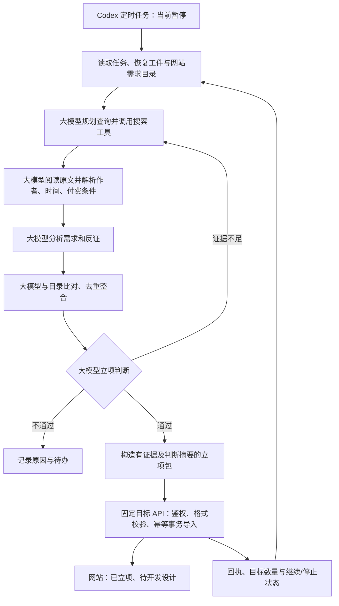

# 外部大模型立项与网站导入

## 已确认的决策

外部大模型完成搜寻、原文解析、需求分析、证据处理、需求整合与立项判断。仅通过立项的需求生成立项包并调用网站接口，导入后直接登记“已立项、待开发设计”。用户已明确选择该状态。网站不再对这条新流程重复抓取或调用模型判断。模型仅允许 OpenAI/DeepSeek。

采用 Codex 提示词驱动的定时任务，沿用每天 Asia/Shanghai 08:10 的草案。当前必须暂停，不开启真实定时搜索或扩大网络权限。无总搜索次数或预算上限，按目标数量、证据队列、任务状态和平台运行窗口停止/保存/续跑。

## 职责与立项要求

模型按现有 strong-wtp.v1 业务标准判断：同一核心任务、可自助交付、3 位独立用户、2 个原始站点、2 位有直接付费信号用户，以及具体价格或可定位的真实既有消费。该标准进入提示词，网站新入口不重新做语义判断或付费计数。不得把已有许可证等同于真实消费，不得忽略免费替代方案、否定、讽刺和付款条件。无法定位的原文不算证据。

模型产出简短、可核查的判断摘要，不要求输出内部推理过程。立项包包含用户、核心任务、范围/不做什么、原始引用/作者/时间、逐条证据结论、替代方案、成本假设、免费或付费策略、获客方案、验收标准、去重依据、模型厂商/名称/审查时间及实际用量。未知费用保留 unknown。

## 接口和兼容

- 新任务模式 `agent_project`；创建页面默认选择新模式。旧任务/旧请求省略模式时保留原行为，旧 producer 不会仅因升级自动获得对旧任务立项的能力。
- `GET /api/research/v1/catalog`：已认证执行端读取全部需求的 id、version、title、task、task_key、status，返回内容哈希 revision。模型据此完成跨需求语义去重。目录过大明确报错，不截断后声称完整。
- `POST /api/research/v1/projects`：`creative.project-package.v1`，沿用顶层 task_id/batch_id/run_id/rules_version/submitted_at/candidates/run_report；每包恰好一条候选，另有 project 字段。project 包含 verdict=approved、provider、model、reviewed_at、catalog_revision、task_key、reasoning、deduplication、逐条 evidence 结论以及完整 approval 业务材料。
- 仅该执行端的 active 新模式任务允许导入。旧批次接口不接受新模式下的非空候选，但允许空运行报告记录费用/等待；旧接口的已有任务和回执不变。
- 先检查已有 batch_id：同字节返回同回执，不同字节 409；跨入口同 ID 也冲突。原字节不可重写。目录 revision 变化时返回 409，模型重新比较目录并用新包提交，禁止跳过比对。
- 网站只做信任边界和存储校验：字段、公开 URL 格式、时间格式/新鲜度、引用关联、模型厂商、来源 ID 对应、现有 task_key 唯一性、任务/凭据版本、幂等和事务。不会抓网页或再次调用模型。精确 key 冲突是数据库一致性保护，不替代语义去重。
- 单事务保存接收批次、需求、证据摘要、模型判断、立项资料和开发记录 state=approved，回执 completed。失败全部回滚；不进入站内核验队列。
- `project_imports` 表记录导入来源、模型与需求/批次关联；Decision 标记 external_model，页面展示“外部模型判断”，不冒充网站独立核验。导出需求包仍带不可信原文标记。
- 下游开发入口对该来源核对版本、有效期、导入记录和材料完整性，不重复强付费计数；旧来源继续原校验。不得自动登记开工、开发完成、发布或收入。
- 新模式任务按自身已导入的唯一项目计目标，包括已立项/开发中的记录，不因进入开发而扣减；取消和暂停优先。旧任务仍按旧需求池计数。新任务也不自动迁移或批准历史 pending 需求。
- 同一接口可带 `project.replaces={need_id,version}` 完成过期/恢复后的外部复核；只允许同一执行端归属且目录版本匹配的待设计、失效、失败或未立项需求。禁止重置 developing/launched/completed。保留 need_id、新增核验版本及审计，回到 approved 待设计；旧证据保留历史，按 distinct need_id 计数。已经达标的任务不自动重开，需要管理员创建新的复核任务。
- 保留现有 30 天原包、180 天证据/研究元数据清理；幂等哈希及简要回执持续保留。新表不得阻止原核验记录清理和备份恢复。

## 文件影响

新增 `schemas/project-package.v1.schema.json`、`internal/research/project_import.go`、对应测试、`migrations/005_project_import.sql`。
修改 research 的 intake/tasks/retention/approval/qualification，HTTP research/admin 入口与 task/need 模板，固定传输脚本和测试。
新增 `prompts/project-research-task.v1.md`；调整禁用配置指向新提示词和契约；新增中文操作及验证说明。原文 HTML 解析器和模型网络客户端不改，不新增依赖。

## 可行性与风险

现有 Bearer 鉴权、私有 outbox、usage 账本、开发记录和任务包可复用。原有成功导入不是立项的异步契约继续保留；新入口完成事务即已立项。定时任务只提供暂停的调度入口，不表示网络、凭据和端到端实测已通过。

模型可能误判作者、付费意愿和重复需求。新流程由用户授权的外部模型承担此判断，网站只保存证据与结论供复核；不以网站二次模型裁决掩盖该边界。备份恢复仍把开发/发布状态标为待复核，不自动恢复有效批准。
