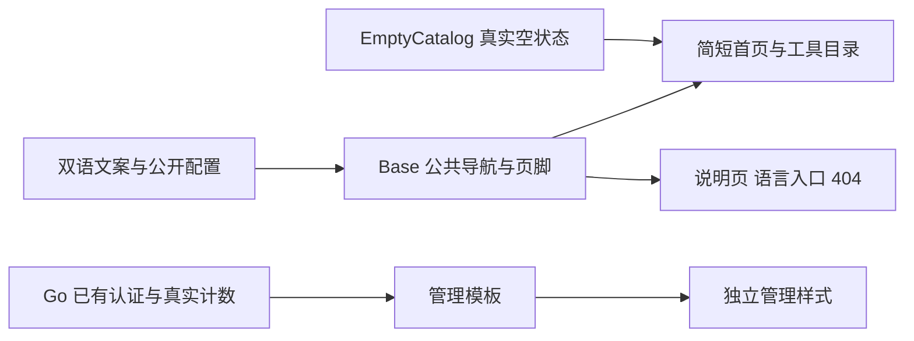

# Creative 现代极简视觉改版

用户选择：现代极简风格，简洁务实，提供必要的功能。本轮据此重新设计现有页面，不增加业务功能。

## 设计方向

曾考虑明亮编辑风（橙色与几何装饰）和深色科技风（深底与高对比强调）；用户明确选择现代极简，因此采用白色、浅灰、炭黑及少量蓝色，重点呈现工具目录与真实状态。装饰不占据主体，文案简短，链接只指向已存在页面或已配置入口。

公开站：统一紧凑页头、清晰的中英文切换、48px 以内主标题、单个主入口。首页依次为简短介绍、工具目录/真实空状态、两条简短说明。目录页复用同一空状态。关于/隐私/反馈采用可阅读的窄栏与同一页面标题体系。根页保留语言选择，404 保留返回入口。移动端缩小间距并自然换行，任何导航不被隐藏为无法使用的按钮。

管理站：登录页紧凑表单；总览使用明确的页头、四项真实数量、未接入服务列表和注销入口。保留全部字段名、CSRF、错误提示与自动转义。使用相同黑白灰视觉，但不依赖公开站构建输出或外部资源。

## 文件与结构

修改 src/styles/global.css、src/layouts/Base.astro、src/lib/i18n.ts、现有 src/pages 下页面，以及 web/admin/static/admin.css 和两个管理模板。新增一个轻量的 src/components/EmptyCatalog.astro 以统一首页与目录空状态。新增本文、实施计划与验证记录；现有 Node/Go 行为测试继续作为回归依据。

## 可行性与兼容性审查

只变更视图层，沿用 Astro 静态构建和 Go html/template，不新增包、客户端脚本、网络资源或图片素材；简单图形为自制内联 SVG。URL、i18n locale、三项公开配置、noindex/canonical、产品 []、管理 HTTP 路径/字段/CSRF 全部沿用，数据库无迁移。无需更改认证或研究协议。后台 CSP 允许静态内联 SVG（无脚本/外链），样式仍从现有 CSS 路径加载。

风险集中在窄屏溢出、键盘焦点、英文本地化换行、表单字段遗漏与样式不一致。通过实际构建回归、Go HTTP 测试及浏览器检查覆盖；浏览器工具失效如实记录。新分支基于包含最新 master 的迭代 1 分支，PR 以 feat/iteration-0-1 为目标，仅包含视觉差异。
