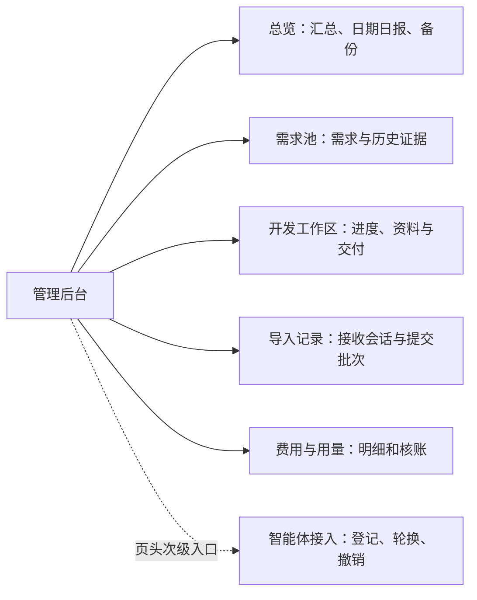

# 管理后台五项导航精简设计

## 已确认的范围

用户批准上一轮取舍建议：主导航保留总览、需求池、开发工作区、导入记录、费用与用量；清理旧流程文案，保留历史数据和必要功能，定时搜寻继续暂停。本次仅调整管理端页面组织，沿用现代极简的 Mac 桌面样式。

## 方案与架构

采用复用既有查询、模板和地址的页面合并。只隐藏导航不能改善分散的内容；新建通用设置框架或重做协议会扩大范围，因此不采用。智能体接入保留原页面与所有凭据操作，入口放页头，不新增设置页。

- 总览移除“历史合格需求”和未接入的收入/流量占位，保留实际需求/完成/产品数及接收接口状态。加入可选择上海日期的日报、费用摘要和备份状态；日报沿用按上海日汇总记录的方式；立项计数修正为同时统计外部导入/复核与历史人工立项事件，原字节重试不产生第二笔计数。
- 导入记录合并只读接收会话与批次列表。会话区默认折叠，异常、目标和缺口仍可展开查看；历史批次分页和详情不变，不把会话状态当作 Codex 日程状态。
- `/admin/reports` 直接复用总览 handler，保留 date 参数及非法日期 422；`/admin/tasks` 复用导入记录 handler。旧地址仍返回受认证保护的 200 页面，无新增重定向或外部跳转。
- 需求与开发空态明确“外部 Codex 判断通过并导入”；移除“到需求池人工立项”“等待网站核验”等失效指引，保留历史证据与有效期提示。新立项包接收成功代表已立项，批次成功不代表已开发/上线；空报告不创建项目。
- 开发详情保留需求/开发包下载、方案登记、开工及交付登记，技术表单使用原生 details 折叠；不得删除字段、状态限制、版本检查或必要验收依据。
- 不更改研究 API、数据库、模型配置、保留期限、凭据、搜索开关或日程；旧退役写接口继续 410，认证/CSRF/Host 不变。

## 文件影响与兼容性审查

修改 `internal/httpserver/{admin,operations_admin,research_admin}.go` 合并只读页面查询；修改 `web/admin/templates` 中布局、总览、日报、会话、批次、需求及开发模板，必要时少量调整 `web/admin/static/admin.css`。新增页面整合回归测试，调整既有汇总断言；更新当前 README、运行说明和验收记录。无需新依赖或迁移，不删除历史功能。

已检查现有接口与模板：日报可嵌入总览、会话可嵌入批次；旧地址可复用 handler 保持状态码、身份和参数验证。主要风险是分页/日期丢失、次级权限入口不可达、模板折叠误隐藏必填操作，分别用真实 handler 回归覆盖。无阻塞性设计问题。MR #8 尚开放，本分支在最新 master 基线上纳入该依赖，本轮 MR 指向该分支以保持差异可审查，不自动合并。

审查修订：独立代码审查发现原日报只统计 need_approved，漏掉 project_imported。隐藏该指标会丢失当前流程的重要进展，故在 internal/research/operations.go 最小修正查询；不改数据或接口，补充真实导入幂等与上海日边界回归。
