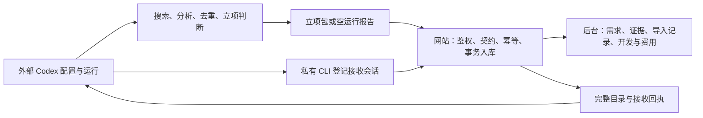

# 管理后台只管理外部研究结果

## 依据与边界

用户再次明确：搜寻交给外部 Codex，管理端只管理搜寻到的数据。本次落实已经确认的外部研究架构；定时任务仍 PAUSED，不执行真实搜索或模型调用。后台继续提供已有开发资料、状态、费用与凭据管理，不新增业务功能。

现状：网页尚能创建/恢复搜寻任务、选择站内核验、启用站内模型及重试候选；服务启动还会消费旧核验队列。仅更名会留下实际执行通路。

## 实施方式

采用完整关闭站内研究入口、保留历史数据与现有立项包格式的方案。仅改导航不能消除旧流程；删除旧数据或全面重做协议会破坏现有历史回执，因此不采用。

- 网页移除搜寻主题/目标编辑、任务创建/恢复/取消、模型设置、站内重试与旧候选人工立项入口。历史 `/admin/tasks` 改为只读接收记录；已移除的写入口在登录及 CSRF 检查后返回 410。模型设置旧链接重定向到用量页。
- 保留接入凭据登记/轮换/撤销，标为“智能体接入”，只管理数据提交权限。总览说明研究由 Codex 完成，按实际配置显示接收 API 是否启用；不推测 Codex 自动化状态。
- `cmd/creative` 不加载模型配置，不构造来源抓取器或模型客户端；后台循环仅做过期清理及一致性备份，不领取/处理研究批次，不自动恢复等待线索的接收会话。历史待处理记录只读展示“旧流程已停止”。
- 新增私有 CLI `intake-create`、`intake-cancel`、`intake-resume`，供已授权的外部 Codex 操作接收会话。复用现有 CreateProjectTask/ChangeTask、版本检查与审计；只创建 agent_project 模式，不执行搜索，不修改 Codex 日程。create 接受 producer、topic、languages、target；cancel/resume 接受 task、version。目标仅用于接收数量与停止回执。
- 研究 API 保留 task/catalog/projects/receipt 的路由和字段。`/batches` 的新请求只接受空运行报告，入账与报告状态在同一事务完成，返回 completed，不依赖核验 worker；报告照常累计实际外部用量。非空旧候选的新批次返回 410。已入库原字节重试优先返回原接收回执；异字节冲突仍 409。
- 新空报告仅允许当前、active、仍有缺口的 agent_project 会话；取消、被替代、达标、等待或暂停均拒绝新批次。先完成幂等判断，再重算目标并校验状态。submitted 保持 active；waiting_for_signals/paused_service 分别更新同名状态，不允许报告恢复会话；批次、用量、状态同事务回滚。
- 旧模式 task/receipt 一律 should_continue=false，提示外部 Codex 先读取 ID/版本，通过 intake-cancel 明确取消旧会话，再 intake-create 新模式。intake-resume 只恢复 agent_project，禁止恢复旧研究模式；不自动迁移旧任务。
- 旧 Service.Receive 仅保留给历史处理逻辑与旧数据回归夹具；生产 HTTP 使用新 ReceiveReport 共用接收实现的外部模式。生产启动路径无旧语义处理调用。历史记录及旧算法不删，避免额外存储迁移和扩大本次删除范围。
- 不修改 schema、数据库迁移、已有需求/证据/开发数据；不替用户批准需求、不重开已取消任务。现有历史资格仍按有效期管理，历史资料可继续查阅。旧候选若要立项，交给外部模型重新判断并按现有 replaces 权限导入。

## 文件影响

- 管理页面：`web/admin/templates/{research-layout,index,tasks,producers,batch,need}.html`，删除不再使用的模型设置和人工立项模板。
- 服务与路由：`cmd/creative/main.go`、`internal/worker/worker.go`、`internal/httpserver/{admin,research,research_admin,operations_admin,development_admin,verification_admin}.go`。
- 接收与状态：`internal/research/{intake,tasks,retention}.go`；新增 CLI 实现在 `cmd/creative-admin/intake.go`，主命令注册。
- 回归：对应 Go 测试、HTTP 禁用边界、空报告事务/幂等、私有 CLI 权限/版本、worker 不消费旧队列；保留项目导入与传输原字节测试。
- 中文说明：README、外部立项操作说明/提示词、禁用研究配置说明及本次验收记录。旧迭代文档保留历史性质，明显标注新入口替代。

## 兼容性与验收

兼容性变化有意限制在旧操作：新旧候选写入分流、旧网页写入口 410、空报告由异步转同步、等待状态不再由每日维护恢复。立项包、目录哈希、任务所有权、幂等原字节、认证和授权保持。已有正在处理的旧队列不执行也不覆盖结论，页面说明已停用。本次切换不删除历史；既有原包 30 天、研究资料 180 天清理策略继续有效，长期保留哈希和接收回执，不承诺原文永久可查。

实现前独立检查 CLI 接收会话是否闭环、报告事务是否会在取消/达标后误写、旧包重试优先级及历史保留。完成后进行代码审查、CGO_ENABLED=0 Go 回归/构建/vet、固定传输测试、macOS 桌面后台检查，再创建 MR。更新本机服务使用相同数据库、owner 和私有 CSRF 配置，保持定时暂停与研究 API 当前关闭状态。

独立设计审查已指出空报告状态、历史保留及旧任务退出三项需明确的问题，以上已补齐；不需要新的用户业务决策。
