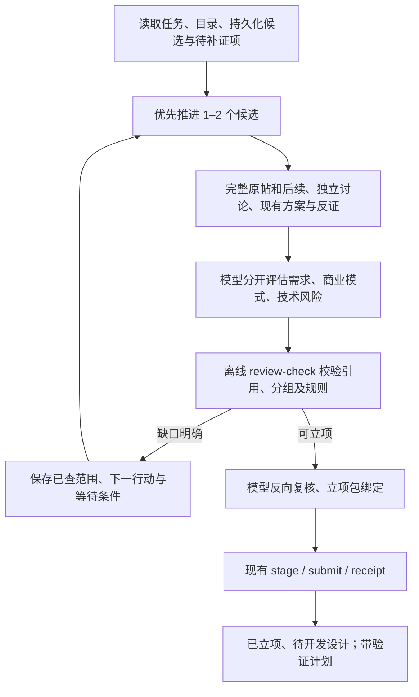

# 深入搜寻与分类型立项设计

## 目标和边界

依据用户本轮“优化搜寻、立项流程，提高搜寻深度，优化立项条件”实施。外部 Codex/DeepSeek 继续负责搜索、原文理解、身份归并、反证与立项判断；网站只校验和管理交付数据。保持 Mac 桌面浏览器范围、自助交付、历史数据和 5 项主导航，不启用定时任务，不购买服务或启动真实模型调用。

解决已观察到的三个问题：横向换题多于补证；付费意愿被产品尚未实测连带归零；所有商业模式套用同一强付费门槛，日期精度与币种格式又造成额外排除。

## 方案选择

只改提示词无法解除 Go 中的固定门槛；直接重写 strong-wtp.v1 会改变旧包及旧任务含义。采用新增 opportunity.v2 规则、复用 v1 数据外壳的兼容方案：新建外部立项任务默认 v2，已存在任务仍执行其原规则，历史冻结包仍按原字节查询/重试。旧站内核验模式继续 v1，不恢复其搜寻功能。本选择是本轮实施判断，不声称用户逐项指定了阈值。

## 深入搜寻

- 每轮先恢复 research-state.json，以稳定 task_key 续接已有候选，不用新标题绕开旧缺口。优先推进 1–2 个候选是注意力分配，不限制搜索次数、总时间或费用。
- 每次搜索先写待回答的问题：同任务的第二独立用户/讨论、付款范围、最新后续、竞争方案是否解决、获客渠道或自助实现阻塞。搜后记录新增证据或无增量，不反复改写同义词。
- 深审前读原帖、作者后续、付款上下文和代表性反证；有未展开回复时记录覆盖范围。若缺失可能改变付款/已解决判断，不能声称上下文完整并批准。
- 比较至少三个可定位替代方案；不足时保存检索范围及原因。有竞品证明已有解决方式，不自动否定机会；必须定位同一用户任务的具体剩余缺口，已满意的用户不凑未满足人数。
- 技术评估区分 plausible / validated / blocked / unknown。已有文档或同类能力可以支持 plausible；无须先开发完整产品。plausible 必须记录风险及明确可执行验收，blocked/unknown 不自动批准。需要实测但尚无合法样本时保存补证任务，不编造结果。
- 私有状态至少记录 task_key、原始来源/用户分组、已查问题、反证、覆盖缺口、候选阶段、下一最有价值行动、等待/放弃原因、outbox 及真实用量。恢复优先补证；只有现有候选明确无机会或等待外部变化时扩展题目。

## opportunity.v2 条件

以下是初始可解释规则，不承诺收入，也不是为了让现有候选必过。

共用：至少 3 位独立未满足用户，至少 2 个独立原始讨论，可来自同一网站；至少 1 位用户有近 180 天的未满足原文。必须同一任务、可自助、目录无重复、存在引用支持的具体差异。原文未知时间可计人数但不计近期证据或近期付款；创作者广告、转载、满意用户、同人多帖不能凑人数。

- 付费工具：至少 1 位近 12 个月、与本候选范围一致的明确付款意愿或可定位既有消费用户。一个付款者是风险提示，不伪装验证过收入。金额、币种或计费周期缺失不否定意愿，具体价格/消费仍单独计数并提示补证。
- 免费广告工具：不要求付款承诺；至少 2 位有效用户有重复/批量使用的原文。必须有与有效证据关联的获客渠道、广告收入假设、成本依据与验证计划，不能用“加广告就赚钱”代替分析。没有搜索量工具时标明未知，不编造流量或广告单价。
- undecided 不能自动通过；免费和付费两个分支由 candidate.monetization_proposal 选择，并与立项 approval.monetization 一致。免费引流加付费增强按本候选最小交付范围选一个主模式，后续产品扩展另审。
- conditions_supported 在 v2 表示付款条件被保留且落在拟交付范围，不能因“尚未开发/未实测”自动设 false；技术能否实现由独立 feasibility 记录。明显超出范围、人工服务、必须手机后台等条件依然不能移除。

## 数据与验证

沿用 creative.agent-review.v1 / creative.project-package.v1 外壳，以 rules_version 区分语义。v1 审查仍使用旧规则；v2 审查和项目新增必填 evaluation：

- depth：context_complete、counterevidence_checked、alternatives_checked、notes。前 3 项全部为 true 才可通过。
- differentiation：文字结论、gap_evidence_ids（必须指向有效未满足证据）、fewer_alternatives_reason（不足 3 个时必填）。至少核查 1 个替代，不能没有替代材料就宣布差异。
- feasibility：status、basis、risks、validation_plan。只接受 plausible/validated 立项，保留未验证风险。
- acquisition：channel、evidence_ids、rationale；economics：cost_basis、revenue_hypothesis、validation_plan。ID 必须存在且为有效用户证据。

v2 每条候选证据新增 discussion_url，明确原帖而非每条评论各算一个讨论；URL须公开且与证据同注册域，模型负责正确归并讨论。审查条目增加 repeat_quote（可为空，非空须原文子串）；依照用户集合统计，避免同人拆分。

候选证据可增加 published_date（YYYY-MM-DD），published_at 与其最多一个非空。不把日期补成零点假时间。近期计算以日期可能范围保守处理（未知时区按 UTC±14h），跨过有效期边界则不计近期；日期在未来或观察早于该日期可能范围时拒绝。v1 不接纳日期字段作为旧资格依据。

v2 显示原始近期付款信号数与范围内付款人数，及讨论数、近期未满足用户、重复使用人数。未知价格和单站点/单付款者、未实测技术以 warnings 展示；不能掩盖硬性阻塞。v2 价格识别支持明确的 £/€ 符号，单独 $/¥ 不猜币种；报价不要求臆造计费周期。v1 价格计算不变。

Schema 错误返回字段路径和失败约束，供模型重生成完整 JSON；不得修补失败原文。每候选初审和反审合计最多额外两次格式纠正，与搜索次数无关。

项目包保存相同 evaluation；离线 --project 检查其与最终审查一致。网站核对版本、时间、引用、结构和状态，保存到 decision 与开发任务包，不执行搜索或语义判断。后台需求详情展示商业模式/风险/验证计划、规则版本及日期精度。

可行性审查补充：v2 approval 的 price/unit_cost/payment_fee/currency 可用空串表示未知；已填数值和币种仍须合法。免费用户价格及支付费固定为 0，与广告收入假设分别记录；付费 price_basis 必填，未验证报价须标作假设。v1 金额约束不变。30 天为资格上限，review-check 输出 qualification_valid_until，按至少一条仍有效的近期未满足证据及付费分支至少一条付款证据的保守到期截断；v2 项目必须复制此截止时间，--project 精确绑定，网站只接受晚于当前且不超过审查后30天的截止值。

## 兼容性与文件范围

不增表、不改历史 JSON、不改变旧包字节；使用现有 JSON 字段保存新增评估和日期。新规则项目需贯通资格读取、维护过期、开发入口、任务包导出，仍保留原有 30 天资格与 180 天材料保留规则。新代码可读旧包；旧客户端不应向旧服务提交 v2，部署顺序为服务→新提示词/配置→手动运行，保持自动化暂停。

- 新增 internal/research/opportunity.go 及测试：v2规则与日期/价格辅助。
- 修改 internal/research/agent_review.go、types.go、qualification.go、project_import.go、tasks.go、needs.go、retention.go、approval.go、development.go：分版本校验、保存和生命周期兼容。
- 修改 schemas/agent-review.v1.schema.json、demand-batch.v1.schema.json、project-package.v1.schema.json：新增字段和 v2 条件约束，v1字段及含义不变。
- 修改提示词、config/research-task.json 的支持版本列表、运行文档、README；enabled、activation_checks、绑定和定时状态不变。
- 修改现有后台需求详情和相应测试；新增 v2 端到端导入/开发任务包/维护回归，复用 Python 固定传输。

## 验收

自制证据验证：单站两讨论、条件付款但未实测技术、日期精度、未知币种、广告重复使用、已解决与跨人拼接、未来/过期/未知日期、重复作者及讨论、缺反证/缺竞品/技术阻塞、包绑定和旧包幂等。v2 导入后正常显示、导出任务包、维护不错误失效；v1历史流程仍通过。Go CGO_ENABLED=0，每次测试外层超时小于10分钟。真实材料只在私有目录离线回放，不为了测试伪造真实批准；完成独立可行性/兼容性与代码审查后创建 MR，不合并/发布。
