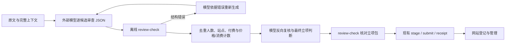

# 外部模型审查契约修复

## 问题与边界

真实搜寻中，JSON mode 返回过嵌套位置漂移及缺少末尾括号；自由文字汇总又把“明确愿意付款”与“已付款”混淆，并遗漏无金额消费和后续补充。修复外部 Codex 的交付链路，网站继续只接收与管理模型结论。

每次只审查一个候选，使用固定 JSON Schema。模型负责原文理解、身份归并、核心任务关联、条件及反证判断；离线命令只验证结构、引用和集合计数。付费人数不要求每人有金额；至少一条明确价格或可定位实际消费即可。条件式明确付费可计入，未实现的条件与已满足需求不能混入有效付费。未知时间/币种保留 null，不补造。

不自动补括号、挪字段、截断后导入。失败原文私有留存，每候选至多两次格式纠正调用，仍失败则 paused_service；这不是搜索次数限制。模型每次调用及失败用量都保留。

## 文件与兼容性

新增 `schemas/agent-review.v1.schema.json`、`internal/research/agent_review.go` 及测试；在现有 `creative-admin` 增加无数据库/网络副作用的 `review-check` 子命令。更新提示词、运行说明、README 和验证记录。复用已有 jsonschema、jsonutil、SiteKey 和价格检查，不新增依赖。

`--file` 检查候选审查，`--project` 可核对待提交包与审查的候选、模型标识、目录版本、时间和逐条标记一致。成功输出机器可读计数与输入哈希；错误退出非零，不能进入 stage。现有 HTTP 契约、数据库、历史包、outbox、旧模式算法均不修改。命令只帮助外部智能体，不是独立 Go 搜寻程序。

可行性与兼容性审查：Go 已有完整 schema 校验库；CLI 可在打开数据库之前分派；引用现有候选 schema，避免再造解析器。仅新增外部契约和离线门禁，旧接口行为保持。真实页面准确性仍需模型复核，集合计数不能证明原文真实或跨站身份正确。未知/过期时间不冒充新鲜证据。定时配置与 PAUSED 状态保持。
